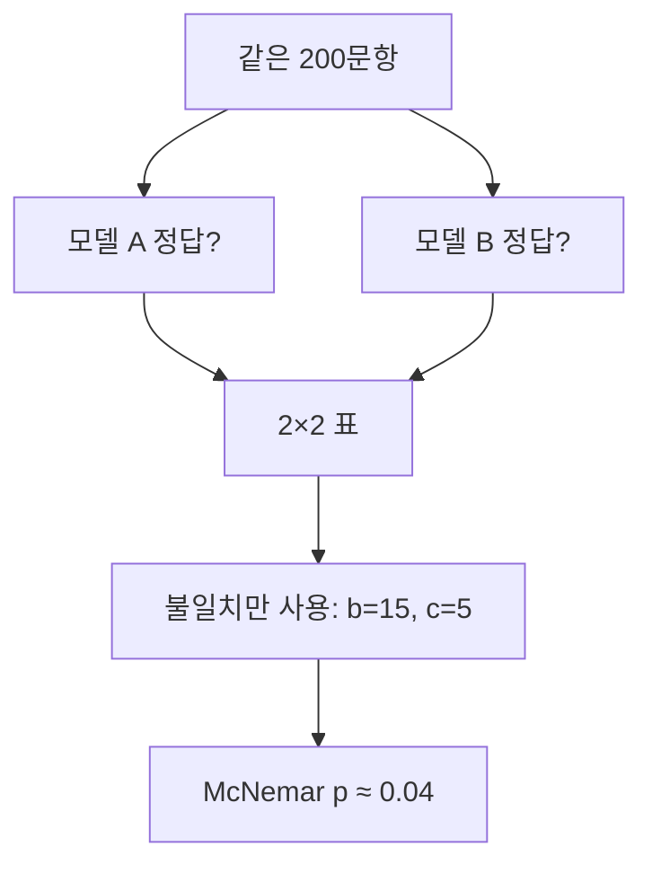
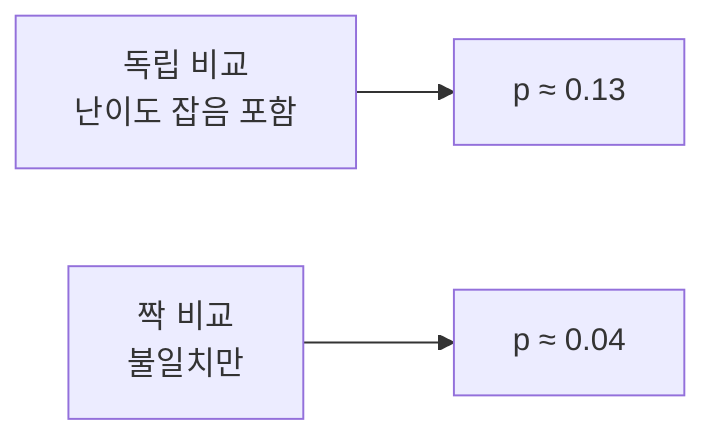

# 같은 문항 쌍 비교

> 두 모델(또는 두 프롬프트)을 같은 평가 문항에 돌려 비교하면 문항별 정답 여부를 짝지어 볼 수 있다. 이 짝 비교(McNemar 검정 등)는 두 모델이 다르게 답한 문항만 보므로, 서로 다른 문항에서 각각 평가하는 독립 비교보다 같은 데이터로 더 작은 차이를 가려낼 수 있다.

## 쉽게 말하면
쌍둥이 형제에게 같은 문제집을 풀게 하고 "형만 맞힌 문제 / 동생만 맞힌 문제"만 세면 둘 중 누가 나은지 알 수 있다. 둘 다 맞히거나 둘 다 틀린 쉬운 문제와 어려운 문제는 비교에 기여하지 않는다. 쉽고 어려운 문제의 난이도 차이라는 잡음이 사라진다.

## 자세히
- **설정(Wikipedia McNemar's test, 열람)**: 같은 단위를 두 번 측정한 이진 결과를 2×2 표로 정리한다. 칸은 a(둘 다 정답), b(모델 1만 정답), c(모델 2만 정답), d(둘 다 오답). 귀무가설은 b와 c의 확률이 같다는 것이다.
- **통계량**: χ² = (b − c)² / (b + c), 자유도 1. 연속성 보정판은 (|b − c| − 1)² / (b + c)다. b + c가 25 미만으로 작으면 n = b + c, p = 0.5인 정확 이항 검정을 쓰고 양측 p-값은 꼬리 확률의 두 배다. 문서는 정확 검정과 연속성 보정판이 보수적이고 mid-p 판이 근사 검정과 비슷하다고 한다.
- **핵심**: 불일치 쌍 b와 c만 결과를 좌우한다. 대각선(a, d)은 결정에 영향이 없다. 반대로 b + c가 작으면 전체 표본이 커도 검정력이 낮을 수 있다.
- **직접 계산한 예(문항 200개)**: 모델 A 정확도 170/200 = 85%, 모델 B 180/200 = 90%라고 하자. 둘 다 정답 165, A만 정답 5(c), B만 정답 15(b), 둘 다 오답 15라면 A=165+5, B=165+15가 맞는다.
  - 짝 비교(정확 이항): b=15, c=5, 불일치 20건 중 5건 이하일 확률 ×2 = **p ≈ 0.041**
  - 짝 비교(연속성 보정 McNemar): χ² = (|15−5|−1)²/20 = 4.05, p ≈ 0.044
  - 독립 비교(두 비율의 z 검정, 문항이 서로 다르다고 보고): 5%p 차이, z ≈ 1.51, **p ≈ 0.13**
  같은 문항에 짝으로 비교하면 같은 5%p 차이가 5% 수준에서 유의하지만 독립 비교는 그렇지 않다. 이 예는 가정한 표이며, 둘 다 틀리거나 맞히는 문항이 많을수록(난이도 공유) 짝 비교의 이점이 커진다(해석).
- **주의(해석)**: 문항이 군집(같은 문서에서 나옴)이면 [군집 표본의 신뢰구간](#clustered-samples-ci) 문제가 남는다. 여러 모델을 비교하면 다중 비교 보정이 필요하다. 문서는 3개 이상 처치에는 Cochran's Q를 안내한다.
- **보고**: 정확도뿐 아니라 b와 c, 사용한 검정, p-값을 같이 적는다.

## 그림으로 보기

## 예시
- 프롬프트 두 버전을 같은 200문항에 돌리고 각 문항에 정답 여부를 기록해 b와 c를 센다. b와 c가 비슷하면 차이가 없다.
- 교육 활용: 같은 표를 독립 비교와 짝 비교로 나눠 계산해 p-값이 달라지는 것을 확인하는 실습.

## 헷갈리는 것과 비교
| 개념 | 차이 |
| --- | --- |
| 독립 비교(두 비율 z 검정) | 문항이 서로 다르다고 가정. 난이도 잡음이 큼 |
| McNemar 검정 | 같은 문항의 짝 비교. 불일치만 사용 |
| [평가셋 크기 계획](#eval-set-size-planning) | 탐지하려는 차이에서 필요한 문항 수 계산 |
| [군집 표본의 신뢰구간](#clustered-samples-ci) | 문항 간 종속이 남는 문제 |

## 더 읽을거리
- [Wikipedia: McNemar's test](https://en.wikipedia.org/wiki/McNemar%27s_test) — 통계량·정확 검정·예
