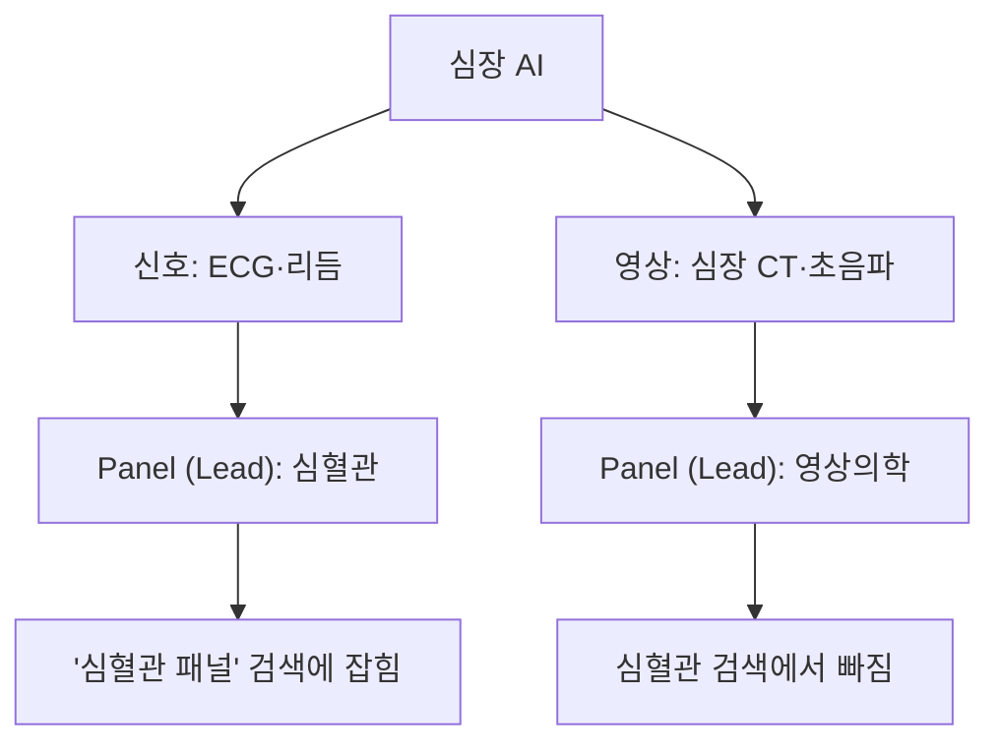
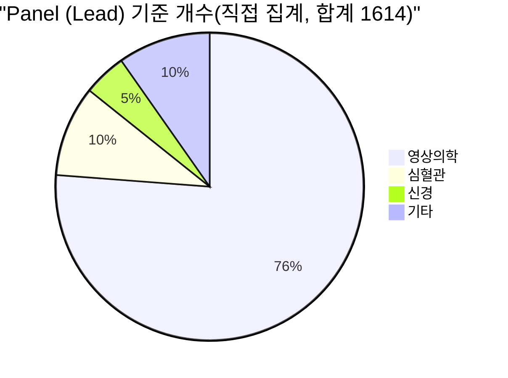

# 패널 분류의 함정

> FDA AI 기기 목록의 "Panel (Lead)" 열은 기기당 하나의 분야만 적는다. 그래서 심장 AI라도 심전도 계열은 심혈관 패널, 심장 CT·초음파 영상 AI는 영상의학 패널에 들어가기도 한다. "심혈관 AI가 몇 개인가"는 정의를 맞추지 않으면 답이 달라진다.

## 쉽게 말하면
도서관에서 "요리 심리학" 책이 심리학 서가에 있을지 요리 서가에 있을지는 분류 규칙에 달려 있다. 심장 AI도 어느 서가(패널)에 꽂혔는지로 세면 심장 AI가 154개도, 그보다 훨씬 많게도 보인다. 서가 이름이 곧 "무엇에 관한 것"은 아니다.

## 자세히
출처: FDA "List of Artificial Intelligence-Enabled Medical Devices" 페이지의 표를 직접 내려받아 집계(가장 최근 최종 결정일 2026-06-29 기준 1,614행, 2026-11-17 열람). 아래 숫자는 이 글을 쓰며 직접 센 값이며 제3자 집계와 다를 수 있다.
- **표 구조**: 열은 최종 결정일, 제출 번호, 기기명, 회사, **Panel (Lead)**, 주요 제품 코드(Primary Product Code) 여섯 개. 한 기기에 패널은 **하나**다. 페이지는 패널 배정 방식을 설명하지 않고 패널을 정의하지도 않는다.
- **패널별 개수(직접 집계)**: 영상의학 1,230, 심혈관 154, 신경 73, 마취 30, 소화기·비뇨 27, 혈액 22 … 합계 1,614.
- **심전도 계열은 심혈관 패널**: 제품명에 ECG·리듬이 들어간 심혈관 패널 항목이 30건. 예: Anumana ECG-AI 심장 아밀로이드증(K253801)·폐동맥고혈압(K252360) 12유도 알고리즘, iRhythm ZEUS 플랫폼(K252859, 제품 코드 DQK).
- **심장 영상 AI는 영상의학 패널**: 영상의학 패널 중 제품명에 심장·관상동맥·대동맥·에코 같은 단어가 들어간 것이 74건(내 키워드 기준, 정의에 따라 달라짐). 예: syngo.CT Coronary Cockpit(K253786), cvi42 Coronary Plaque(K251027), 관상동맥 석회화 CAC 계열(Bunkerhill K260166), EchoPAC(GE, K251342), HeartFocus(Deski, K260780), 대동맥판 협착 소프트웨어 AutoAS(GE, K254161). 대부분 제품 코드 QIH(영상 처리 소프트웨어 계열로 보임, 이 코드의 정의는 열람하지 않음).
- **심초음파 키워드 비교**: 제품명에 echo가 든 항목이 영상의학 16건, 심혈관 3건(예: EchoNext K260332, 제품 코드 QXO). 키워드로 센 대략치.
- **왜 함정인가**: ① "심혈관 AI 비율 9%"는 패널 기준이고 심장 영상 AI를 합치면 훨씬 커질 수 있다. ② 영상의학 쏠림([영상의학 AI 쏠림](#radiology-ai-dominance))은 일부가 심장·혈관 영상이다. ③ 경쟁사 분석에서 패널 하나만 검색하면 비슷한 제품을 놓친다. **제품 코드와 기기명, 의도 용도로 교차 검색해야 한다.**
- **FDA 방법론**: 이 목록은 허가 문서 요약과 분류 설명의 AI 관련 용어(FDA 디지털 헬스·AI 용어집 기반)로 기기를 골랐고 **전수 목록이 아니다**.

## 그림으로 보기

## 예시
- 경쟁사 조사: 심전도 AI 경쟁사를 찾을 때는 심혈관 패널의 ECG 항목, 심장 CT AI 경쟁사는 영상의학 패널의 QIH 제품 코드와 "coronary" 키워드를 함께 본다.
- 시장 보고서에서 "심혈관 AI는 전체의 약 9.5%"라는 문장은 패널 기준(154/1,614 ≈ 9.5%)임을 확인하고 인용한다.

## 헷갈리는 것과 비교
| 개념 | 차이 |
|---|---|
| Panel (Lead) | 목록에서 기기당 하나의 대표 분야 |
| 제품 코드 | 기기 유형 코드. 같은 패널 안에서도 세분 |
| [FDA 심사 패널](#fda-panel) | 21 CFR 862~892 분야 분류 |
| [FDA 자문 패널 회의](#advisory-panel-meeting) | 허가 전 외부 자문 회의(분류와 다름) |

## 더 읽을거리
- [List of AI-Enabled Medical Devices (FDA)](https://www.fda.gov/medical-devices/artificial-intelligence-enabled-medical-devices/list-artificial-intelligence-enabled-medical-devices) — 직접 내려받아 집계한 표
