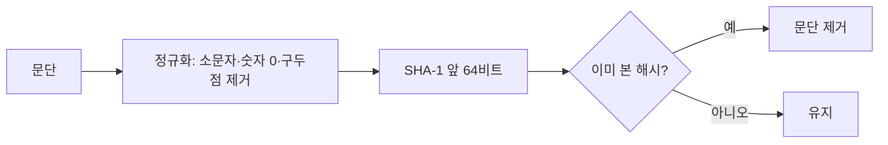
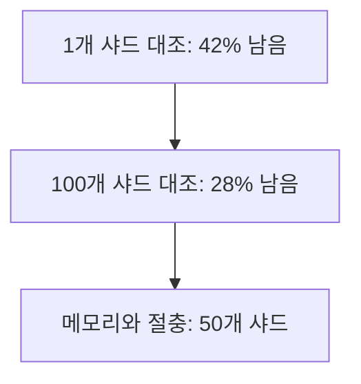

# 문단 해시 중복 제거

> 문서가 아니라 문단 단위로 정규화한 뒤 해시값으로 같은 문단을 찾아 지우는 중복 제거 방식이다. 메뉴·약관·푸터처럼 여러 페이지에 반복되는 문단을 크게 줄인다. CCNet이 쓴다.

## 쉽게 말하면
책 여러 권에서 똑같이 들어 있는 "저작권 안내문"을 문단 지문(해시)으로 찾아 한 번만 남기는 것이다. 문서 전체가 같지 않아도 문단이 같으면 잡힌다.

## 자세히
(CCNet 논문 arXiv 1911.00359 본문을 직접 읽고 확인.)
- **효과**: 한 스냅샷에서 중복 문단이 **텍스트의 70%**를 차지했다고 보고.
- **정규화**: 소문자화, 숫자를 `0`으로 치환, 유니코드 구두점·악센트 제거 후 비교(날짜·번호만 다른 문단도 같게 본다).
- **해시**: 정규화한 문단의 **SHA-1 앞 64비트**를 키로 쓴다. 샤드마다 해시를 이진 파일로 저장하고, 문서를 처리할 때 이 파일과 대조해 중복 문단을 제거.
- **범위**: 스냅샷은 1600개 샤드(각 5GB, 약 160만 문서). 대조하는 샤드가 많을수록 더 지워진다 — 1개 샤드 대조 후 글자의 42% 남음, 100개 샤드 대조 시 28% 남음. 저자들은 **50개 샤드**를 메모리와의 절충으로 사용.
- **한계(제안)**: 문서 안 일부 문단만 지워 문맥이 끊길 수 있다. 문서 통째 유사도(MinHash)와는 목적이 다르다.

## 그림으로 보기

## 예시
- 여러 쇼핑몰 페이지에 반복되는 환불 약관 문단이 한 번만 남음.
- 교육 활용: 해시가 "내용의 지문"이라는 개념 소개.

## 헷갈리는 것과 비교
| 개념 | 차이 |
|---|---|
| 문단 해시 중복 제거 | 문단 단위 정확 일치(정규화 후) |
| [근접 중복 제거](#near-duplicate-removal) | 문서 유사도(MinHash 등) |
| [중복 n-그램 비율](#duplicate-ngram-fraction) | 문서 내부 반복 측정 |

## 더 읽을거리
- [CCNet (arXiv 1911.00359)](https://arxiv.org/abs/1911.00359) — 정규화·샤드 수에 따른 잔존율.
