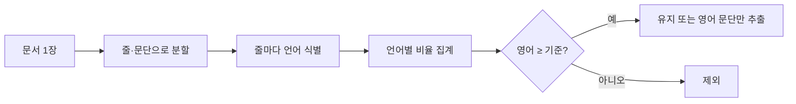
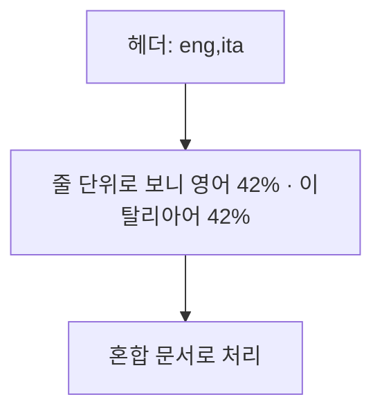

# 문단 단위 언어 판정

> 웹 문서에는 **여러 언어가 섞인 경우가 많아** 문서 전체에 언어 하나를 붙이면 부정확하다. 문서를 문단(줄) 단위로 나눠 각각 언어를 식별한 뒤 비율을 보고 문서의 처리 방침을 정한다.

## 쉽게 말하면
호텔 안내문이 영어 한 줄, 현지어 한 줄씩 번갈아 적혀 있다면 "이 문서는 영어"라고 딱 잘라 말할 수 없다. 줄마다 언어를 확인한 뒤 영어가 몇 %인지 보는 것이 더 정확하다.

## 자세히
- 직접 확인(`CC-MAIN-2024-10` WET 앞 2MB, 변환 문서 587개): WET 헤더의 `WARC-Identified-Content-Language`에 언어가 **1개인 문서 406개, 2개 166개, 3개 15개** — 즉 **181개(약 31%)가 둘 이상의 언어**로 식별됐다. 헤더의 첫 번째 값만 쓰면(예: `eng,zho` → 영어) 나머지 언어 비중은 사라진다.
- 문단 단위 실험(py3langid, 헤더에 언어 2개 이상이고 8단어 이상 줄이 5개 이상인 문서 15개, 줄별 식별): 예 —
  | 헤더 언어 | 줄 수 | 줄 단위 식별 분포 |
  |---|---|---|
  | vie, dan | 124 | 베트남어 100% (헤더의 두 번째 `dan`은 줄 단위로는 안 나옴) |
  | eng, zho | 18 | 영어 100% |
  | eng, kor | 10 | 영어 90%, 한국어 10% |
  | eng, ell, ita | 12 | 영어 42%, 이탈리아어 42%, 그리스어 8% |
  | pol, eng | 5 | 폴란드어 60%, 영어 40% |
  | ind, eng | 14 | 인도네시아어 86%, 영어 14% |
  | zho, eng | 16 | 라틴어(la) 50%, 영어 38%, … |
- 읽는 법: 문서 한 장에 영어와 이탈리아어가 절반씩인 경우가 있고, **헤더가 여러 언어를 적었어도 줄 단위로는 한 언어뿐**일 수도 있다(첫 행). 반대로 **식별기의 오류**도 보인다 — 중국어 문서에서 `yue`·`wuu`(중국어 방언)나 `la`(라틴어)가 나온 것은 식별기가 긴 한자·영어 혼합 줄을 잘 못 가리기 때문이다(추정). 분석 대상이 15개뿐이라 일반화는 금물이다.
- 실무 전략(제안): ① **문단별 식별 → 영어 문단 비율**을 계산해 일정 비율(예: 80%) 이상이면 유지하거나 영어 문단만 추출 ② 전체 길이 대비 문자 수로 가중 ③ 식별 불확실한 짧은 줄은 앞뒤 문단과 합쳐 판정([짧은 글 언어 식별](#language-id-short-text)) ④ 언어별 코퍼스로 보낼 때는 문단 단위로 분리 저장 ⑤ 번역 병렬 문서는 일부러 섞인 것이므로 별도 처리.
- C4 규칙과의 연결: C4는 페이지가 영어일 확률 0.99 이상일 때만 남기는데([C4 줄 단계 필터](#c4-line-filters)), 혼합 언어 페이지는 이 기준을 통과하기 어렵다. 반대로 영어 비중이 낮은데도 통과하는 문서는 없는지 점검해야 한다(추정).
- 한계: 줄 단위 판정은 짧은 줄에서 불안정하며 한 문단 안의 코드 스위칭(문장 중간 언어 전환)은 못 다룬다.

## 그림으로 보기



## 예시
```python
share_en = sum(ident.classify(l)[0] == "en" for l in lines) / len(lines)
```
- 교육: 다국어 웹 문서를 문단 단위로 쪼개 언어 분포를 그려 보는 실습.

## 헷갈리는 것과 비교
| 개념 | 차이 |
|---|---|
| 문서 단위 판정 | 한 언어로 단순화 |
| 문단 단위 판정 | 혼합 비율을 보존 |
| 코드 스위칭 | 한 문장 안 언어 전환(문단 단위로도 어려움) |

## 더 읽을거리
- [Common Crawl: Get Started](https://commoncrawl.org/get-started) — WET 파일 개요(읽음).
- [py3langid](https://github.com/adbar/py3langid) — 줄 단위 식별에 쓴 도구.
- 직접 실행: WET 헤더 언어 수 집계와 줄 단위 식별.
