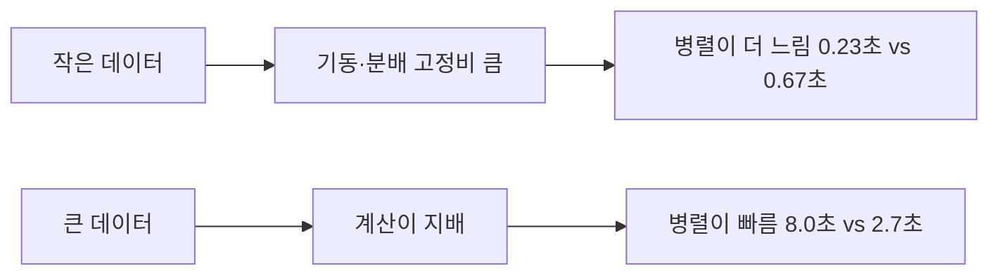
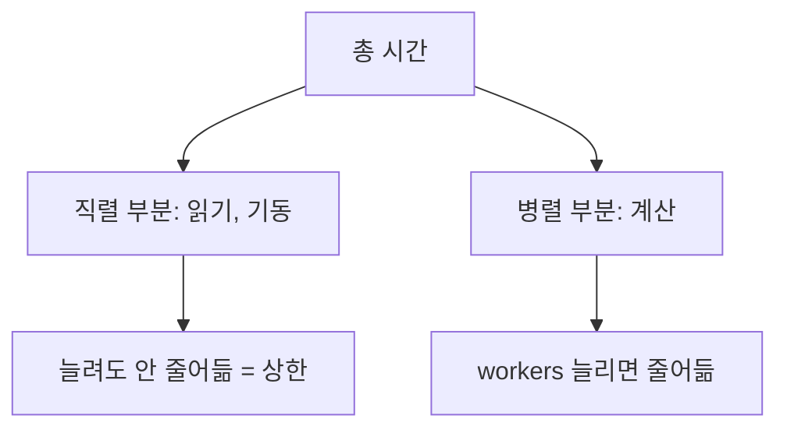

# 작은 데이터의 병렬 오버헤드

> 작업자를 늘리면 항상 빨라지는 것이 아니다. 프로세스를 띄우고 파일을 나누는 **고정 비용**이 계산량보다 크면, 작은 데이터에서는 병렬이 오히려 더 느리다.

## 쉽게 말하면
짐이 상자 한 개뿐인데 이삿짐 일꾼 네 명을 부르면 인사하고 역할 나누다 시간이 간다. 혼자 들고 가는 게 빠르다. 상자가 수백 개일 때 비로소 네 명이 이득이다.

## 자세히
- **직접 측정**(datatrove LocalPipelineExecutor, CPU 4코어, 파일 8개·tasks=8, 문서마다 SHA-256을 200번 돌리는 필터, 각 1회 측정):

| 문서 수 | workers=1 | workers=4 | 배율 |
|---|---|---|---|
| 800 | 0.23초 | 0.67초 | 4개가 약 2.9배 **느림** |
| 80,000 | 8.00초 | 2.73초 | 4개가 약 2.9배 **빠름** |

- 해석: 800개에서는 계산이 0.2초뿐이라 프로세스 기동·직렬화 같은 고정 비용이 지배한다. 8만 개에서는 계산이 커져 4코어에 가까운 이득(이론 4배 대비 약 2.9배)이 났다. 4배가 안 나오는 이유는 파일 읽기·쓰기와 기동 비용처럼 병렬화되지 않는 부분 때문이다.
- **Amdahl의 법칙**: 전체 속도 향상 = 1 / ((1−p) + p/s). 개선되는 부분 비율 p가 작거나 병렬로 못 줄이는 부분이 크면 상한이 낮다(Wikipedia 확인). 위 결과는 그 법칙의 현실판이다.
- **실무 기준(제안)**: 전체 처리 시간이 수 초 이내면 workers=1로 충분하다. 분 단위 이상일 때 workers를 늘리고, task 수는 workers의 배수로 두며 task가 너무 작지 않게 한다. 직접 재서 정하는 편이 맞다.
- 한계: 한 번씩 잰 값이고 머신·필터 무게에 따라 교차점이 달라진다. 교차점 위치는 일반화하지 않는다.

## 그림으로 보기

## 예시
- 사내 문서 2천 건 정제: workers=1로 몇 초에 끝나므로 병렬 설정에 시간을 쓰지 않는다.
- 교육: 문서 수를 10배씩 늘리며 workers 1과 4를 비교해 교차점을 찾는 실습.

## 헷갈리는 것과 비교
| 개념 | 차이 |
|---|---|
| 병렬(parallel) | 한 작업을 쪼개 동시에 |
| 분산(distributed) | 여러 머신에 나눠 |
| [실행기 종류](#pipeline-executor-types) | Local은 한 머신, Slurm·Ray는 클러스터 |
| [skip_completed](#datatrove-skip-completed) | 병렬 조각의 재개 기능 |

## 더 읽을거리
- [Amdahl's law — Wikipedia](https://en.wikipedia.org/wiki/Amdahl%27s_law) — 병렬 이득의 상한 공식(열어 확인).
- [huggingface/datatrove](https://github.com/huggingface/datatrove) — LocalPipelineExecutor tasks·workers(직접 설치해 측정).
