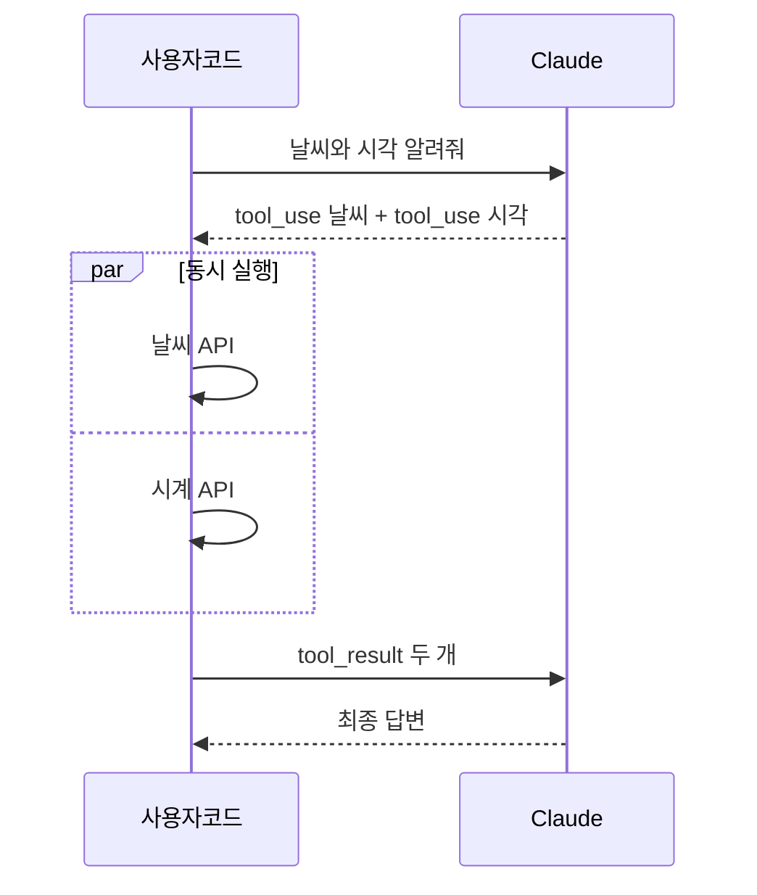
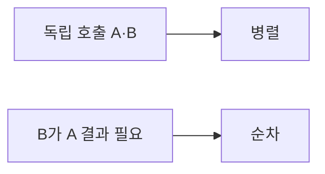

# 병렬 도구 호출

> 병렬 도구 호출은 서로 의존하지 않는 여러 도구 호출을 한 번의 모델 응답에 함께 요청해, 왕복 횟수를 줄이는 방식이다.

## 쉽게 말하면
식당 주문에서 "물, 수저, 메뉴판 주세요"를 한 번에 말하는 것과 같다. 하나씩 시킬 때마다 직원이 왔다 갔다 하는 시간이 사라진다. 단 "고기 구운 뒤에 소스" 같은 순서가 있으면 따로 시켜야 한다.

## 자세히
- Claude는 응답에 `tool_use` 블록을 **여러 개** 담을 수 있다. 예를 들어 "샌프란시스코 날씨와 현재 시각"이면 두 도구를 한 응답에서 요청할 수 있다(Anthropic 문서의 응답 예시는 텍스트 + tool_use 구성).
- 내 코드는 각 호출을 (가능하면 동시에) 실행하고 결과를 `tool_result` 블록들로 **다음 사용자 메시지에 함께** 돌려준다. 각 결과는 `tool_use_id`로 짝을 맞춘다(일반적 API 규약; 정확한 규칙은 handle-tool-calls 문서 참고, 이 실행에서는 열어 보지 않음).
- 병렬화 조건: 호출 간 **입력 의존성이 없을 것**. 앞 결과가 뒤 호출의 인자가 되면 순차로 간다.
- 장점: 지연·왕복 감소. 주의: 동시 쓰기 충돌, 속도 제한, 한 호출 실패 시 부분 결과 처리.
- 프롬프트로 "독립적인 도구는 동시에 호출하라"고 유도할 수 있다(일반 실무 권고).

## 그림으로 보기

## 예시
리서치 에이전트가 검색 3건을 한 번에 요청 → 코드가 `asyncio.gather`로 동시에 실행 → 결과 3개를 한 메시지로 반환. 파일 읽기 여러 개도 같은 방식이다.

## 헷갈리는 것과 비교
| 개념 | 차이 |
| --- | --- |
| 병렬 도구 호출 | 한 응답 안의 여러 호출 |
| 순차 호출 | 앞 결과가 뒤 입력일 때 |
| [LangGraph 멀티에이전트](#langgraph-multi-agent) | 여러 *에이전트*가 나눠 일함 |
| [tool_choice와 strict](#tool-choice-strict) | 호출 통제 옵션 |

## 더 읽을거리
- [Define tools — Claude 문서](https://platform.claude.com/docs/en/agents-and-tools/tool-use/define-tools) — 복수 tool_use 응답 예시와 다음 단계 링크
