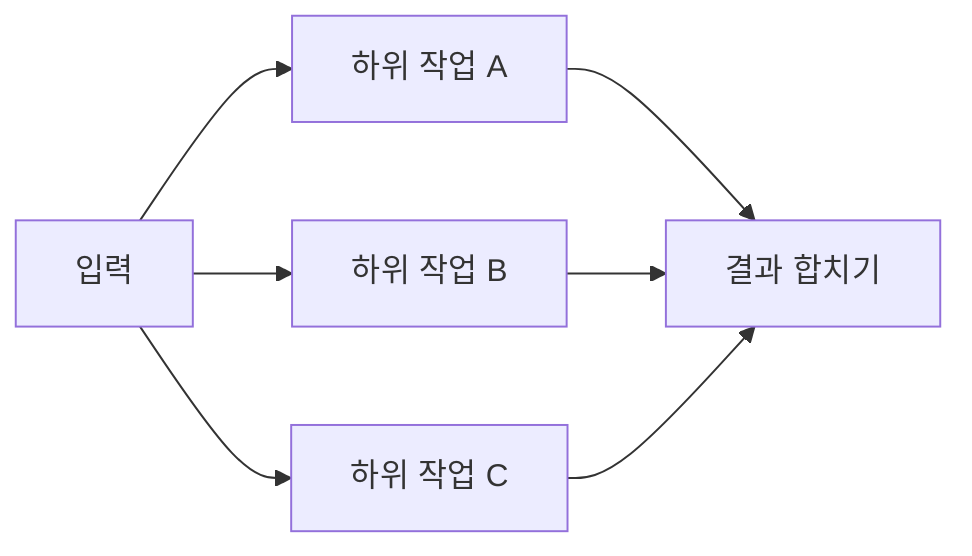
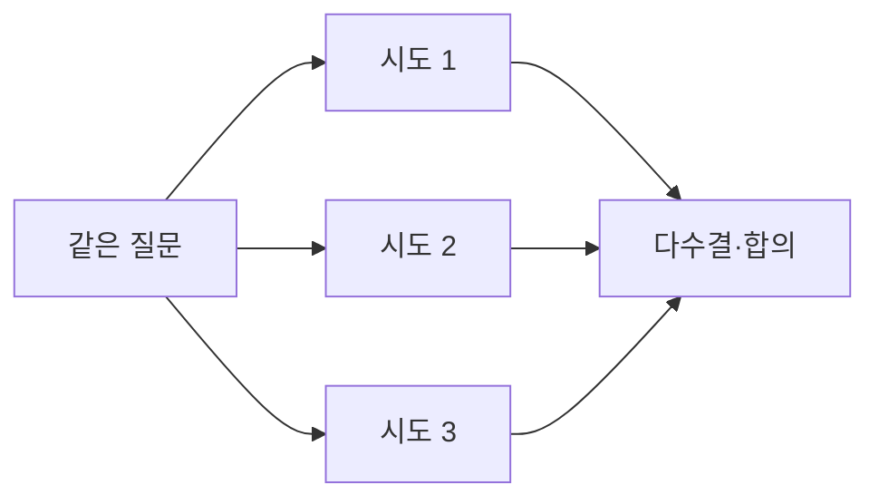

# 병렬화 패턴

> 한 작업을 여러 LLM 호출로 동시에 실행하고 결과를 합치는 워크플로 패턴이다. 독립 하위 작업을 나누는 sectioning과 같은 작업을 여러 번 돌려 비교하는 voting 두 변형이 있다.

## 쉽게 말하면
이삿짐을 혼자 나르면 하루가 걸리지만 다섯이 방별로 나누면(sectioning) 한 시간이다. 또 중요한 서류는 세 명이 따로 검토해 다수결로 확인한다(voting).

## 자세히
Anthropic "Building effective agents"(2026-11 확인):
- **Sectioning**: 독립적인 하위 작업을 나눠 동시에 실행. 예: 가드레일(본 처리 + 검사 분리), 자동화된 평가(eval) 항목별 채점.
- **Voting**: 같은 작업을 여러 번 돌려 다양한 결과를 얻음. 예: 여러 프롬프트가 코드 취약점을 각각 검토해 하나라도 문제를 표시하면 경고.
- 언제 효과적인가: 속도가 중요하거나, 여러 관점으로 신뢰도를 높여야 할 때.
- 비용: 호출 수만큼 토큰이 든다. 단순한 해법으로 충분하면 병렬화하지 않는다("복잡도 추가는 측정 가능한 개선이 입증될 때만").

## 그림으로 보기

## 예시
- 계약서 검토: 조항 유형(지급·해지·책임)별로 3개 호출을 병렬 실행하고 보고서로 합친다(sectioning).
- 코드 보안 점검: 같은 코드를 3개 다른 프롬프트로 보고 의견이 갈리면 사람 검토(voting).

## 헷갈리는 것과 비교
| 개념 | 차이 |
|---|---|
| 병렬화 | 동시에 여러 호출, 합침 |
| [프롬프트 연쇄](#prompt-chaining) | 순서대로 앞 결과가 다음 입력 |
| [가드레일](#guardrails) | 병렬화로 구현하는 안전장치 |
| [워크플로 vs 에이전트](#workflow-vs-agent) | 병렬화는 고정 경로 워크플로 |

## 더 읽을거리
- [Building effective agents](https://www.anthropic.com/engineering/building-effective-agents) — sectioning/voting 정의와 예시.
