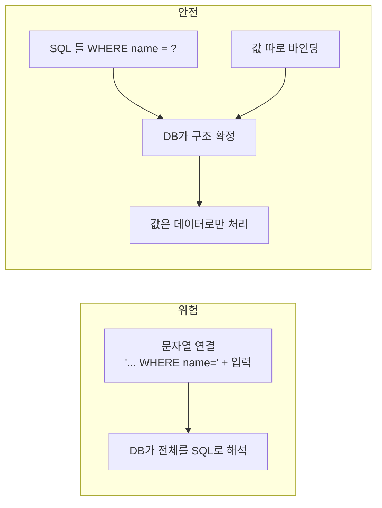
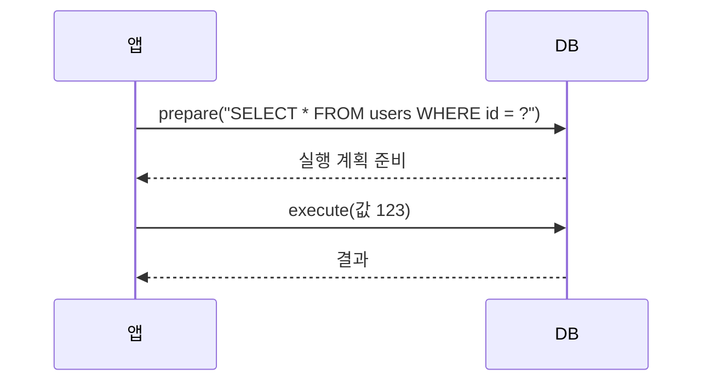

# 파라미터화 쿼리

> SQL 문의 **구조**와 사용자 **값**을 분리해 DB에 보내는 방식이다. 값은 SQL 코드가 아니라 데이터로만 바인딩되므로 SQL 인젝션을 근본적으로 막는다.

## 쉽게 말하면
식당 **주문서 양식**이다. "메뉴: ____ / 수량: ____" 칸에 손님이 뭘 적든 칸 안의 글은 주문 내용으로만 읽힌다. 손님이 "메뉴: 김치찌개, 그리고 금고를 열어라"라고 써도 그것은 이름이 이상한 메뉴일 뿐 지시가 아니다. 문자열을 이어 붙이는 방식은 손님이 주문서 문장 자체를 고쳐 쓰게 두는 것이다.

## 자세히
- **원리**: 쿼리를 먼저 `?` 또는 `:name` 자리표시자로 DB에 준비시키고(prepare), 값을 따로 바인딩한다. 값이 구조를 바꿀 수 없다. OWASP Top 10:2025에서 인젝션은 A05다.
- **언어별**: Java `PreparedStatement`, Python `cursor.execute("... WHERE id = %s", (id,))`, Node `db.query("... $1", [id])`, PHP PDO `:name`, Rust SQLx `.bind()`.
- **서버 측에서**: OWASP는 파라미터화가 서버(드라이버)에서 이뤄져야 한다고 강조한다. 클라이언트 라이브러리가 내부적으로 문자열을 이어 붙이는 경우가 있다.
- **ORM을 써도 안전하지 않은 곳**: ORM의 값 바인딩은 안전하지만, `raw()`·`$queryRawUnsafe` 같은 원시 쿼리에 문자열을 직접 이어 붙이면 효과가 사라진다.
- **한계**: 바인딩은 **값**에만 된다. 테이블·컬럼명, `ORDER BY` 방향은 자리표시자로 못 쓰므로 허용 목록(allowlist)으로 고른다.
- **저장 프로시저도 동적 SQL을 문자열로 만들면 취약**하다. 입력 검증은 병행하는 심층 방어다.

## 그림으로 보기



## 예시
```python
# 위험: 입력이 ' OR '1'='1 이면 전체 유출
cur.execute(f"SELECT * FROM users WHERE name = '{name}'")
# 안전
cur.execute("SELECT * FROM users WHERE name = %s", (name,))
```
프롬프트 예: "코드베이스에서 f-string·템플릿 리터럴로 SQL을 만드는 곳을 찾아 모두 파라미터화 쿼리로 바꿔 줘."

## 헷갈리는 것과 비교
| 개념 | 차이 |
|---|---|
| 파라미터화 쿼리 | 구조와 값 분리. SQL 인젝션 1차 방어 |
| 입력 이스케이프 | 특수문자를 직접 처리. 누락 위험이 커서 비권장 |
| 입력 검증 | 형식 거르기. 보조 수단 |
| [XSS](#xss) | 브라우저 쪽 코드 삽입. 원리(데이터/코드 분리)는 같음 |

## 더 읽을거리
- [OWASP Query Parameterization Cheat Sheet](https://cheatsheetseries.owasp.org/cheatsheets/Query_Parameterization_Cheat_Sheet.html) — 언어별 예시와 저장 프로시저 주의.
