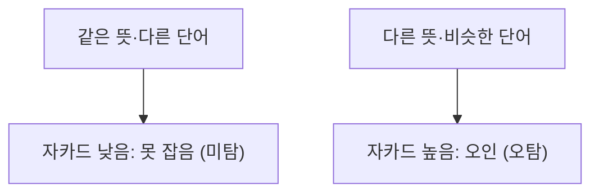

# 패러프레이즈 중복의 한계

> MinHash·LSH 같은 **표면 문자열 기반 중복 제거는 단어를 바꿔 쓴 같은 뜻의 문장(패러프레이즈)을 못 잡고**, 반대로 한 단어로 뜻이 뒤집힌 문장은 중복으로 오인할 수 있다. 의미 중복은 임베딩 기반 방법으로 따로 다룬다.

## 쉽게 말하면
표절 검사기가 글자 겹침만 본다면, 문장을 자기 말로 바꿔 쓴 표절은 통과시키고 "이익"을 "손실"로 한 글자 바꾼 정반대 문장은 "거의 똑같다"고 경고한다. 글자가 아니라 뜻을 봐야 둘 다 잡는다.

## 자세히
- 직접 계산(글자 3-그램 자카드):

| 문장 쌍 | 자카드 |
|---|---|
| "The company reported record profits this quarter." ↔ "This quarter the firm posted its highest earnings ever." (같은 뜻, 다른 단어) | 0.23 |
| 같은 문장 + 느낌표 하나 | 0.96 |
| profits → losses (뜻은 반대) | 0.71 |
| "회사가 이번 분기 사상 최대 이익을 냈다." ↔ "이번 분기에 회사의 이익이 역대 최고를 기록했다." (한국어 같은 뜻) | 0.10 |
- 해석: 같은 뜻 쌍(0.23, 0.10)은 임계값 0.5~0.8에서 중복으로 안 잡히고, 뜻이 반대인 쌍(0.71)이 오히려 더 높다. 표면 유사도는 의미를 대신하지 못한다. 한 문장 사례 4개라 통계가 아니라 예시다.
- 대안(의미 중복): 임베딩으로 문서를 벡터로 바꾸고 가까운 것을 군집으로 묶어 중복을 제거한다. SemDeDup(Abbas 외, 2023, arXiv 2303.09540)은 LAION 부분집합에서 데이터 50%를 제거해도 성능 손실이 적고 학습 시간이 약 절반이라고 보고한다(초록 확인).
- 실무 순서(제안): ① 정확 일치 해시 → ② MinHash·LSH(표면 근접 중복) → ③ 임베딩 군집(의미 중복). 앞 단계가 싸고 빠르므로 먼저 쓴다.
- 의미 중복은 항상 제거가 정답은 아니다. 같은 뜻의 다양한 표현은 학습에 도움이 될 수 있어 비율을 조절한다.

## 그림으로 보기

## 예시
- 뉴스 기사 여러 매체가 통신사 기사를 윤문해 싣는 경우: 표면 중복 제거를 통과하므로 의미 군집 단계가 필요하다.
- 교육: 같은 문장 두 개를 보여 주고 "글자 유사도 vs 뜻 유사도"를 학습자가 직접 추측해 보게 한다.

## 헷갈리는 것과 비교
| 개념 | 차이 |
|---|---|
| 정확 중복 | 완전히 같은 문서 |
| 근접 중복([MinHash·LSH](#minhash-lsh)) | 표면이 거의 같음 |
| 의미 중복 | 뜻이 같고 표현이 다름, 임베딩 필요([텍스트 임베딩](#text-embedding)) |

## 더 읽을거리
- [SemDeDup (arXiv 2303.09540)](https://arxiv.org/abs/2303.09540) — 임베딩으로 의미 중복을 제거한 연구(초록 확인).
