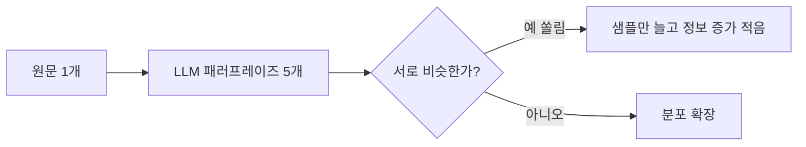
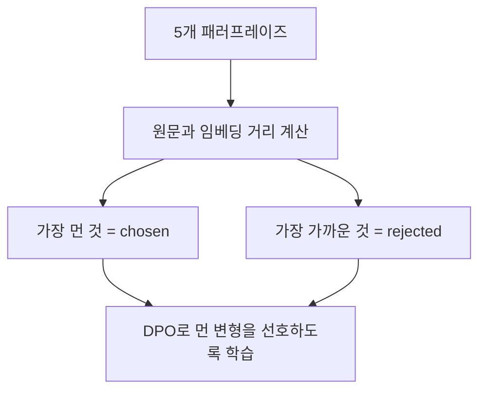

# 패러프레이즈 다양성 쏠림

> LLM에게 문장을 바꿔 쓰게 해 데이터를 늘리면, **생성된 변형들이 비슷한 문체·어휘로 몰려** 데이터 수는 늘어도 다양성은 늘지 않는 문제. 그래서 증강에서는 개수보다 분포의 다양성을 관리한다.

## 쉽게 말하면
같은 사람에게 "이 문장을 다르게 말해 줘"를 열 번 시키면 말투가 거의 같다. 학생 열 명에게 시켰다면 훨씬 다양했을 것이다. 데이터가 늘었는데 사실상 같은 문장의 복제본이라면 모델은 새로 배우는 것이 별로 없다.

## 자세히
- **문제 제기(DoAug, arXiv 2502.11671, ACL 2025, 본문 직접 읽음)**: 기존 방법 대부분이 샘플 수를 늘리는 데 집중하고 **분포 다양성은 소홀히 한다**고 지적한다. Llama-3.2-1B-Instruct를 패러프레이저로 미세조정하고, 정보가 많은 소수 샘플(coreset)에만 적용해 원본과 합친다.
  - **다양성 측정 6지표**: 임베딩 쌍 거리(Distance)·분산(Dispersion), 데이터셋 수준의 Isocontour Radius·Homogeneity, 어휘 크기(Vocabulary Size)·고유 3-gram 수, 그리고 라벨 일관성을 보는 Affinity.
  - **DPO로 다양성 학습**: 원문 하나에 패러프레이즈 5개를 만들어 BERT 임베딩 거리가 가장 먼 것을 chosen, 가장 가까운 것을 rejected로 하는 5만 쌍 선호 데이터를 만들고 DPO(β=0.1)로 튜닝.
  - **결과(저자 보고)**: 12개 데이터셋 평균 정확도 향상 10.52%(차점 Taboo 6.76%), 정규화 다양성 점수 0.98 vs 차점(Hint) 0.67. RTE에서만 졌다. 절제 실험에서 높은 온도나 다양성 프롬프트로 DPO를 대체하면 성능이 더 나빴다.
- **프롬프트 기반 다양성 유도(Cegin 외, arXiv 2401.06643, 초록 직접 읽음)**: 크라우드소싱에서 쓰던 세 방식(금지어 taboo, 이전 이상치 해답 힌트 hints, 이상치 해답 위에 이어 쓰기 chaining)을 LLM 증강 지시에 넣어 5개 LLM·6개 데이터셋·2개 다운스트림 모델에서 비교했다. **다양성은 taboo가 가장 많이 높였지만 다운스트림 성능은 hints가 가장 좋았다**. 다양성과 성능이 늘 같이 움직이지 않는다.
- **측정(제안)**: Self-BLEU(생성문끼리 겹침, 낮을수록 다양)와 고유 n-gram 수, 임베딩 거리로 다양성을 따로 재고, 라벨이 뒤집히지 않았는지 확인한다.
- **한계**: 위 결과는 저자들이 정한 데이터셋·모델 설정에서의 것이다. 합성 데이터 일반의 다양성 저하를 다룬 다른 연구(arXiv 2511.01490)가 있다는 것은 검색 요약으로만 확인했다.

## 그림으로 보기

## 예시
| 방법 | 12개 데이터셋 평균 정확도 향상(DoAug 논문) |
|---|---|
| DoAug | 10.52% |
| Taboo | 6.76% |
- 업무 장면: 고객 문의 100건을 LLM으로 열 배 늘릴 때, 프롬프트에 "이 단어는 쓰지 마"(taboo)나 서로 다른 말투 힌트를 넣고 고유 3-gram 수를 전후로 비교한다.

## 헷갈리는 것과 비교
| 개념 | 차이 |
|---|---|
| 다양성 쏠림 | 변형들이 서로 비슷함 |
| [모델 붕괴](#model-collapse) | 세대를 거치며 분포가 좁아지는 현상(더 큰 시간 척도) |
| [여러 중간 언어 혼합](#multi-pivot-mixing) | 역번역으로 변형을 넓히는 다른 방법 |
| [LLM 패러프레이즈 증강](#llm-paraphrase-augmentation) | 이 문제가 속한 상위 기법 |

## 더 읽을거리
- [Diversity-oriented Data Augmentation with Large Language Models (arXiv 2502.11671)](https://arxiv.org/abs/2502.11671) — DoAug 다양성 지표와 결과(본문 직접 읽음).
- [Effects of diversity incentives in LLM-based text augmentation (arXiv 2401.06643)](https://arxiv.org/abs/2401.06643) — taboo·hints·chaining 비교(초록 직접 읽음).
