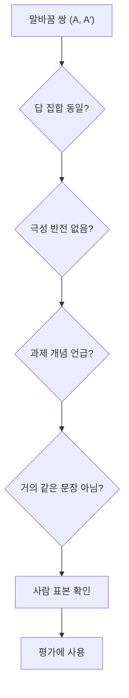
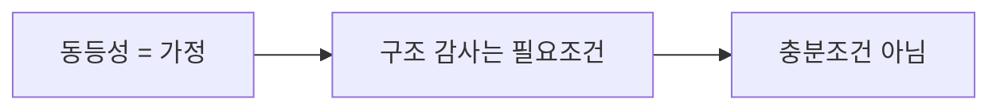

# 말바꿈의 의미 보존 검증

> 견고성·일관성 평가에서 **"표현만 바꾼 두 문장이 정말 같은 것을 요구하는가"를 확인하는 절차**다. 이 검증이 없으면 점수 하락이 모델의 불안정 때문인지, 질문이 실제로 달라졌기 때문인지 구분할 수 없다.

## 쉽게 말하면
"사과를 몇 개 샀어?"와 "사과를 안 산 게 몇 개야?"는 비슷해 보여도 같은 질문이 아니다. 두 문장에서 답이 달랐다고 모델이 흔들린다고 말할 수 없다. 말바꿈이 진짜 같은 뜻인지 먼저 점검해야 한다.

## 자세히
(JudgeSense 논문, arXiv 2604.23478의 HTML 본문 일부를 WebFetch로 직접 확인. 요약 도구가 준 발췌 기준이며 부록 E 원문은 읽지 못했다.)
- **논문의 입장**: 두 지시문이 같은 판단을 요구한다는 **동등성은 가정이지 결과가 아니다**. 독립적인 심사(사람이든 모델이든)를 하지 않았고, 모델 기반 확인은 **순환적**이라 쓰지 않았다고 밝힌다.
- **구조 감사(논문)**: 대신 자동으로 점검한다. ① 한 템플릿 쌍 안에서 **요구하는 답 집합이 같은가** ② **극성(polarity)이 뒤집히지 않았는가** ③ 각 템플릿이 **자기 과제의 개념**을 언급하는가 ④ **거의 같은 문장 쌍이 아닌가**. 20개 템플릿이 모두 통과했다. 다만 관련성 템플릿 2개는 "한 토큰으로 답하라"는 제약이 없어 파싱 표면이 짝과 달랐다고 보고한다.
- **극성 반전 사고(논문)**: 이전 버전은 극성이 뒤집힌 짝을 포함해 심사위원 간 뒤집힘 비율이 거의 같았고, 저자들은 이를 **측정 도구의 결함**으로 읽었다. v2에서 극성 반전을 원천 제거하고 "추론은 남기되 숫자는 버렸다". 이 사례가 의미 보존 검증이 왜 필요한지를 보여 준다.
- **구조 감사의 한계(논문)**: 이 검사들은 두 표현이 같은 판단을 묻는다는 것을 **보장하지 못한다**.
- **기타 위협(논문)**: 말바꿈이 **심사위원의 답변 여부(거절)**를 바꿀 수 있고, 5점 척도는 민감도를 키우고 이진 척도는 불안정을 가릴 수 있다. 안정성은 정확성이 아니다 — "안정성은 도구의 필요조건이지 충분조건이 아니다".
- **실무 체크리스트(해석)**: 말바꿈 쌍마다 사람이 두 표현의 의미 동일성을 표본 확인, 답 형식·극성·범위 조건 일치 확인, 중복 문장 제거.

## 그림으로 보기

## 예시
- 챗봇 평가용 말바꿈 질문 100쌍을 만든 뒤, 부정문으로 바뀐 쌍이 없는지 필터링하고 20쌍을 사람이 읽어 의미 동일성을 확인한다.
- 교육 활동: 수강생이 말바꿈 쌍 5개를 만들어 서로 바꿔 검수하며 "뜻이 달라진 것"을 찾는다.

## 헷갈리는 것과 비교
| 개념 | 차이 |
|---|---|
| 의미 보존 검증 | 말바꿈 쌍이 같은 요구인지 점검 |
| 모델 기반 검증 | 평가 대상과 같은 모델로 확인하면 순환 위험 |
| [Judge Sensitivity Score](#judge-sensitivity-score) | 검증된 쌍에서 일치도를 잼 |
| [최악 프롬프트 성능](#worst-prompt-performance) | 말바꿈이 사람 검수를 거쳐야 의미가 있음 |

## 더 읽을거리
- [JudgeSense (arXiv 2604.23478)](https://arxiv.org/abs/2604.23478) — 동등성은 가정이라는 입장, 구조 감사와 극성 반전 사고(HTML 일부 확인).
- [On the Worst Prompt Performance of Large Language Models (arXiv 2406.10248)](https://arxiv.org/abs/2406.10248) — 말바꿈 질의 기반 벤치마크(초록 확인).
