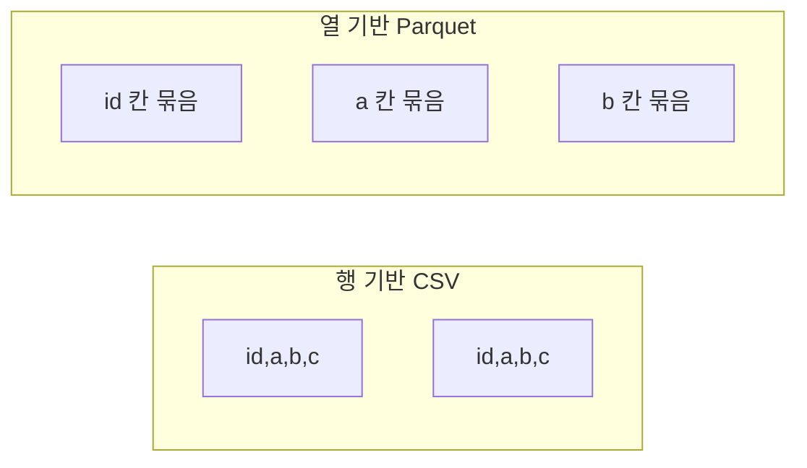
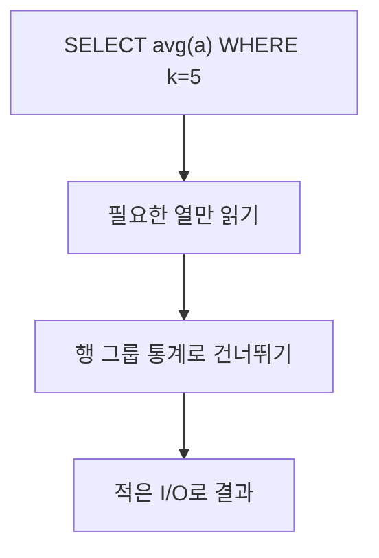

# Parquet 열 기반 포맷

> Parquet은 표 데이터를 **행이 아니라 열 단위로 묶어 저장**하는 오픈 파일 포맷이다. 필요한 열만 읽고(열 가지치기), 조건에 맞지 않는 행 그룹은 통계로 건너뛰며(조건 푸시다운), 열별 압축으로 용량도 줄인다.

## 쉽게 말하면
명부를 "사람 한 명당 한 줄"로 적는 대신 "이름 칸 모음, 나이 칸 모음"으로 따로 묶어 보관하는 것이다. "나이 평균"만 구하려면 나이 칸 묶음만 꺼내면 된다. 같은 종류의 값끼리 모여 있어 압축도 잘 된다.

## 자세히
- **설계 목표(Apache Parquet 공식 소개, 직접 확인)**: 하둡 생태계 프로젝트에 **압축된 효율적 열 기반 저장**을 제공, 중첩 구조는 Dremel 레코드 분해·조립 방식 사용, 열별 압축 설정과 새 인코딩 추가 가능, 의존성이 무거운 설정 없이 여러 프레임워크에서 쓸 수 있게 한다.
- **직접 해 본 실험(이 세션, 가상 데이터, pyarrow)**: 실수 20열 + 정수 2열, **200만 행**을 CSV와 Parquet로 저장.
  - 파일 크기: Parquet 약 **342MB** vs CSV 약 **794MB**(약 2.3배 차이, 난수 실수라 압축이 덜 되는 편이며 실제 데이터에서는 다를 수 있음)
  - 읽기 시간(2~3회 중 최솟값): Parquet **1개 열만** 약 0.0065초, Parquet **전체 열** 약 0.077초, Parquet 조건 `k == 5`와 1열 약 0.0084초, CSV 전체 약 0.59초, CSV에서 1열만 지정해도 약 0.27초(CSV는 줄 전체를 파싱해야 함).
  - 해석: Parquet은 1열만 읽을 때 전체의 약 8%(0.0065/0.0774) 시간이다. 단일 머신·캐시된 상태에서의 한 번 측정이므로 일반 수치가 아니다.
  - 파일 메타데이터: 22열·행 그룹 2개(pyarrow 기본 설정).
- **조건 푸시다운(이전 노드와 연결)**: 행 그룹별 최소·최대 통계로 필터에 맞지 않는 그룹을 건너뛴다([Z-order 클러스터링](#z-order-clustering)의 실험도 같은 통계를 이용). 정렬되지 않은 열은 통계 범위가 넓어 건너뛰기 효과가 작다.
- **주의(해석)**: 작은 파일을 너무 많이 쓰면 열 기반의 이점이 사라진다([작은 파일 문제](#small-files-problem)). 행 단위로 전체를 자주 읽는 워크로드나 레코드 단위 갱신에는 맞지 않을 수 있다.

## 그림으로 보기

## 예시
- 분석용 로그 테이블을 CSV 대신 Parquet로 저장해 일부 열만 읽는 대시보드 질의를 빠르게 만든다.
- 교육 소재: 같은 데이터를 CSV와 Parquet로 저장해 파일 크기와 1열 읽기 시간을 비교하는 실습.

## 헷갈리는 것과 비교
| 개념 | 차이 |
|---|---|
| CSV | 행 기반 텍스트, 열만 읽기 어려움 |
| Parquet | 열 기반 이진, 압축·통계 |
| [작은 파일 문제](#small-files-problem) | 파일 수가 비용을 키움 |
| [파티셔닝과 가지치기](#data-partitioning-pruning) | 폴더 수준 건너뛰기 |

## 더 읽을거리
- [Apache Parquet: Motivation](https://parquet.apache.org/docs/overview/motivation/) — 설계 동기(직접 확인).
- [Delta Lake: Optimizations](https://docs.delta.io/latest/optimizations-oss.html) — 압축·작은 파일(직접 확인).
