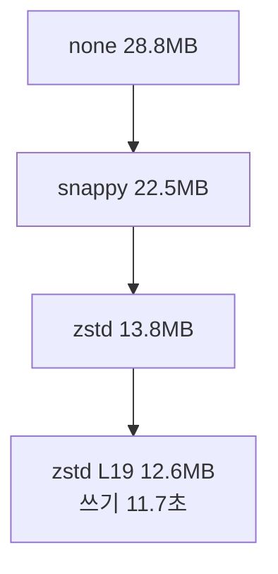
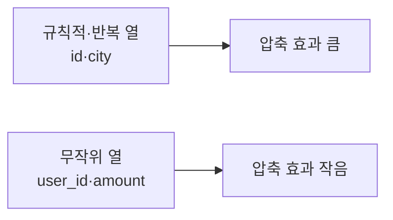

# Parquet 압축 코덱

> Parquet은 페이지 단위로 **압축 코덱을 골라** 저장 크기와 읽기·쓰기 속도를 맞바꿀 수 있고, 열마다 다른 코덱을 줄 수도 있다. 같은 표에서 코덱에 따라 크기가 2배 가까이 달라진다.

## 쉽게 말하면
이삿짐을 싸는 방법에도 "빨리 대충 싸기(snappy)", "시간 들여 꽉꽉 싸기(zstd 높은 수준, gzip)"가 있다. 꽉 싸면 짐 부피는 줄지만 싸는 데 오래 걸리고, 풀 때도 시간이 든다. 연속된 번호처럼 규칙적인 짐은 아주 작게 접히고, 무작위 문자열은 잘 안 접힌다.

## 자세히
(Parquet 공식 문서의 압축 페이지를 직접 읽었고, 크기·시간은 이 세션에서 **pyarrow 26.0.1(Python 3.13)** 로 직접 측정했다. 100만 행 합성 데이터, 한 환경, 읽기는 3회 중 최솟값이다. 일반 결론이 아니며 실제 데이터에서는 달라진다.)
- **지원 코덱(Parquet 문서)**: UNCOMPRESSED(무압축), SNAPPY, GZIP(RFC 1952), LZO, BROTLI(RFC 7932), **LZ4(폐기 — Hadoop에서 물려받은 문서화 안 된 프레이밍, LZ4_RAW로 이전 권고)**, ZSTD(RFC 8878, 압축 수준은 명세에 없음), LZ4_RAW(LZ4 블록 형식, LZ4의 권장 대체). 압축은 딕셔너리 페이지와 데이터 페이지의 데이터 블록에 적용된다. "열 단위(column chunk)로 적용"이라는 명시는 읽은 페이지에서 확인하지 못했다.
- **직접 측정(같은 100만 행 표, pyarrow 기본 수준)**

| 코덱 | 크기(MB) | 쓰기(초) | 전체 읽기(초) |
|---|---|---|---|
| none | 28.83 | 0.11 | 0.028 |
| snappy | 22.52 | 0.17 | 0.044 |
| lz4 | 22.50 | 0.16 | 0.032 |
| zstd | 13.77 | 0.21 | 0.038 |
| brotli | 14.15 | 1.65 | 0.084 |
| gzip | 14.92 | 9.06 | 0.118 |

  이 데이터에서는 **zstd가 크기와 속도 모두 균형이 좋았고**, gzip은 크기가 비슷한데 쓰기가 크게 느렸다(기본 수준의 pyarrow 설정에서). 이는 이 합성 데이터·이 라이브러리 기본값의 결과다.
- **압축 수준(직접 측정)**: zstd level 1은 13.77MB(기본과 같은 크기), level 9는 13.69MB(쓰기 0.67초), level 19는 12.64MB(쓰기 **11.67초**) — 높은 수준은 크기를 조금 더 줄이지만 쓰기가 크게 느려진다. gzip level 1은 15.67MB에 쓰기 0.58초로, 기본 gzip(9.06초)보다 훨씬 빠르고 14.92MB보다 약간 크다.
- **열별 압축 효과(직접 측정, zstd 기준 열 통계)**: `id`(연속 정수)는 압축 전 8.27MB → 1.28MB, `city`(8개 값 반복)는 약 0.38MB, `user_id`(무작위 정수)는 2.20MB → 2.12MB(거의 안 줄어듦), `amount`(무작위 소수)는 1.84MB → 1.79MB, `note`(무작위 문자열)는 16.1MB → 8.19MB. 규칙적·반복적인 열은 많이 줄고 무작위 열은 거의 안 줄어든다.
- **열마다 다른 코덱(직접 측정)**: `id`를 무압축으로 두고 나머지를 zstd/snappy로 섞었더니 **20.78MB**로 전부 zstd(13.77MB)보다 커졌다. 압축 효과가 큰 열(id)을 무압축으로 둔 영향이다. 열별 설정은 열의 성격을 보고 해야 한다.
- **선택 가이드(해석)**: 균형이 필요하면 zstd 기본·낮은 수준이 무난하고, 쓰기 속도가 최우선이면 snappy/lz4, 저장 비용이 최우선이고 쓰기가 드물면 높은 수준의 zstd를 고려한다. 다만 위 수치는 한 환경의 측정값이다.

## 그림으로 보기



## 예시
```python
import pyarrow.parquet as pq
pq.write_table(tbl, "t.parquet", compression="zstd")                 # 전체 열
pq.write_table(tbl, "t2.parquet", compression="zstd", compression_level=9)
pq.write_table(tbl, "t3.parquet",
    compression={"id": "zstd", "city": "zstd", "amount": "snappy"})  # 열별
```
- 교육 소재: 자기 데이터 한 열을 골라 코덱별 크기를 표로 만들어 보기.

## 헷갈리는 것과 비교
| 개념 | 차이 |
|---|---|
| 압축 코덱 | 바이트를 줄이는 알고리즘(snappy·zstd 등) |
| 인코딩(딕셔너리 등) | 값을 표현하는 방식, 압축 전 단계 |
| [CSV vs Parquet 실험](#csv-vs-parquet-experiment) | 형식 자체의 크기·속도 비교 |
| [열 가지치기](#column-pruning) | 필요한 열만 읽는 최적화 |

## 더 읽을거리
- [Parquet compression (Apache Parquet 문서)](https://parquet.apache.org/docs/file-format/data-pages/compression/) — 코덱 목록과 LZ4 폐기(직접 읽음).
