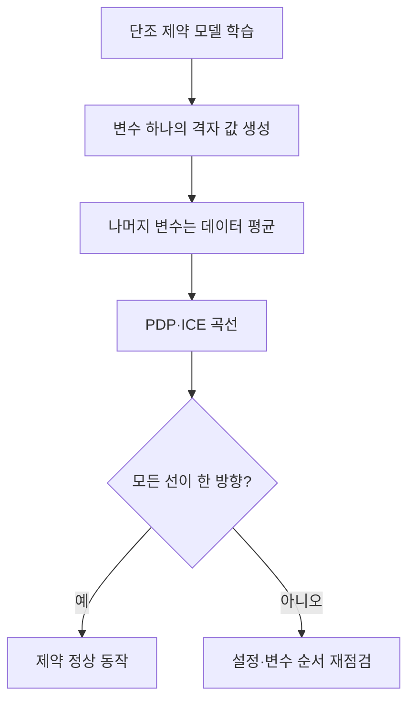

# 부분 의존 곡선 점검

> 단조 제약을 건 모델이 실제로 한 변수에 대해 한 방향으로만 움직이는지, **부분 의존(PDP)·ICE 곡선을 그려 눈과 숫자로 확인**하는 방법.

## 쉽게 말하면
에어컨 온도 다이얼을 돌리며 방 온도 변화를 지켜보는 것과 같다. 다른 조건은 그대로 두고 한 변수만 천천히 바꿔 가며 모델의 예측이 계속 한쪽으로만 가는지 본다. 중간에 튀면 제약이 깨졌거나 설정이 틀린 것이다.

## 자세히
출처: scikit-learn 부분 의존 문서와 XGBoost 단조 제약 튜토리얼(둘 다 본문 확인, 2026-11-18).
- **PDP**: 관심 변수와 응답의 관계를, 나머지 변수에 대해 평균(주변화)해 얻은 "기대 응답" 곡선. 보통 1~2개 변수.
- **ICE**: 샘플마다 한 줄. PDP가 평균이라 가리는 샘플별 차이(상호작용)를 보여 준다. 한 변수만 지원.
- **sklearn 사용**: `PartialDependenceDisplay.from_estimator(model, X, [0, 1], kind="both")`. `kind`는 `average`(PDP, 기본)·`individual`(ICE)·`both`. 선이 많으면 `centered=True`로 중심화.
- **계산 방법**: `brute`는 모든 모델용이며 격자마다 전체 데이터를 통과해 느리고 ICE는 이 방식만. `recursion`은 일부 트리 모델 전용으로 빠르다.
- **점검 절차(제안)**: ①제약 모델의 모든 ICE 선이 한 방향인지 ②무제약 모델과 PDP를 겹쳐 차이를 본다 ③XGBoost 튜토리얼처럼 제약 모델은 전반 추세는 유지하고 위반하는 진동만 사라져야 한다.
- **한계**: 변수 독립을 가정하므로 상관된 변수에서는 비현실적 조합이 평가되어 왜곡될 수 있다. 격자 밖은 보증하지 못하므로 값 범위 점검도 병행한다.
- **숫자 점검**: 격자 예측을 정렬해 `np.all(np.diff(pd) >= 0)`로 단조성을 직접 확인한다.

## 그림으로 보기


## 예시
```python
from sklearn.inspection import PartialDependenceDisplay, partial_dependence
import numpy as np
PartialDependenceDisplay.from_estimator(model, X, ["income"], kind="both")
r = partial_dependence(model, X, ["income"], kind="average")
ok = np.all(np.diff(r["average"][0]) >= 0)   # 증가 제약이면 True 기대
```
연체율 모델에서 "소득이 오르면 위험이 내려간다" 제약을 건 뒤 이 점검을 CI에 넣는다.

## 헷갈리는 것과 비교
| 개념 | 차이 |
|---|---|
| PDP | 평균 곡선, 이질성을 가림 |
| ICE | 샘플별 곡선 |
| [단조 제약 설정법](#monotone-constraints) | 제약을 거는 쪽, 이 노드는 검증 쪽 |
| SHAP 의존도 그림 | 기여도 기반이며 PDP와 계산 방식이 다름 |

## 더 읽을거리
- [scikit-learn 부분 의존](https://scikit-learn.org/stable/modules/partial_dependence.html) — PDP·ICE 옵션과 한계
- [XGBoost 단조 제약 튜토리얼](https://xgboost.readthedocs.io/en/stable/tutorials/monotonic.html) — 제약 전후 곡선 비교
