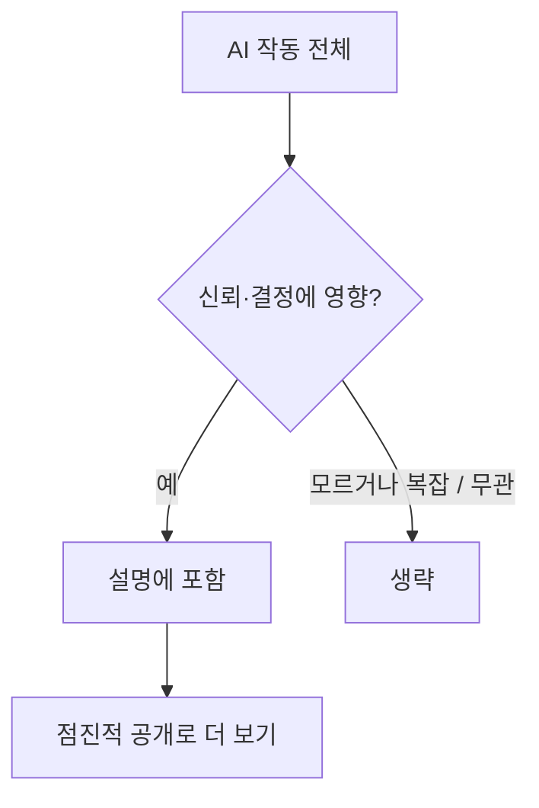

# 부분 설명

> AI의 작동을 **전부 설명하려 하지 않고, 신뢰와 결정에 영향을 주는 핵심 부분만** 알려 주는 설명 방식이다. 모르거나 너무 복잡하거나 쓸모없는 부분은 일부러 뺀다.

## 쉽게 말하면
자동차 계기판은 엔진 내부를 전부 보여 주지 않고 속도·연료·경고등만 보여 준다. 운전자가 결정하는 데 필요한 부분만 골라 알려 주는 것이다.

## 자세히
(Google PAIR People + AI Guidebook "Explainability + Trust" 챕터를 직접 읽었다.)
- **정의(PAIR)**: 시스템이 어떻게 작동하는지의 한 핵심 요소를 설명하거나 일부 데이터 출처를 드러내되, 알 수 없거나 복잡하거나 쓸모없는 부분은 의도적으로 생략한다. 호기심 많은 사용자를 위해 **점진적 공개**와 함께 쓸 수 있다. 가이드는 "최선의 설명은 아마 부분 설명"이라고 쓴다.
- **두 종류(PAIR)**: **일반 시스템 설명**(AI가 대체로 어떻게 작동하나) / **특정 출력 설명**(이번에 왜 이 결과가 나왔나).
- **주의(PAIR)**: 설명은 만들기 어렵고 보통 여러 차례 사용자 테스트가 필요하다. **투명성이 늘 신뢰를 높이지는 않는다.** 압도적이거나 혼란스러운 설명은 역효과다. 설명을 통째로 없애기 전에 부분 설명이 신뢰에 미치는 영향을 비교해 본다.
- 관련: 설명 없음이 적절한 경우(일반적 멘탈 모델과 일치), 완전한 설명이 필요한 경우(법적·책임 요구)는 PAIR가 따로 구분한다.

## 그림으로 보기

## 예시
- 추천 이유: "최근 본 영상과 비슷해서 추천했어요" 한 줄(특정 출력 설명). 더 알고 싶으면 "추천 원리 보기"(일반 시스템 설명)를 눌러 열기(제안).

## 헷갈리는 것과 비교
| 개념 | 차이 |
|---|---|
| 부분 설명 | 핵심만 선택해 설명 |
| 완전한 설명 | 제3자가 재현할 수 있을 만큼 상세(법적 요구 등) |
| 설명 없음 | 익숙한 멘탈 모델과 일치할 때 |
| [확신 표시 유형](#confidence-display-types) | 불확실성을 보여 주는 UI 방식 |

## 더 읽을거리
- [Google PAIR — Explainability + Trust](https://pair.withgoogle.com/chapter/explainability-trust/) — 직접 읽음.
