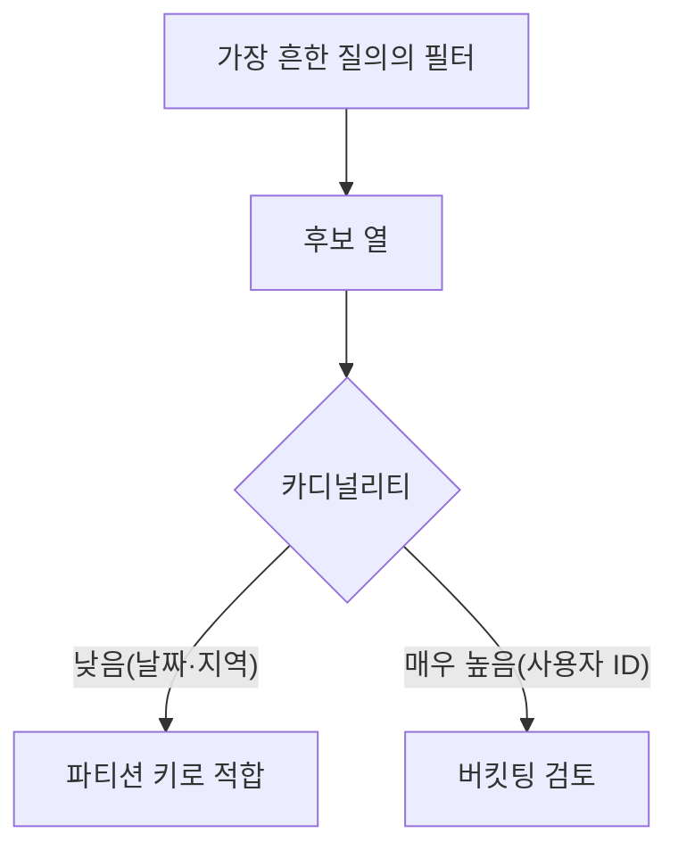
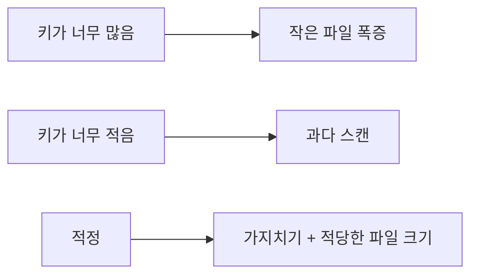

# 파티션 키 고르기

> 어떤 열을 파티션 키로 삼을지 정하는 설계다. **가장 흔한 질의의 필터**에 맞추고, 너무 많이도 너무 적게도 나누지 않는 것이 핵심이다.

## 쉽게 말하면
도서관에서 책을 "장르별"로 꽂을지 "저자 성(姓)별"로 꽂을지는 손님이 주로 어떻게 찾느냐에 달렸다. 손님 대부분이 장르로 찾는데 성별로 꽂아 두면 소용없고, 책 한 권마다 서가를 하나씩 쓰면 서가만 수만 개가 된다.

## 자세히
(AWS Athena 성능 최적화 문서 "Optimize data"를 직접 읽었다. Athena·Glue 기준이며 일부는 서비스 특화 규칙이다.)
- **질의에 맞춘다(문서)**: 파티션은 질의 성능에 큰 영향을 주므로 설계 때 신중해야 한다. 파티션 키는 테이블 생성 시 정의해 질의 필터로 쓰는 **가상 열**처럼 동작한다. 키가 너무 많으면 파편화되어 작은 파일이 폭증하고, 너무 적거나 없으면 필요 이상으로 스캔한다.
- **드문 질의를 위해 최적화하지 않는다(문서)**: 대부분이 일 단위 구간을 본다면 일부가 시간 단위로 거른다고 시간 파티션을 만들지 않는다. 시간 단위 질의는 **타임스탬프 열**로 처리하고, 컬럼형 포맷에 레코드를 **타임스탬프로 정렬**해 두면 짧은 구간 질의도 시간 파티션만큼 거의 효율적이며 일 단위 질의 성능도 해치지 않는다.
- **모든 파티션 키에 조건을 준다(문서)**: 파티션이 수만 개인 테이블은 모든 파티션 키에 조건이 있을 때 더 잘 동작한다. 모든 키에 **등호 조건**이 있으면 파티션 메타데이터를 바로 읽을 수 있어 빠르고, 키에 조건이 없거나 범위면 파티션 전체 목록을 걸러야 한다. 수만 개 이상이면 오버헤드가 커진다.
- **타입은 STRING(Athena 규칙, 문서)**: Athena는 파티션 필터를 Glue로 푸시다운하려면 파티션 키가 STRING이어야 하고, 파티션이 적지 않다면 다른 타입은 성능이 나빠질 수 있다. 날짜·숫자처럼 보이면 질의에서 캐스팅한다.
- **오래된·빈 파티션 정리(문서)**: S3에서 데이터를 지우면 Glue 카탈로그의 파티션 항목도 지운다. 질의가 매칭한 모든 파티션을 S3에서 나열하므로 빈 파티션이 많으면 낭비다. 수만 개로 늘면 쓰지 않는 오래된 파티션 메타데이터를 제거하면 빨라질 수 있다.
- **파티션이 너무 많을 때의 도구(문서)**: 파티션 프로젝션(규칙으로 계산), Glue 파티션 인덱스. 또한 `MSCK REPAIR TABLE`은 오래 걸리고 새 파티션만 추가해 파티션 관리에는 효율적이지 않다고 한다.
- **버킷팅(문서)**: 카디널리티가 높은 키로 단건 조회가 많다면 버킷팅이 유용하고(예: 사용자 ID), 여러 값을 자주 찾으면 덜 유용하다.
- **일반 원칙(문서 문장은 아님)**: 카디널리티가 낮고 질의 필터에 자주 쓰이는 열이 후보다. 사용자 ID처럼 값이 아주 많은 열을 파티션 키로 쓰면 파티션이 폭증한다.

## 그림으로 보기

## 예시
- 일 단위 분석이 대부분인 로그: `dt`(문자열 `2026-11-23`)만 파티션 키로 두고, 시간대 질의는 `event_ts` 정렬로 처리(예시).
- 교육 소재: 우리 팀의 대표 질의 3개를 적고 거기에 맞는 파티션 키를 정해 보기.

## 헷갈리는 것과 비교
| 개념 | 차이 |
|---|---|
| 파티션 키 | 폴더 단위로 데이터를 가르는 열 |
| 정렬 | 파일 안 순서로 통계를 활용해 건너뛰기 |
| 버킷팅 | 높은 카디널리티 키를 파일로 분배 |
| [작은 파일 폭증 문제](#too-many-small-files) | 키를 잘못 고른 결과 |

## 더 읽을거리
- [Optimize data (AWS Athena)](https://docs.aws.amazon.com/athena/latest/ug/performance-tuning-data-optimization-techniques.html) — 파티션 키 선택·STRING 타입·버킷팅(직접 읽음).
