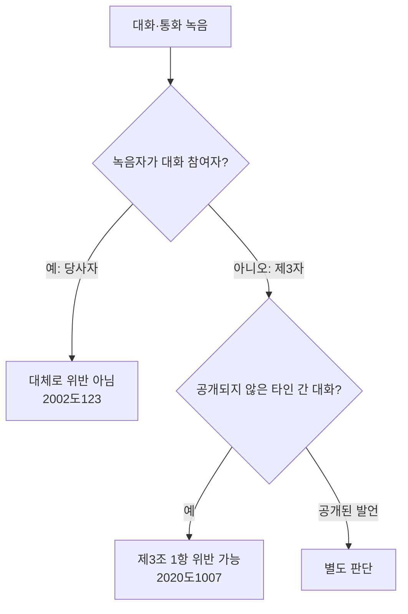

# 당사자 녹음 원칙

> 한국 통신비밀보호법에서 대화·통화의 **당사자**가 자기가 참여한 대화를 상대 몰래 녹음하는 것은 원칙적으로 금지 대상(감청·타인 간 대화 녹음)이 아니라는 판례 원칙. 대화에 참여하지 않은 제3자의 녹음은 다르다. (법률 자문 아님)

## 쉽게 말하면
내가 낀 대화를 받아 적는 것은 "내 기억을 남기는 일"로 본다. 그런데 문 밖에서 몰래 듣거나, 한쪽 말만 허락받고 제3자가 끼어 녹음하는 것은 도청이다. AI 노트테이커가 사람인지 제3자인지에 따라 결론이 갈릴 수 있는 이유다.

## 자세히
- **판례 1 (대법원 2002. 10. 8. 선고 2002도123, 판례 요약 확인)**: 전화통화 당사자 일방이 상대 몰래 녹음하는 것은 '감청'이 아니다. 감청은 제3자가 당사자의 동의 없이 하는 것이기 때문이다. 반대로 제3자가 한쪽 당사자 동의만 받고 녹음하면 상대방 동의가 없어 위법이다.
- **판례 2 (대법원 2020도1007, 2022-08-31 선고, 법률신문 기사로 확인)**: 대화에 참여하지 않은 사람이 가청거리에서 타인 간 대화를 녹음해 제3자에게 전송한 사건. 대법원은 특별한 사정이 없으면 통신비밀보호법 제3조 1항 위반이라고 했다. "공개되지 않았다"는 것은 비밀과 같지 않으며 발언자 의사, 대화 내용·목적, 상대 수, 장소 성격 등 객관적 사정으로 판단하고, 가청거리라는 사정만으로 녹음이 허용되지 않는다.
- **3인 이상 대화**: 대화 참여자 한 명의 녹음을 허용한다는 해설과 다른 두 사람의 발언은 "타인 간 대화"로 볼 수 있다는 해설이 섞여 있어, 사안별 판결을 찾아봐야 한다(이번에 원문을 열지 못함).
- **AI 서비스 적용(추정)**: AI 서기가 클라우드 업체 서버로 음성을 보내면 업체가 제3자인지, 사용자 도구인지가 쟁점이 될 수 있다. 이 부분은 판례 근거 없는 실무적 추정이므로 이용자 전원에게 고지·동의를 받는 설계가 안전하다.
- 녹음 후 SNS 등에 올리면 명예훼손 같은 별도 책임이 생길 수 있다.

## 그림으로 보기

## 예시
- 내가 참석한 회의를 AI로 녹음해 요약 → 당사자 녹음으로 대체로 허용된다고 보지만 회사 정책·개인정보법 확인.
- 회의에 참석하지 않은 사람이 옆자리에서 대화를 녹음해 전송 → 2020도1007과 같은 문제.

## 헷갈리는 것과 비교
| 개념 | 차이 |
|---|---|
| [한국 통신비밀보호법](#kr-communication-secrecy-law) | 상위 법 설명 |
| 미국 [전원 동의](#all-party-consent) | 주에 따라 모든 당사자 동의 필요 |
| [음성의 개인정보 성격](#voice-personal-data) | 녹음이 합법이어도 개인정보법은 별도 |
| [회의 AI 노트테이커](#meeting-ai-notetaker) | 당사자 녹음 원칙의 실무 적용 |

## 더 읽을거리
- [대법원 2002도123 판결 요지 (nepla)](https://www.nepla.ai/case/대법원/2002도123) — 당사자 녹음은 감청이 아님(열어서 확인)
- [가청거리에서 타인의 대화 몰래 녹음 (법률신문)](https://www.lawtimes.co.kr/news/articleView.html?idxno=182425) — 2020도1007 해설(열어서 확인)
