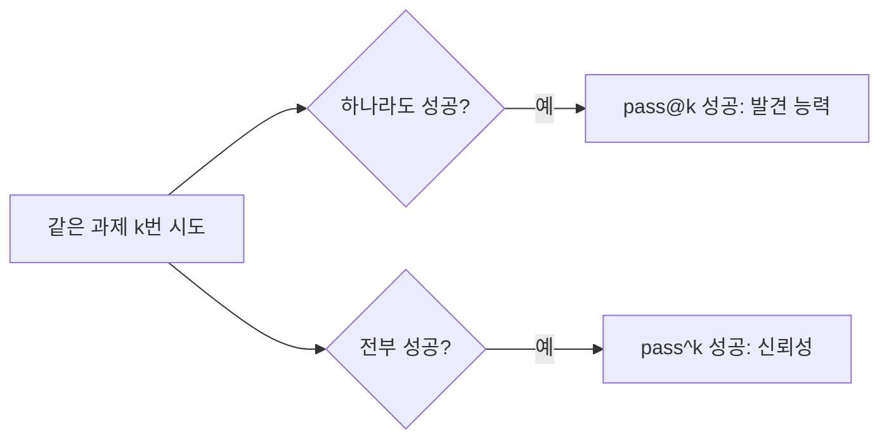
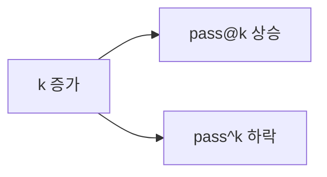

# pass@k와 pass^k

> 같은 과제를 k번 시켰을 때, **한 번이라도 성공할 확률**이 pass@k, **k번 모두 성공할 확률**이 pass^k다. 앞은 "찾아낼 수 있나", 뒤는 "믿고 맡길 수 있나"를 잰다.

## 쉽게 말하면
농구 자유투를 10번 던진다고 하자. "10번 중 한 번이라도 넣었나"는 능력의 상한, "10번 다 넣었나"는 꾸준함이다. 코드 생성처럼 정답을 자동 검증할 수 있으면 여러 번 시도해 하나만 고르면 되니 pass@k가 의미 있다. 고객 응대처럼 매번 같은 품질이 필요하면 pass^k가 맞다.

## 자세히
- **pass@k**: 독립 시도 k번 중 ≥1번 성공할 확률. k가 커질수록 **올라간다**. 추론 시간 컴퓨트를 늘려 해를 "발견"하는 경향을 보여 준다.
- **pass^k**: k번 모두 성공할 확률(과제별로 계산해 평균). k가 커질수록 **내려간다**. Sierra의 τ-bench 논문(arXiv 2406.12045, 2024)이 제안했다.
- n번 시도 중 c번 성공으로 조합식 추정. pass^1 = pass@1 = 평균 성공률.
- τ-bench 결과: 당시 GPT-4o 계열 함수 호출 에이전트는 과제 성공률 50% 미만, 소매 도메인 pass^8은 25% 미만 — 한 번 잘하는 것과 매번 잘하는 것은 크게 다르다.
- 주의: 사용자 시뮬레이터 자체가 확률적이면 에이전트의 비일관성과 시뮬레이터 잡음이 섞인다는 비판이 있다(2차 블로그).
- 간단 예: 성공률 p=0.8이면 pass^5 ≈ 0.8^5 ≈ 0.33, pass@5 ≈ 1−0.2^5 ≈ 0.9997.

## 그림으로 보기

## 예시
- 코딩 벤치마크에서 "pass@10 = 90%"는 10번 뽑으면 한 번은 맞는다는 뜻 — 테스트가 있으면 유용.
- 고객센터 에이전트: 한 건도 틀리면 안 되는 환불 처리 → pass^8 같은 지표로 본다.
- 파이썬 계산: `p=0.8; print(p**5, 1-(1-p)**5)`

## 헷갈리는 것과 비교
| 개념 | 차이 |
|---|---|
| pass@k | 한 번이라도, k↑ 시 상승 |
| pass^k | 매번, k↑ 시 하락 |
| [벤치마크](#benchmarks) | 과제 모음. pass@k는 그 점수 계산법 |
| [SWE-bench](#swe-bench) | 대표적 코딩 벤치마크 |

## 더 읽을거리
- [τ-bench 논문](https://arxiv.org/pdf/2406.12045) — pass^k 정의와 결과
- [Sierra: Benchmarking AI agents](https://sierra.ai/blog/benchmarking-ai-agents) — 제안 배경 해설
