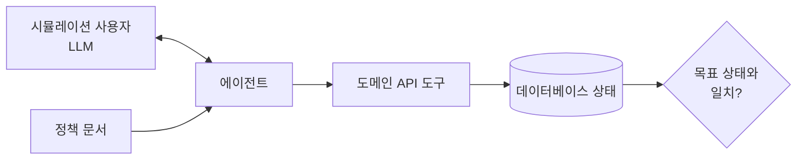
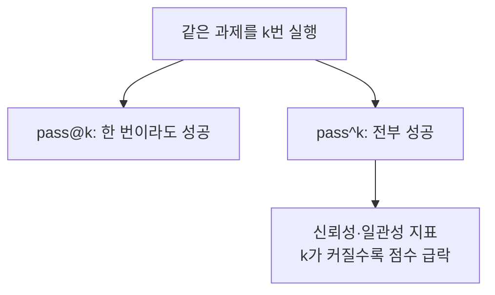

# pass^k와 τ-bench

> τ-bench는 AI 에이전트가 가상 고객과 대화하며 도구(API)를 쓰고 회사 정책을 지켜 일을 끝내는지 재는 Sierra의 벤치마크이고, pass^k는 "같은 과제를 k번 시켜 k번 모두 성공하는가"로 일관성(신뢰성)을 재는 지표다.

## 쉽게 말하면
신입 상담원이 환불 문의를 한 번 잘 처리했다고 믿을 수 있을까? 같은 유형의 문의 8번을 모두 규정대로 처리해야 현장에 투입한다. 한 번 잘하는 능력(pass@k류)과 매번 잘하는 신뢰성(pass^k)은 다르다. 고객 응대 자동화에서는 후자가 중요하다.

## 자세히
- **τ-bench**(Sierra, arXiv 2406.12045): LLM이 흉내 내는 사용자와 에이전트가 대화하고, 에이전트는 도메인 API 도구와 정책 지침을 갖는다. 성공 여부는 대화 종료 시 **데이터베이스 상태**가 정답으로 주석된 목표 상태와 같은지로 판정한다. 도메인은 τ-retail(소매)과 τ-airline(항공)이다.
- **사용자가 시뮬레이션**이라 같은 과제를 다시 돌려도 사용자의 말투가 달라진다. 그래서 반복 시 일관성을 잴 수 있다.
- **pass^k**: 같은 과제를 k번 시도해 **모두** 성공할 비율. 한 번 성공(pass^1)은 높아도 k가 커질수록 급락한다. 시행당 성공률이 p이고 독립이라면 대략 p의 k제곱이 된다(직관용 근사; 논문은 n번 시도 중 c번 성공을 바탕으로 한 불편 추정을 쓴다고 알려져 있으나 이 글에서 정의 수식은 확인하지 못했다).
- **결과(Sierra 블로그·논문)**: 테스트한 에이전트 12종(함수 호출·ReAct 방식, 상용·오픈 모델) 모두 어려워했다. 최고 성능인 GPT-4o 에이전트도 두 도메인 평균 성공률 50% 미만이었고, τ-retail의 **pass^8은 약 25%**로 pass^1보다 약 60% 떨어졌다.
- **실패 원인 분석**: 규칙을 일관되게 따르기, 긴 호흡의 계획, 상충하는 사실 중 중요한 정보에 집중하기가 약했다. 함수 호출 에이전트는 정책 문서 준수가 특히 약했다.
- **pass@k와 대비**: pass@k는 k번 중 **한 번이라도** 성공하면 인정(코드 생성처럼 여러 번 시도해 좋은 걸 고를 수 있을 때). 고객 상황처럼 매번 정답이어야 하면 pass^k가 맞다.
- **주의**: 이 수치는 2024년 모델 기준이다. 최신 모델 결과는 리더보드에서 확인해야 한다.

## 그림으로 보기

## 예시
- 고객센터 에이전트 도입 평가: 같은 환불 시나리오 8가지를 각 8번 돌려 pass^8을 본다. pass^1이 80%여도 pass^8이 20%라면 현장 투입은 이르다.
- 모델 비교: 평균 성공률이 비슷하면 pass^k가 높은 쪽(일관성 좋은 쪽)을 고른다.

## 헷갈리는 것과 비교
| 개념 | 차이 |
|---|---|
| pass@k | k번 중 한 번이라도 성공하면 OK. 최대 능력 |
| pass^k | k번 모두 성공해야 OK. 신뢰성 |
| [벤치마크 포화](#benchmark-saturation) | 점수가 만점 근처에 몰려 변별력 상실. τ-bench는 일관성 측면에서 아직 변별력이 큼 |
| [에이전트 비용·지연](#agent-cost-latency) | 반복 실행으로 신뢰도를 높이면 비용이 늘어남 |

## 더 읽을거리
- [τ-bench: A Benchmark for Tool-Agent-User Interaction (arXiv 2406.12045)](https://arxiv.org/abs/2406.12045) — 논문
- [Benchmarking AI agents (Sierra)](https://sierra.ai/blog/benchmarking-ai-agents) — pass^k와 결과 설명
