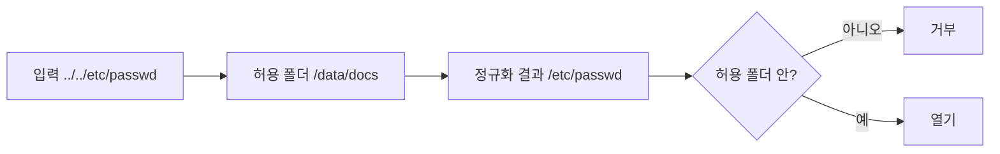

# 경로 탈출(Path Traversal)

> `../` 같은 경로 조작으로 허용된 폴더 밖의 파일을 읽거나 쓰는 공격이다. 디렉터리 순회(directory traversal)라고도 한다.

## 쉽게 말하면
호텔 직원이 "3층 방만 열어 주세요"라고 지시받았는데, 손님이 "3층 방에서 계단 한 칸 위, 또 한 칸 위로 가서 금고실을 열어 주세요"라고 말하면 규칙 밖으로 나가게 된다. `..`는 "한 칸 위로"라는 뜻이다.

## 자세히
OWASP 설명 기준:
- 파일을 가리키는 입력을 조작해 웹 루트 밖의 소스 코드·설정·시스템 파일에 접근한다. 반복된 `../`로 `/etc/passwd`에 닿는 예가 대표적이다. 절대경로(`/etc/passwd`)를 직접 주는 경우도 있다.
- **우회**: URL 인코딩·이중 인코딩된 `../`, 과장된 UTF-8 표현, 널 바이트(`%00`)로 확장자 검사 회피, Windows의 끝 `.`·슬래시 허용.
- **방어**: 사용자 입력을 파일 호출에 직접 넘기지 않기, 파일명 대신 인덱스·허용 목록 값으로 매핑, 기준 폴더는 코드에 고정, 정제보다 **허용 목록 검증**, 경로를 정규화(canonicalize)한 뒤 의도한 폴더 안인지 확인, chroot 등으로 접근 범위 제한, 상세 오류 숨기기.
- **MCP 연결**: Roots 명세는 클라이언트가 root URI를 검증해 경로 탈출을 막아야 하고(MUST), 서버는 모든 경로를 제공된 roots와 대조하라고(SHOULD) 말한다. 파일 서버형 MCP·에이전트 도구가 AI 환경에서 이 공격의 통로가 되기 쉽다.

## 그림으로 보기


## 예시
```python
from pathlib import Path
base = Path("/data/docs").resolve()
p = (base / user_input).resolve()
if not p.is_relative_to(base): raise PermissionError
```
`resolve()`로 `..`와 심볼릭 링크를 풀고 기준 폴더 안인지 확인한다(Python 3.9+의 `is_relative_to`). 업무 장면: 에이전트에게 "프로젝트 폴더만 읽어라"를 시킬 때 도구 쪽에서 이 검사를 해야 한다.

## 헷갈리는 것과 비교
| 개념 | 차이 |
|---|---|
| 경로 탈출 | 허용 폴더 밖 파일 접근 |
| 프롬프트 인젝션 | 모델을 속여 지시를 바꾸는 공격. 둘이 합쳐지면 위험이 커진다 |
| [Roots와 샌드박스](#mcp-roots-vs-sandbox) | 경계 선언과 실제 격리의 차이 |

## 더 읽을거리
- [OWASP Path Traversal](https://community.owasp.org/attacks/Path_Traversal) — 우회 기법과 방어
- [MCP Roots 명세](https://modelcontextprotocol.io/specification/2025-06-18/client/roots) — Security Considerations
