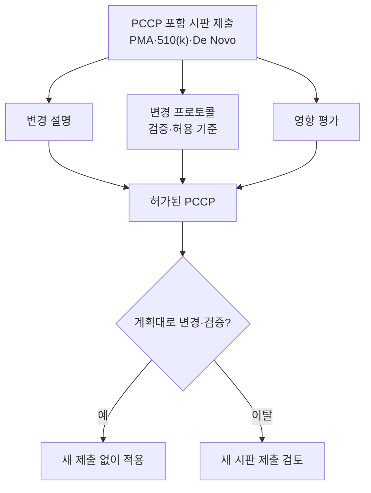

# AI PCCP 최종 지침

> FDA 지침 "Marketing Submission Recommendations for a Predetermined Change Control Plan for Artificial Intelligence-Enabled Device Software Functions". 2024-12-04 최초 발행, 2025-08-18 재발행된 비구속 권고로, AI 소프트웨어 기기의 PCCP에 무엇을 담아야 하는지 설명한다.

## 쉽게 말하면
"앞으로 이렇게 바꿀 테니, 바꾸는 방법과 검증 기준을 미리 심사받겠다"는 계획서를 어떻게 써야 하는지 FDA가 알려 주는 작성 안내서다. 법(515C)이 허용하는 틀 안에서의 세부 가이드라인이다.

## 자세히
출처: FDA 지침 PDF 전문(내려받아 읽음, 문서 머리글 기준 "Document issued on August 18, 2025. Document originally issued on December 4, 2024"). 앞쪽 일부와 정책 절을 중심으로 읽었고 부록 A와 세부 절은 훑지 않았다.
- **적용 범위**: 시간이 지나며 변경할 AI 소프트웨어 기능(AI-DSF). 변경이 **자동**(소프트웨어가 스스로, 지속 학습)이든 **수동**(사람의 입력·검토·결정 필요)이든 혼합이든 해당. 권고는 모든 AI 기기에 넓게 적용되지만 FDA가 검토한 PCCP 제출 대부분이 머신러닝(ML) 기기라 ML에 맞춘 내용이 많다.
- **PCCP의 정의**: 새 시판 허가 제출이 보통 필요했을 변경(21 CFR 807.81(a)(3), 814.39(a))을 미리 승인받아 두는 계획. 경로는 PMA(515C(a)), 510(k)(515C(b)), De Novo(513(f)(2)).
- **세 구성 요소(V절)**:
  - **변경 설명(Description of Modifications)**: 계획된 변경의 특성과 성능 사양
  - **변경 프로토콜(Modification Protocol)**: 변경을 뒷받침할 검증·확인 시험 활동과, 의도한 사용 집단 전반에서 안전·효과가 유지됨을 보장하는 허용 기준
  - **영향 평가(Impact Assessment)**: PCCP 시행의 이익·위험 평가와 위험 완화 계획
- **효과**: 승인된 PCCP에 따라 명시·시행된 변경은 이미 심사받은 것이므로 새 시판 제출을 일으키지 않는다.
- **이탈(deviation)**: PCCP를 따르지 않았거나 따를 수 없는 경우. 예: 데이터 관리·재학습 실패, 사전 지정한 성능 기준 미달. 안전·효과에 영향을 줄 수 있다. 새 제출이 필요 없는 변경은 이탈로 보지 않는다.
- **데이터 집합**: 의도한 사용 집단을 대표해야 하며 인종·민족·질병 중증도·성별·연령 같은 특성을 고려한다고 정의 절이 적는다(요지).
- **구속력**: "Contains Nonbinding Recommendations" 문서다. 같은 요건의 조문은 [FD&C Act 515C](#section-515c).

## 그림으로 보기

## 예시
- 영상 AI: "다른 병원 데이터를 추가해 재학습, 민감도·특이도가 사전 기준 이상이고 하위 집단 성능이 유지될 때만 배포"를 PCCP에 명시.
- 이탈 예: 재학습 결과가 사전 지정한 성능 기준에 못 미쳤는데도 배포 → PCCP 이탈로 새 제출 문제.

## 헷갈리는 것과 비교
| 개념 | 차이 |
|---|---|
| [FD&C Act 515C](#section-515c) | 법 조문, 이 지침은 작성 방법 권고 |
| [변경 관리 계획(PCCP)](#pccp) | 제도 개요 노드 |
| [변경 프로토콜](#modification-protocol) | 세 구성 요소 중 검증 부분 |
| [FDORA](#fdora) | 515C를 만든 법 |

## 더 읽을거리
- [PCCP for AI-Enabled Device Software Functions (FDA 지침 PDF)](https://www.fda.gov/media/166704/download) — 2024-12-04 최초, 2025-08-18 재발행 본문(내려받아 확인)
