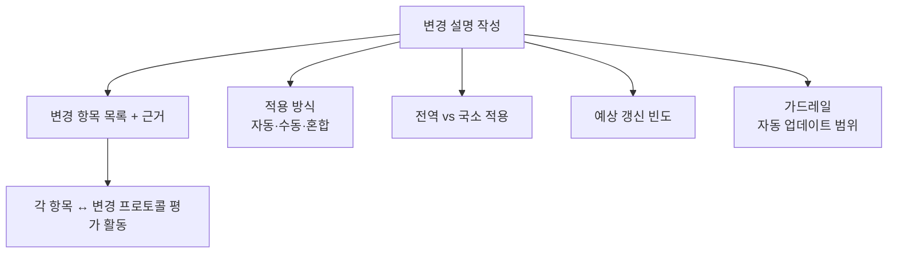

# 변경 설명 작성

> PCCP의 첫 구성 요소인 "Description of Modifications". 제조사가 앞으로 실제로 시행하려는 AI 소프트웨어 변경을 하나씩 구체적으로 나열하고, 각 변경의 이유·적용 방식·빈도·한계를 적는 부분이다.

## 쉽게 말하면
공사 계획서의 "공사 항목표"와 같다. 무엇을(항목), 왜(이유), 어떻게(자동/수동), 얼마나 자주(빈도), 어디까지(가드레일) 바꿀지를 구체적으로 적어야 나중에 "이 변경이 계획에 들어 있었나"를 판단할 수 있다.

## 자세히
출처: FDA 지침 "PCCP for AI-Enabled Device Software Functions"(2024-12-04 최초, 2025-08-18 재발행) PDF, VI절(내려받아 읽음).
- **목표**: 새 시판 제출 없이 시행할 수 있도록, 계획된 변경의 **특성·성능 사양**을 명시한다. 심사 효율을 위해 **구체적이고 검증·확인 가능한 변경을 적은 수만** 담으라고 권한다.
- **내용**:
  - 개별 변경을 **목록**으로 쓰고 AI 기능의 각 부분을 바꾸는 **구체적 근거**를 적는다.
  - 변경이 영향을 줄 **표시(라벨) 항목**을 참조하면 도움이 된다.
  - 각 변경은 변경 프로토콜의 **특정 성능 평가 활동과 연결**(Table 1 예시)한다.
  - 변경이 **자동**(소프트웨어가 스스로), **수동**(사람의 입력·검토·결정 필요), 혼합 중 무엇인지 밝힌다. FDA는 자동 변경 PCCP도 검토하되 추가 복잡성이 있어, **자동 업데이트의 범위를 정하는 경계(guardrails)**를 명확히 하면 도움이 된다고 한다.
  - **전역(global)**(모든 기기에 동일) 또는 **국소(local)**(시설·환자 특성에 따라 다름). 국소면 어떤 국소 요인이 변경을 정당화하는지 설명.
  - **예상 갱신 빈도**: 연 1회 이하(거의 고정) ~ 사용 중 지속 적응까지.
- **적합한 변경 유형(VI.C)**: 안전·효과를 유지·개선하는 것으로, ① 정량적 성능 사양(같은 유형의 입력으로 새 데이터를 재학습해 성능 개선), ② 입력과 호환성(같은 신호의 새 출처, 예: 다른 제조사·모델의 영상 장비, 제한된 새 입력, 운영체제·클라우드 갱신), ③ 사용·성능 관련 일부(예: 원래 적응증 안의 특정 하위 집단 허가).
- **한계**: PCCP의 변경은 기기를 **의도한 용도 안에** 유지해야 하고, 해당하면 predicate와 실질적 동등성을 유지해야 한다. 적응증 변경은 대체로 사전 평가가 어렵지만 일부는 가능하며 Q-Sub 협의를 강하게 권한다. 어떤 변경이 적합한지는 기기의 위험·이익에 따라 다르다.

## 그림으로 보기

## 예시
- "새 병원 3곳의 같은 유형 영상으로 재학습, 민감도 기준 X 이상·하위 집단 성능 유지 시 적용. 수동 배포, 전역 적용, 연 1회."
- 부적합 예: "다른 질환으로 적응증 확대"는 사전 평가가 어려워 보통 PCCP에 맞지 않음.

## 헷갈리는 것과 비교
| 개념 | 차이 |
|---|---|
| 변경 설명 | 무엇을 바꿀지(what) |
| [변경 프로토콜](#modification-protocol) | 어떻게 검증·적용할지(how) |
| 영향 평가 | 이익·위험 평가 |
| [전체 적용 vs 국소 적용](#global-vs-local-updates) | 변경 설명 안의 한 항목 |

## 더 읽을거리
- [PCCP for AI-Enabled Device Software Functions (FDA 지침 PDF)](https://www.fda.gov/media/166704/download) — VI절 변경 설명(내려받아 확인)
