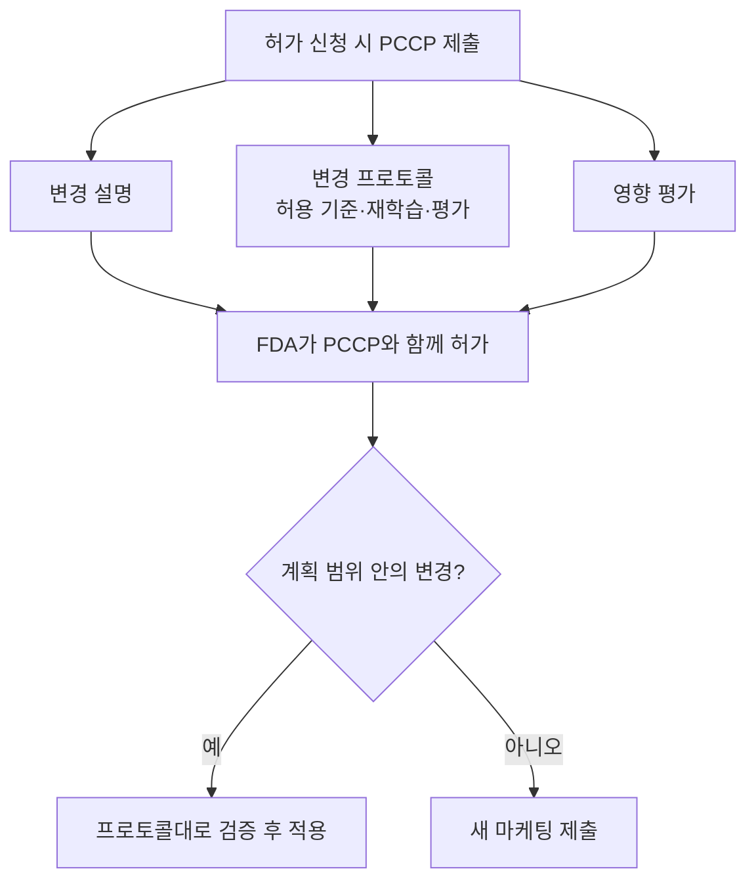

# 변경 관리 계획(PCCP)

> Predetermined Change Control Plan. AI 의료기기 제조사가 허가 때 "앞으로 이런 변경을 이런 절차로 검증해 적용하겠다"는 계획을 미리 승인받아 두면, 그 범위 안의 업데이트는 새로 허가를 받지 않고 할 수 있게 하는 제도.

## 쉽게 말하면
도로 공사 계획을 미리 허가받아 두면, 계획 범위 안의 정비는 매번 허가를 받지 않고 한다. 계획에 없던 큰 변경은 다시 허가를 받아야 한다. AI는 재학습으로 자주 바뀌어서, 업데이트마다 새 허가를 받으면 너무 느리기 때문에 생긴 방식이다.

## 자세히
출처: Foley & Lardner 해설(2025-01-06, 열어서 읽음). FDA 안내 원문 페이지는 주소가 404여서 열지 못해 원문과 대조하지 못했다. 최종 지침 발표일은 자료에 따라 2024-12-03/04로 갈린다.
- **지침**: FDA가 2023-04 초안을 낸 뒤 2024-12-04(해설 기준) AI 기반 기기 소프트웨어 기능용 PCCP 최종 지침을 발표. 비구속 지침이다. 적용 범위는 모든 AI 기반 기기 소프트웨어 기능이며 머신러닝에 가장 관련이 크다. 경로는 PMA, 일반 510(k), De Novo에서 쓸 수 있다.
- **세 구성 요소**:
  1. **변경 설명**: 변경이 자동(소프트웨어 업데이트)인지 수동(사람의 행동·결정)인지, 전체 동일 적용(global)인지 환자·시설별(local)인지, 예상 빈도. FDA는 정량적 성능 사양, 입력·호환성, 사용·성능의 일부 변경을 예상한다.
  2. **변경 프로토콜**: 변경을 어떻게 개발·검증·적용할지와 사전 정한 허용 기준. 데이터 관리, 재학습, 성능 평가 프로토콜, 갱신 절차(사용자 소통·투명성, 실사용 모니터링)를 포함.
  3. **영향 평가**: 허가 후 변경의 이익·위험과 완화 방법.
- **한계**: 변경은 대체로 의도한 용도·적응증 안에 있어야 하고(predicate와 실질적 동등 유지), 특별 510(k)에는 쓸 수 없다. 사전 제출 단계에서 FDA가 PCCP를 승인하지는 않는다. 승인된 PCCP의 변경은 대체로 새 마케팅 제출이 필요하다.
- **표시**: PCCP가 허가된 기기는 라벨에 머신러닝이 들어 있고 PCCP가 허가됐다고 밝혀야 한다.

## 그림으로 보기

## 예시
- 폐결절 AI: "더 많은 병원 데이터로 재학습해 민감도 기준 이상일 때만 배포한다"는 변경을 PCCP에 적어 허가받으면, 그 범위 안의 재학습 배포는 새 허가 없이 가능.
- 의도 용도를 "보조"에서 "단독 진단"으로 바꾸는 변경은 PCCP로 처리하기 어려워 새 제출이 필요하다.

## 헷갈리는 것과 비교
| 개념 | 차이 |
|---|---|
| [predicate 사슬 문제](#predicate-creep) | 허가 전 비교 연쇄, PCCP는 허가 후 업데이트 관리 |
| [실질적 동등성](#substantial-equivalence) | 허가 판단 기준, PCCP 변경도 동등성 유지가 전제 |
| 일반 소프트웨어 업데이트 | 허가 범위 밖 변경이면 새 제출 필요 |
| [predicate 기기](#predicate-device) | 비교 기준 기기 |

## 더 읽을거리
- [FDA's Final Guidance for PCCPs (Foley & Lardner, 2025-01)](https://www.foley.com/insights/publications/2025/01/fda-final-guidance-ai-device-software-predetermined-change-control-plan/) — 세 구성 요소와 한계(열어서 확인)
- [McDermott 해설](https://www.mcdermottlaw.com/insights/fda-issues-final-guidance-on-predetermined-change-control-plans-for-ai-enabled-devices/) — 같은 지침 해설(검색으로만 확인)
