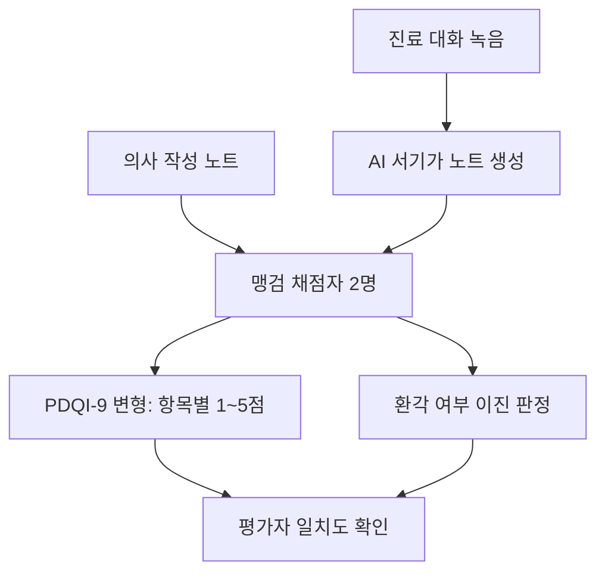

# PDQI-9

> Physician Documentation Quality Instrument. 의사가 쓴 진료 기록의 품질을 9개 속성에 1~5점 척도로 채점하는 도구(Stetson 등, 2012 소개). 요즘은 AI 서기(ambient scribe)가 만든 노트 평가에 변형해 쓴다.

## 쉽게 말하면
논문 심사 체크리스트의 병원판이다. "그럴듯한 노트인가"라는 인상이 아니라 정확성·완전성·간결성 같은 항목별로 점수를 매겨, 두 노트(사람 작성 vs AI 작성)를 같은 잣대로 비교한다.

## 자세히
- **원 도구**: 9개 속성 척도. 속성 이름은 원 논문 기억에 근거한 것으로 이번 조사에서 직접 확인하지 못했다(최신 여부·정확·철저·유용·조직·이해 가능·간결·종합·내적 일관성으로 알려짐). 한 연구는 내과 입원 노트로 기존 검증이 이뤄졌다고 적는다.
- **AI 서기 평가 사례 ①(Palm 등 2025, arXiv 2505.17047, Suki AI 소속 저자)**: PDQI-9을 변형해 사람 전문의 작성 "Gold" 노트와 LLM "Ambient" 노트를 97건 진료에서 전문과별 평가자 2명이 맹검 채점. Gold 4.25 vs Ambient 4.20(p=0.04), 차이는 작지만 유의. 평가자 일치도는 일반내과·정형·산부인과에서 높았다(RWG>0.7). 검색 요약상 이 논문은 항목을 11개로 늘리고 이진 환각 탐지를 추가, AI 노트가 더 철저하고 조직적이지만 덜 간결하고 환각이 더 많았다고 한다(본문 확인 못 함). 이해관계가 있는 저자가 쓴 연구라는 점을 감안한다.
- **사례 ②(VHA 연구, 검색 요약)**: 모의 증례 5건, 변형 PDQI-9에서 AI 서기 노트가 모든 10개 영역에서 사람보다 낮았고, 배경 소음·마스크 착용 환경에서 특히 약했다. 두 연구는 방향이 달라 변형판 간 점수 직접 비교는 안 된다.
- **한계**: 척도 점수는 심각한 오류 한 건(누락된 알레르기)을 평균 속에 묻을 수 있다. 그래서 오류 유형·위험도 분류([누락과 환각 구분](#omission-vs-hallucination))를 함께 쓴다.

## 그림으로 보기

## 예시
- 병원이 AI 서기 도입 전 100건 시범: 같은 진료의 사람 노트·AI 노트를 섞어 채점하고, 항목별 평균과 환각 건수를 함께 보고.
- 평가 팀 규칙: 정확성 항목이 3점 이하인 노트는 점수와 무관하게 안전 검토 큐로.

## 헷갈리는 것과 비교
| 개념 | 차이 |
|---|---|
| PDQI-9 | 사람 평가자의 품질 척도 |
| [루브릭 채점](#rubric-grading) | LLM 심판용 항목 분해 방식 |
| 오류 분류법 | 오류 종류·위험도 집계 |

## 더 읽을거리
- [Assessing the Quality of AI-Generated Clinical Notes (arXiv 2505.17047)](https://arxiv.org/abs/2505.17047) — 변형 PDQI-9로 AI 서기 평가(초록 확인)
