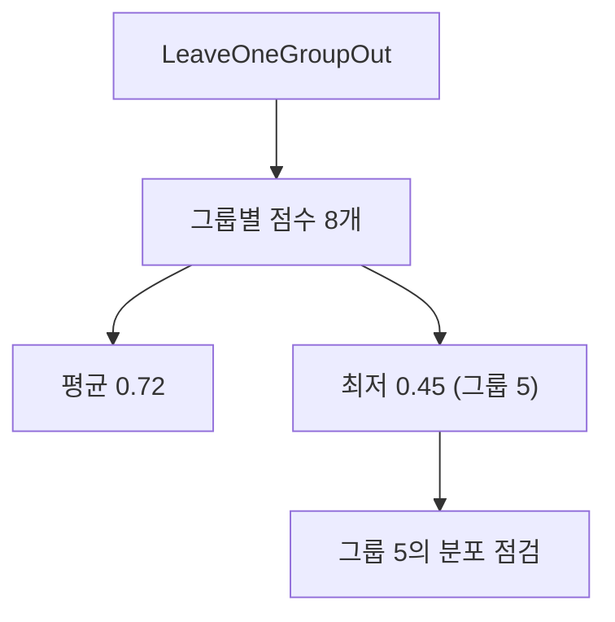

# 그룹별 점수 분석

> 그룹 단위 교차검증(Leave-One-Group-Out 등)을 하면 **그룹마다 점수가 하나씩 나온다.** 평균만 보지 말고 그룹별 점수를 펼쳐 봐야 "특정 환자·기기·지점에서만 성능이 무너지는" 약점이 보인다.

## 쉽게 말하면
반 전체 평균이 72점이라도 모둠별로 보면 한 모둠만 45점일 수 있다. 평균만 보고 "괜찮네"라고 하면 그 모둠은 계속 방치된다.

## 자세히
- **Leave-One-Group-Out(scikit-learn 가이드)**: 폴드마다 특정 그룹 하나의 샘플을 통째로 빼고 시험한다. 그룹 수만큼 폴드가 생기므로 `cross_val_score(..., groups=g, cv=LeaveOneGroupOut())`는 **그룹당 점수 하나**를 돌려준다. 이것이 그룹별 점수 분석의 재료다.
- **직접 실험(scikit-learn 1.9.1, 합성 데이터)**: 8개 그룹 각 60샘플인 2차원 이진 분류. 그룹 5만 분포를 크게 이동시켰다. LOGO 그룹별 정확도 `[0.77 0.72 0.80 0.75 0.82 0.45 0.65 0.80]`, 평균 0.719. 무작위 8-폴드는 평균 0.740으로 그룹 이동이 평균에 크게 드러나지 않았고, 그룹 5의 0.45(우연 수준)는 그룹별 점수에서만 보인다.
- **무엇을 볼까**
  1. **최저 그룹**: 가장 나쁜 그룹이 서비스의 최악 경험이다(평균이 아니라 최저·하위 분위수).
  2. **그룹 간 퍼짐**: 표준편차가 크면 새 그룹에 일반화가 불안정하다.
  3. **그룹 크기와 함께**: 샘플이 적은 그룹의 점수는 노이즈가 크다. 크기를 같이 표로 본다.
  4. **원인 추적**: 나쁜 그룹의 입력 분포(센서, 병원, 지역)를 학습 그룹과 비교해 분포 이동을 확인한다([드리프트](#data-drift)).
- **공정성 점검과 연결**: 그룹을 인구 집단으로 정하면 집단별 성능 격차를 보는 것이 된다(해석은 용도에 따라).
- 주의: 그룹이 적으면 그룹별 점수 자체가 표본 몇 개의 결과라 과해석하지 않는다.

## 그림으로 보기



## 예시
```python
from sklearn.model_selection import LeaveOneGroupOut, cross_val_score
scores = cross_val_score(model, X, y, groups=hospital_id, cv=LeaveOneGroupOut())
for h, s in zip(sorted(set(hospital_id)), scores): print(h, round(s, 2))
```
- 병원 8곳 중 한 곳만 정확도가 낮다 → 그 병원 장비 영상 특성 점검.

## 헷갈리는 것과 비교
| 개념 | 차이 |
|---|---|
| 그룹별 점수 | 그룹마다 하나(LOGO) |
| [슬라이스별 통계](#data-statistics-slicing) | 데이터 *기술 통계*를 조각별로 |
| [Leave-P-Groups-Out](#leave-p-groups-out) | 그룹 P개 조합이라 점수가 조합마다 |
| 전체 평균 | 약점을 가림 |

## 더 읽을거리
- [scikit-learn 교차검증 가이드 — Leave One Group Out](https://scikit-learn.org/stable/modules/cross_validation.html) — LOGO 정의·예제와 환자 ID 비유.
