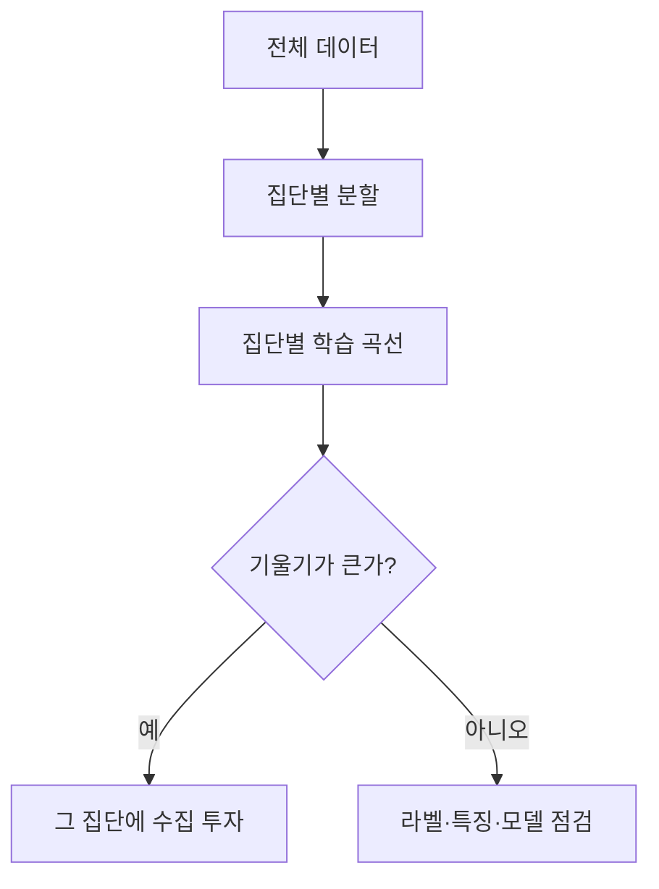
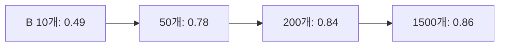

# 슬라이스별 학습 곡선

> 전체 평균 점수 하나가 아니라 **하위집단(슬라이스)별로 학습 곡선을 따로 그려**, 어느 집단에 데이터를 더 모아야 효과가 있는지 추정하는 방법이다. 평균은 다수 집단에 가려 약한 집단의 상태를 못 보여 준다.

## 쉽게 말하면
반 평균 점수가 88점이어도, 전학 온 소수 학생들만 따로 보면 50점일 수 있다. 평균만 보고 "문제집을 더 사 줄 필요 없다"고 하면 그 학생들은 계속 방치된다. 집단별로 점수 변화를 따로 그려야 어디에 문제집을 더 줘야 하는지 보인다.

## 자세히
- 학습 곡선은 학습 크기를 늘릴 때의 학습·검증 점수 변화다. scikit-learn 가이드는 간극이 크면 데이터 추가가 도움이 되고, 두 점수가 낮게 수렴하면 도움이 적다고 설명한다(열어 확인). 이를 **집단마다** 적용한다.
- 직접 실험(scikit-learn 1.9.1, 랜덤 포레스트 100그루, 합성 가우시안 4차원): 다수 집단 A는 3,000개로 고정하고 소수 집단 B(분포·경계가 다름)만 개수를 늘렸다. 정확도 A / B / 전체:

| B 학습 수 | A | B | 전체 |
|---|---|---|---|
| 10 | 0.880 | 0.485 | 0.683 |
| 50 | 0.879 | 0.783 | 0.832 |
| 200 | 0.878 | 0.837 | 0.858 |
| 800 | 0.882 | 0.862 | 0.872 |
| 1,500 | 0.876 | 0.864 | 0.870 |
- 해석: A는 처음부터 0.88 근처에서 평평하므로 A에 더 모아도 이득이 없다. B는 10→50개에서 0.49→0.78로 급상승하다 200개 이후 완만해진다. 전체 평균만 보면 이 구분이 안 보인다.
- 쓰는 순서(제안): ① 집단을 정의(지역·언어·제품군 등) ② 집단별 검증 점수를 학습 크기 몇 지점에서 측정 ③ 기울기가 큰 집단에 수집 예산 배정 ④ 기울기가 평평한 집단은 라벨 품질·특징·모델부터 점검([나쁜 학습 곡선](#bad-learning-curves)).
- 주의: 집단의 검증 표본이 작으면 곡선이 흔들린다. 반복·신뢰구간이 필요하다. 이 결과는 합성 데이터의 한 설정이다.

## 그림으로 보기

## 예시
- 다국어 고객 문의 분류기: 영어 0.92, 베트남어 0.55. 베트남어 곡선만 가파르면 베트남어 라벨 수집이 효율적이다.
- 교육: "평균의 함정" 사례로 쓰기 좋다. 학급 평균과 소수 집단 점수를 따로 보는 습관을 가르친다.

## 헷갈리는 것과 비교
| 개념 | 차이 |
|---|---|
| 전체 학습 곡선 | 평균 기준, 집단 차이가 가려짐 |
| 슬라이스별 곡선 | 집단마다 수집 효과 추정 |
| [외삽](#extrapolation-optimism) | 곡선을 먼 크기로 연장할 때의 낙관 편향 |

## 더 읽을거리
- [scikit-learn 학습 곡선 가이드](https://scikit-learn.org/stable/modules/learning_curve.html) — 간극과 수렴으로 데이터 추가 효과를 읽는 법.
