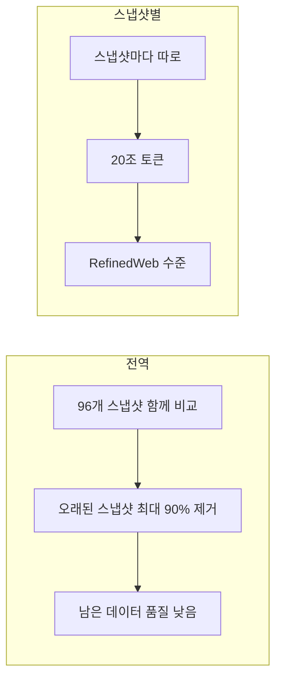
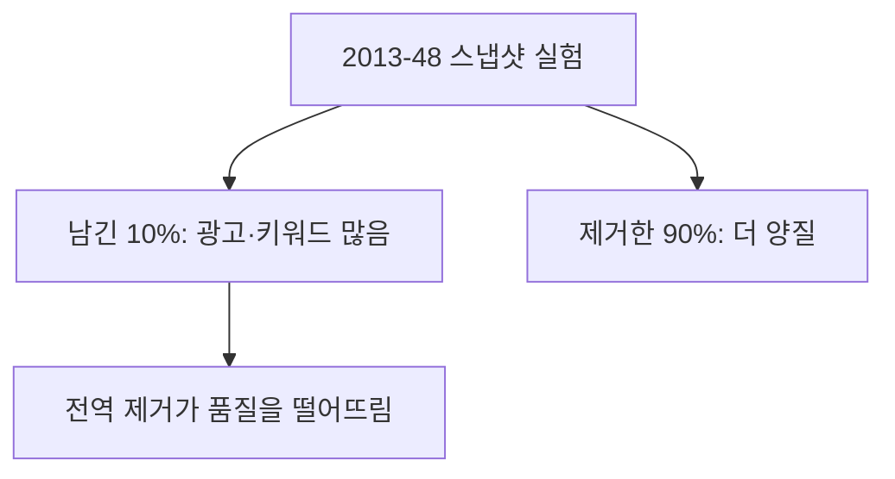

# 스냅샷별 vs 전역 중복 제거

> 웹 크롤링 데이터(Common Crawl)를 중복 제거할 때, 모든 스냅샷을 한꺼번에 비교하는 전역 방식보다 스냅샷마다 따로 제거하는 방식이 더 좋은 모델을 낳았다는 FineWeb의 실험 결과다. "중복을 더 많이 지울수록 좋다"는 가정이 깨진 사례다.

## 쉽게 말하면
책장을 정리하며 "같은 책은 한 권만 남기자"고 오래된 책부터 지웠더니, 오래된 쪽에 남은 책이 광고 전단 같은 품질 낮은 것뿐이었다. 같은 주제 책이 여러 해에 걸쳐 나와 있다면 해마다 따로 정리하는 편이 좋은 책을 더 많이 살린다.

## 자세히
(FineWeb 논문 arXiv 2406.17557의 PDF 본문을 직접 내려받아 확인.)
- **데이터**: 96개 Common Crawl 스냅샷에서 만든 15조 토큰 데이터셋(초록).
- **MinHash 설정(논문)**: 문서의 5-그램을 모아 해시 함수 112개로 MinHash를 계산하고 **8개씩 14개 버킷**으로 나눠, 한 버킷의 8개가 모두 같으면 같은 문서로 매칭. 약 75% 이상 유사한 문서를 겨냥한다. 후보 확률은 1−(1−s⁸)¹⁴ — 계산하면 s=0.5에서 약 5%, s=0.75에서 약 77%, s=0.9에서 약 100%에 가깝다. ([MinHash·LSH](#minhash-lsh)의 밴딩 식과 같다.)
- **전역 제거**: 가장 최근 스냅샷(2023-50)부터 시간 역순으로 이전 스냅샷과 비교하며 지웠다. 가장 오래된 스냅샷에서는 기본 필터링 데이터의 **최대 90%** 가 제거됐다. 결과는 4조 토큰. 그중 3,500억 토큰 무작위 표본으로 학습한 ablation 모델은 중복 제거 안 한 데이터와 비교해 개선이 작았고 RefinedWeb에 한참 못 미쳤다.
- **원인 조사(2013-48 스냅샷)**: 전역 제거 후 남은 약 310억 토큰(원래의 10%)과, 제거된 약 4,600억 토큰을 스냅샷 내에서만 개별 중복 제거해 얻은 1,710억 토큰으로 모델을 각각 학습. **남은 10%가 제거된 90%보다 품질이 낮았다.** 육안 확인에서도 남은 데이터에 광고·키워드 나열·형식이 깨진 글이 더 많았다. 즉 전역 제거가 좋은 글을 지우고 나쁜 글을 남겼다.
- **스냅샷별 제거**: 같은 파라미터로 각 스냅샷을 독립적으로 제거하니 20조 토큰이 남았고, 전 스냅샷에서 뽑은 표본으로 학습한 모델이 RefinedWeb과 맞먹었다.
- **가벼운 전역 기법도 실패**: URL·줄 단위 등 더 가벼운 전역 중복 제거를 얹어도 스냅샷별 제거보다 나아지지 않았다(부록 E.3). 그래서 추가 중복 제거는 하지 않았다.
- **가설(저자)**: 중복 제거의 주된 이득은 모든 크롤에 퍼진 수십만 문서짜리 거대 중복 군집을 없애는 데서 나오고, 100개 미만의 작은 군집까지 더 지우는 것은 이득이 적거나 해롭다.
- 교훈(제안): 중복 제거는 "얼마나 지웠나"가 아니라 "무엇이 남았나"로 평가한다. 정확 부분 문자열 방식과의 비교는 [정확 부분 문자열 제거](#exact-substring-dedup).

## 그림으로 보기

## 예시
- 사내 문서 10년치를 연도별 보관 폴더로 쌓았다면, 전체를 한 번에 중복 제거하면 옛 문서가 대량 삭제되고 남은 것이 보일러플레이트일 수 있다. 연도별로 제거한 뒤 품질 점검을 한다.
- datatrove의 MinHash 예제를 스냅샷 단위로 돌리는 방식([datatrove](#datatrove)).

## 헷갈리는 것과 비교
| 개념 | 차이 |
|---|---|
| 스냅샷별 제거 | 크롤마다 독립적으로 제거 |
| 전역 제거 | 전체 스냅샷을 함께 비교, 오래된 쪽이 크게 줄어듦 |
| [MinHash·LSH](#minhash-lsh) | 두 방식이 공통으로 쓰는 근접 중복 탐지 기법 |
| [근접 중복 제거](#near-duplicate-removal) | 상위 개념 |

## 더 읽을거리
- [The FineWeb Datasets (arXiv 2406.17557)](https://arxiv.org/abs/2406.17557) — 전역 vs 스냅샷별 실험·MinHash 설정(PDF 본문 확인).
