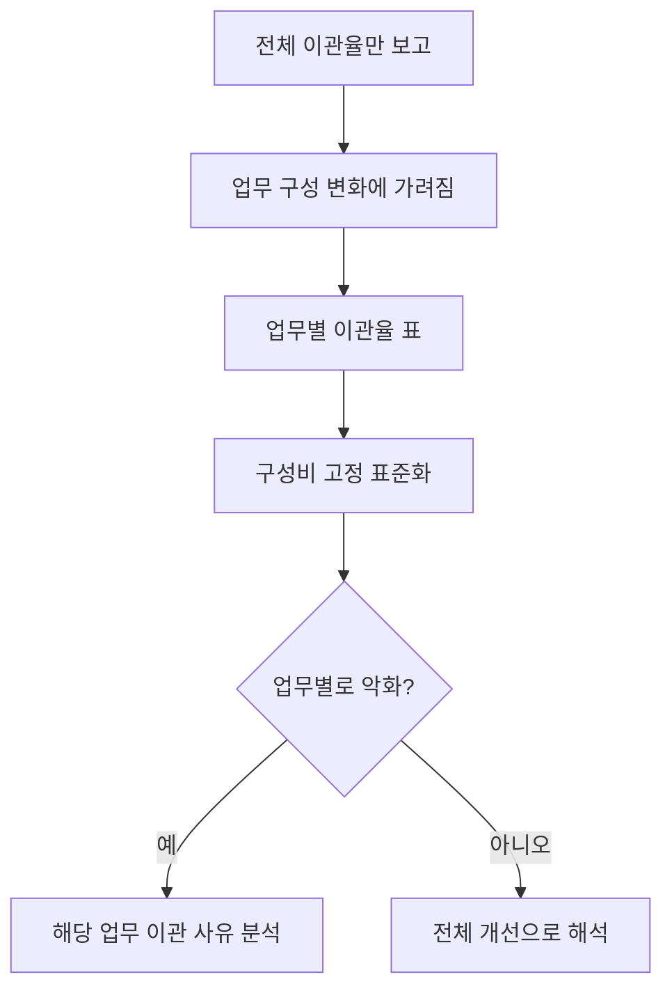

# 업무별 이관율

> 전체 이관율 하나 대신 **문의 유형(업무)별로 이관율을 따로 계산해 보고하는 방식**. 업무 구성이 바뀌면 전체 이관율이 좋아 보여도 모든 업무에서 오히려 나빠졌을 수 있기 때문이다(심프슨의 역설 유형).

## 쉽게 말하면
학교 전체 평균 점수가 올랐는데 모든 과목 점수가 내렸다면 이상하다. 쉬운 과목 응시자가 크게 늘어서 평균이 올라간 것이다. 이관율도 쉬운 업무(배송 조회)가 많아지면 전체가 낮아 보이지만 업무별 실력은 떨어졌을 수 있다.

## 자세히
출처: Wikipedia "Simpson's paradox"(본문 확인)의 개념과 **직접 계산한 가상 사례**(2026-11-18). 이관율 벤치마크는 [에스컬레이션율 목표](#escalation-rate-target)에서 다룬다.
- **심프슨의 역설(Wikipedia)**: 여러 집단 안에서 나타난 경향이 집단을 합치면 사라지거나 뒤집히는 현상. 원인은 교란 변수와 집단 크기의 큰 차이. 예로 신장 결석 치료 A가 두 집단 모두에서 우월한데 합치면 B가 우월해 보이는 경우, 1973년 UC 버클리 입학률에서 전체는 남성이 높지만 학과별로는 여성이 약간 유리했던 경우를 든다.
- **이관율에 적용한 직접 계산(가상)**:

| 업무 | 이전: 건수 / 이관율 | 이후: 건수 / 이관율 |
|---|---|---|
| 배송 조회 | 6,000 / 5% | 8,000 / 6% |
| 환불 | 2,500 / 30% | 1,500 / 35% |
| 해지 | 1,500 / 60% | 500 / 70% |
| **전체** | 10,000 / **19.5%** | 10,000 / **13.6%** |

  전체 이관율이 19.5% → 13.6%로 **좋아졌지만 세 업무 모두 이관율이 올랐다.** 어려운 업무(환불·해지) 비중이 줄고 쉬운 배송 조회가 늘어난 구성 변화 때문이다. 이전 구성비로 고정해(표준화) 이후 업무별 이관율을 적용하면 약 22.9%로 오히려 악화다.
- **보고 방식(제안)**: ①업무별 건수·이관율·추세를 표로 ②구성비 변화를 따로 표시 ③표준화(고정 구성비) 이관율을 병기 ④위험 등급별 목표를 업무별로 설정(전역 임계값 하나 대신).
- **업무를 나누는 기준(제안)**: 위험 수준(읽기 전용·해석·행동), 복잡도, 채널, 언어, 고객 유형. 너무 잘게 나누면 표본이 작아진다([단계별 최소 표본](#minimum-sample-size)).
- **원인 분기**: 업무별 이관율이 오르면 그 업무의 이관 사유를 본다([이관 사유 분류](#escalation-reason-taxonomy), [지식 공백 이관](#knowledge-gap-escalation)).
- **한계**: 업무 분류가 AI 분류에 의존하면 분류 오류가 섞이고, 업무 정의가 바뀌면 추세 비교가 어렵다.

## 그림으로 보기


## 예시
```python
before = {"배송조회": (6000, .05), "환불": (2500, .30), "해지": (1500, .60)}
after  = {"배송조회": (8000, .06), "환불": (1500, .35), "해지": (500, .70)}
overall = lambda d: sum(n*r for n, r in d.values()) / sum(n for n, _ in d.values())
n0 = sum(n for n, _ in before.values())
standardized = sum(before[k][0]/n0 * after[k][1] for k in before)   # 약 0.2285
```
교육 활용: 챗봇 성과 보고서에서 "전체 이관율 개선"이 업무 구성 변화 때문은 아닌지 점검하는 실습.

## 헷갈리는 것과 비교
| 개념 | 차이 |
|---|---|
| 업무별 이관율 | 유형별 이관율을 따로 봄 |
| 전체 이관율 | 구성 변화에 민감한 평균 |
| 표준화 이관율 | 구성비를 고정해 비교 |
| [의도된 이관 vs 실패성 이관](#intentional-vs-failure-escalation) | 이관의 성격을 구분 |

## 더 읽을거리
- [Wikipedia: Simpson's paradox](https://en.wikipedia.org/wiki/Simpson%27s_paradox) — 집단별 경향과 합산 경향이 뒤집히는 원리
- [에스컬레이션율 목표](#escalation-rate-target) — 이관율 벤치마크와 쪼개 보기
