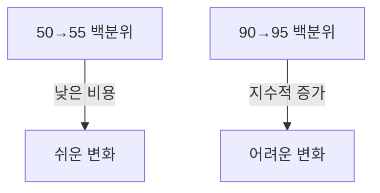

# 백분위 이동 비용

> **백분위 이동 비용(percentile shift cost)**은 어떤 특징을 바꾸는 난이도를 **값의 크기가 아니라 모집단 안에서의 순위(백분위)가 얼마나 움직이는가**로 재는 recourse 비용 함수다. 단위가 달라도 같은 잣대로 비교할 수 있다.

## 쉽게 말하면
"키 5cm 늘리기"와 "연봉 500만원 올리기"는 단위가 달라 어느 쪽이 어려운지 비교하기 어렵다. 대신 "반에서 30등 → 20등"처럼 **순위가 얼마나 올라가야 하는지**로 말하면 둘을 같은 줄 위에 놓을 수 있다.

## 자세히
(Ustun·Spangher·Liu, 「Actionable Recourse in Linear Classification」(arXiv 1809.06514) 3.2~3.4절을 PDF로 직접 읽어 확인.)
- **기본 아이디어**: Q_j(·)를 특징 j의 모집단 누적분포(CDF)라 하면, 행동 전후의 백분위는 Q_j(x_j)와 Q_j(x_j+a_j)다. 논문이 제시하는 기본 비용 함수 두 개는 모두 이 백분위를 쓴다.
- **장점(논문)**: 유클리드 거리와 비교해 (i) **특징의 단위·스케일이 바뀌어도 비용이 안 변한다**, (ii) **모집단의 분포**를 반영한다. 기본값은 특징마다 "1 백분위 이동 = 같은 비용"으로 두어 모든 특징을 똑같이 어렵다고 본다. 이 가정은 전문가가 특징별 상대 난이도를 지정해 완화할 수 있다.
- **최대 백분위 이동 (논문 식 3)**: `cost = max_j [Q_j(x_j + a_j) − Q_j(x_j)]`. 감사(audit)에 적합하다. 최적 비용이 0.25면 "어떤 대안이든 최소 하나의 특징을 25 백분위 이상 바꿔야 한다"는 뜻이다. 또 **느슨한 범위(99 백분위)**로 한 번만 감사한 뒤 비용이 0.5나 0.9를 넘는 사람 수를 세면, 범위를 50/90 백분위로 제한했을 때의 recourse 가능 비율을 한 번에 비교할 수 있다.
- **총 로그-백분위 이동 (논문 식 4)**: `cost = Σ_j log[(1−Q_j(x_j+a_j)) / (1−Q_j(x_j))]`. 이미 높은 백분위일수록 비용이 지수적으로 커진다(소득 90→95가 50→55보다 어렵다). 플립셋을 만들 때 "쉬운 변화"를 우선 보여 주기 위해 쓴다. → [플립셋](#flipset)
- **실험 수치(논문)**: 신용 데이터 ℓ1 패널티 실험에서 recourse 중앙 비용이 0.20→0.39로 올라갔다. 다른 실험에서는 중앙 사람이 0.66, 즉 66 백분위 이동이 필요하다는 결과도 있다. → [recourse와 정규화](#recourse-vs-regularization)
- **한계(제안/주의)**: 백분위는 모집단에 의존한다. 모집단이 바뀌면 같은 행동의 비용이 달라지고, 소수 집단은 다른 분포를 가질 수 있다. 비연속·범주 특징은 백분위 정의가 모호하다.

## 그림으로 보기

## 예시
- 소득 +500만원과 카드 수 −2를 같은 척도로 비교: 소득은 60→70 백분위(10), 카드 수는 80→85 백분위(5)면 후자가 쉬운 변경이다.
- 감사: 비용이 0.9를 넘는 사람 비율을 보고 "극단적 변화를 요구하는 사람"이 얼마나 되는지 판단.

## 헷갈리는 것과 비교
| 개념 | 차이 |
|---|---|
| 백분위 이동 비용 | 순위 변화 기반, 스케일 무관 |
| 유클리드 거리 | 값의 단위·크기에 민감 |
| [도메인 전문가 난이도 가중치](#difficulty-weights-expert) | 특징별 난이도 차이를 보정 |
| [recourse 비용 함수의 성질](#cost-function-properties) | 비용 함수가 가져야 할 단조성 등 |

## 더 읽을거리
- [Actionable Recourse in Linear Classification (arXiv 1809.06514)](https://arxiv.org/abs/1809.06514) — 식 (3)·(4)의 최대/로그 백분위 비용과 감사 사용법(PDF 직접 확인).
