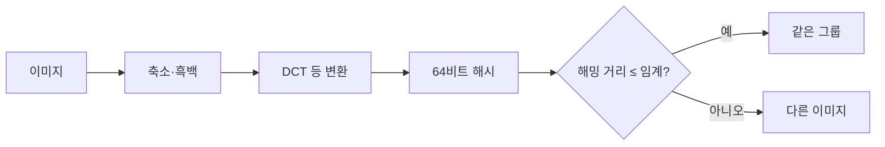
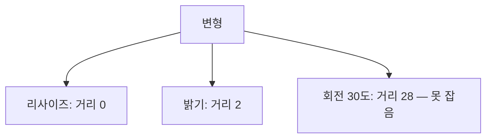

# 지각 해시

> 이미지를 **사람 눈에 비슷하면 비슷한 값이 되도록** 짧은 비트열(보통 64비트)로 줄이는 해시다. 두 해시의 해밍 거리(다른 비트 수)가 작으면 비슷한 이미지로 본다. 증강 전후나 약간 편집된 사진의 중복을 찾을 때 쓴다.

## 쉽게 말하면
일반 해시(SHA)는 글자 하나만 달라도 완전히 다른 값이 나오는 "지문"이다. 지각 해시는 "전체 인상 스케치"에 가까워서, 크기를 줄이거나 밝기를 조금 바꿔도 거의 같은 스케치가 나온다.

## 자세히
- **종류(imagehash 라이브러리 README)**: average hash(평균), perceptual hash(주파수, DCT), difference hash(인접 픽셀 차), wavelet hash, colorhash(색 분포), crop-resistant hash. 앞의 네 가지는 밝기 구조만 본다.
- **비교**: 해밍 거리를 쓴다. 같은 이미지면 0, 서로 다른 이미지일수록 큰 값(README 예: 무관한 두 이미지 33). 임계값을 정해 "이 거리 이하면 같은 이미지"로 본다. 기본 `hashsize=8`이면 64비트.
- **직접 실험(imagehash, 합성 128×128 흑백 이미지)**: 원본 대비 phash 거리 — 리사이즈(64로 줄였다 복원) 0, 밝기 1.2배 **2**, 30도 회전 **28**, 전혀 다른 이미지 **28**. average hash는 리사이즈 0, 밝기 0, 회전 26, 다른 이미지 35. 즉 **크기·밝기 변화는 잡지만 회전은 못 잡는다**(회전한 것이 아예 다른 이미지와 비슷한 거리).
- **한계**: 회전·크롭·강한 필터에는 약하다. 이럴 땐 crop-resistant hash, 회전 후보를 함께 해싱, 또는 이미지 임베딩(CLIP 등) 유사도를 쓴다.
- **AI 데이터에서의 쓰임**: 같은 사진을 증강해 학습/검증에 갈라 넣으면 [증강 그룹 누수](#augmentation-group-leak)가 생긴다. 지각 해시로 근접 중복을 묶어 같은 그룹으로 분할한다.
- **임계값 주의**: 거리 임계값은 데이터 특성에 따라 직접 보정한다. 위 실험의 수치는 합성 이미지 1쌍 기준이라 일반화하지 않는다.

## 그림으로 보기



## 예시
```python
import imagehash
from PIL import Image
h1 = imagehash.phash(Image.open("a.jpg"))
h2 = imagehash.phash(Image.open("b.jpg"))
print(h1 - h2)  # 해밍 거리, 작을수록 비슷
```
- 의료 영상에서 같은 환자의 중복 촬영본을 같은 폴드로 묶기 전 사전 탐지.

## 헷갈리는 것과 비교
| 개념 | 차이 |
|---|---|
| 암호학적 해시(SHA) | 한 비트만 달라도 전혀 다른 값, 완전 중복만 |
| 지각 해시 | 비슷한 이미지는 비슷한 값 |
| 이미지 임베딩 | 의미 유사도, 더 무겁고 유연 |
| [근접 중복 탐지](#near-duplicate-detection) | 텍스트 버전(MinHash) |

## 더 읽을거리
- [imagehash (GitHub)](https://github.com/JohannesBuchner/imagehash) — 해시 종류와 해밍 거리 사용법.
