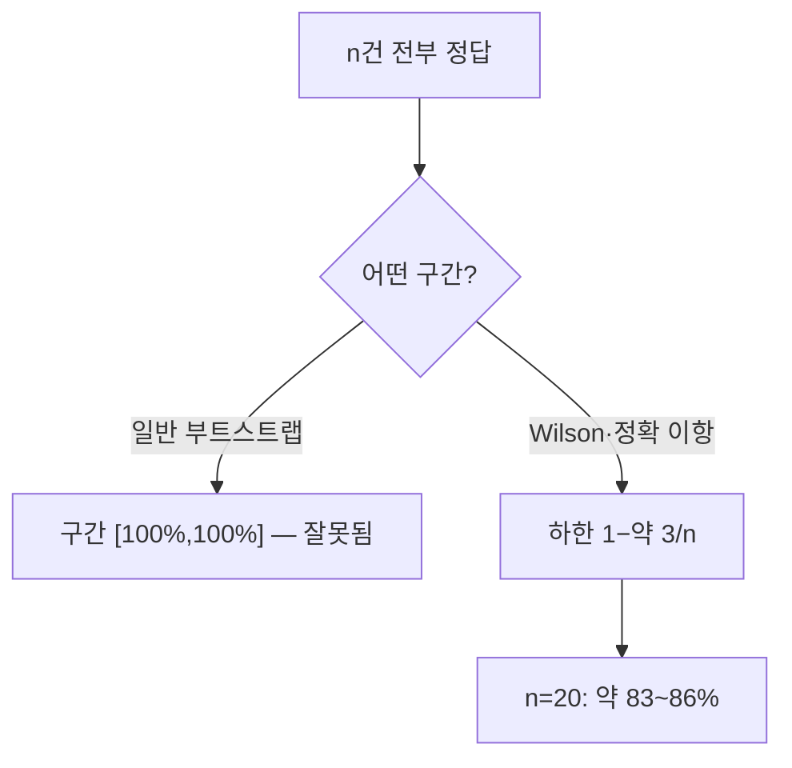
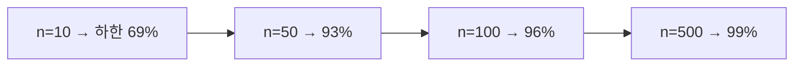

# 만점일 때의 불확실성

> 작은 시험에서 **전부 맞혀도(100%) "진짜 실력이 100%"라는 뜻이 아니다.** 20문제 만점이면 95% 신뢰 하한은 약 83~86%에 불과하다. 그리고 일반 부트스트랩은 만점 표본에서 구간을 [100%, 100%]로 내는 오류를 낸다.

## 쉽게 말하면
신입 직원이 첫 20건을 전부 무사히 처리했다고 "절대 실수 안 한다"고 말하진 않는다. "아직 실수한 적이 없다"일 뿐, 100건쯤 지나야 "실수율이 3% 미만" 정도를 말할 수 있다.

## 자세히
- **3의 법칙(Wikipedia 확인)**: n건에서 사건이 0번이면 발생률의 95% 상한은 약 3/n. 대칭으로 n건 모두 성공이면 성공률 95% 하한은 1−3/n. n>30에서 좋은 근사. 도출: (1−p)ⁿ=0.05 → p≈3/n. 신뢰수준이 다르면 분자가 3.51(97%)·4.61(99%)·5.3(99.5%), 일반식은 −ln(α)/n.
- **직접 계산한 만점 95% 하한(양측 95% 기준 Wilson/정확 단측)**
  | n(전부 정답) | 정확(단측 95%) | 정확(양측 95%) | 3/n 근사 | Wilson |
  |---|---|---|---|---|
  | 10 | 74.1% | 69.2% | 70.0% | 72.3% |
  | 20 | 86.1% | 83.2% | 85.0% | 83.9% |
  | 50 | 94.2% | 92.9% | 94.0% | 92.9% |
  | 100 | 97.1% | 96.4% | 97.0% | 96.3% |
  | 500 | 99.4% | 99.3% | 99.4% | 99.2% |
- **부트스트랩의 함정**(논리적 귀결): 표본이 전부 정답이면 어떤 재표집도 전부 정답이라 모든 반복의 정확도가 100% → 구간이 [1, 1]. 불확실성이 0이라는 말도 안 되는 결론. 이항 정확/Wilson 구간이나 베이지안 구간(Jeffreys)을 써야 한다. 지표가 0/1 경계에 있을 때 일반적으로 부트스트랩이 약하다.
- **실무 의미**: LLM 평가에서 "50문항 만점"은 "진짜 정확도 ≥ 94%"까지만 말해 준다. 안전·규정 요건(예: 오류율 < 1%)을 증명하려면 약 300건 무오류(3/300=1%)가 필요하다.
- **보고 요령**: "20/20 (95% 하한 83%)"처럼 개수와 하한을 함께 적는다.

## 그림으로 보기

## 예시
- 새 프롬프트가 회귀 테스트 40건을 모두 통과 → "오류율 7.4% 이하(약 3/40)"이지 "오류 없음"이 아니다.
- 계산: `1 - 0.05**(1/n)`이 오류율 95% 상한(정확 단측), `3/n`이 암산용 근사.

## 헷갈리는 것과 비교
| 개념 | 의미 |
|---|---|
| 관측 정확도 100% | 표본에서 오류를 못 봄 |
| 진짜 정확도 100% | 표본으로는 증명 불가 |
| [3의 법칙](#rule-of-three) | 0건일 때 상한 3/n |
| [독립 시험 세트 구간](#independent-test-ci) | 일반 이항 구간 |

## 더 읽을거리
- [Wikipedia: Rule of three (statistics)](https://en.wikipedia.org/wiki/Rule_of_three_(statistics)) — 정의·도출·예(열어 확인; 부트스트랩 언급 없음 — 부트스트랩 부분은 논리적 설명).
