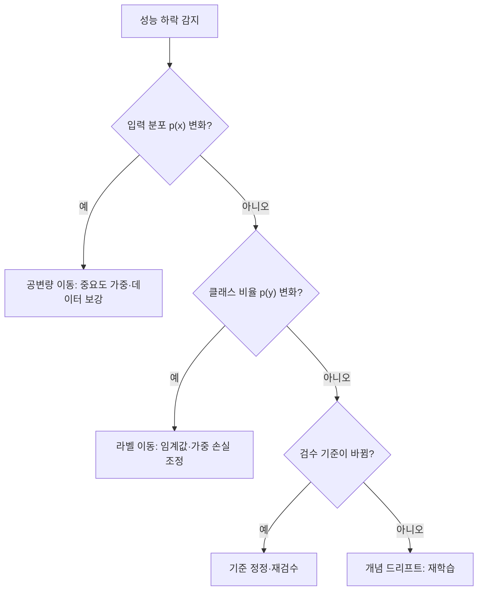
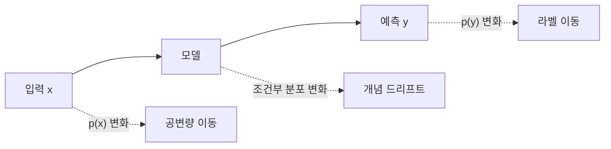

# 성능 하락 원인 분류

> 운영 중 분류기의 성능이 떨어졌을 때, 원인이 **입력 분포 변화(공변량 이동)**, **라벨 비율 변화(라벨 이동)**, **개념 변화(개념 드리프트)**, **라벨링 기준 변화** 중 무엇인지 가려야 처방(가중치 보정·재학습·기준 정정)이 정해진다.

## 쉽게 말하면
식당 매출이 줄었다. 손님 수가 줄었는지(입력 변화), 메뉴 구성이 바뀌어 손님층이 달라졌는지(비율 변화), 같은 손님의 취향 자체가 바뀌었는지(개념 변화), 아니면 매출 집계 방식이 바뀌었는지(기준 변화)에 따라 해결책이 전혀 다르다.

## 자세히
- **공변량 이동(covariate shift)**: p(x)가 변하고 p(y|x)는 그대로. 예: 스팸 필터에 더 긴 메일이 들어오지만 스팸의 특징은 같음. 탐지: 적대적 검증(adversarial validation). 대응: 중요도 가중치.
- **라벨 이동(label shift, 사전확률 이동)**: p(y)가 변하고 p(y|x)는 그대로. 예: 학습은 스팸 50%, 실제는 약 10%. 대응: 새 라벨 분포를 반영한 가중 손실. 정밀도는 흔들리지만 재현율은 안 변하는 것이 단서([시험 세트 비율 불일치](#test-prior-mismatch)).
- **개념 드리프트(concept drift)**: p(y|x) 자체가 변함. 예: 새 스팸 수법으로 같은 특징이 다른 의미. 라벨이 있어야 잡히고 재학습이 필요하며 가장 까다롭다.
- **도메인 이동**: p(x)와 p(y|x)가 함께 변함(2020년 데이터로 학습한 필터가 2023년 스팸을 만나는 경우).
- **라벨 기준 변화**: 모델이 아니라 **검수 기준·지침이 바뀐** 경우. 같은 입력의 정답이 달라져 개념 드리프트처럼 보인다. 검수자 교육·지침 개정 이력을 확인한다.
- **진단 순서(출처 종합: 순차 검정이 실용적)**
  1. 입력 통계(p(x))가 바뀌었는지 → 비라벨 데이터로 가능, 후행 지표 이전의 조기 경보.
  2. 예측 클래스 비율·검수 표본의 클래스 비율(p(y))이 바뀌었는지.
  3. 둘 다 아니면 p(y|x) 변화(개념·기준)를 의심 → 검수 표본에서 같은 입력의 라벨이 달라졌는지 확인.
- **주의**: 범주가 깨끗이 나뉘지 않는다. 라벨 이동이면 보통 입력 분포도 바뀌고, 입력 분포 변화 없이 p(y|x)만 바뀐 것은 비라벨 데이터만으로는 식별 불가. 감시 표본(정밀도·[재현율](#recall-monitoring-via-negatives))이 최종 근거다.

## 그림으로 보기

## 예시
- 문의 분류기가 신제품 출시 후 정밀도가 하락: 입력 단어 분포 변화(공변량) → 신제품 용어 데이터 보강.
- 콘텐츠 검수 정책 개정 후 "정답"이 달라져 갑자기 정확도 하락 → 모델 문제가 아니라 기준 변화이므로 검수 표본을 새 기준으로 재라벨.

## 헷갈리는 것과 비교
| 이동 | 변하는 것 | 고정 | 주된 대응 |
|---|---|---|---|
| 공변량 | p(x) | p(y\|x) | 중요도 가중 |
| 라벨 | p(y) | p(x\|y) | 가중 손실·임계값 |
| 개념 | p(y\|x) | - | 재학습 |
| 도메인 | 둘 다 | - | 목표 도메인 데이터 수집 |

## 더 읽을거리
- [Raschka, Machine Learning Q and AI, ch.23](https://www.sebastianraschka.com/books/ml-q-and-ai-chapters/ch23) — 네 가지 이동의 정의·예·대응(열어 확인).
- [Monitoring 관련 arXiv 2205.08340](https://arxiv.org/pdf/2205.08340v2) — 검색 결과로만 확인(미열람).
