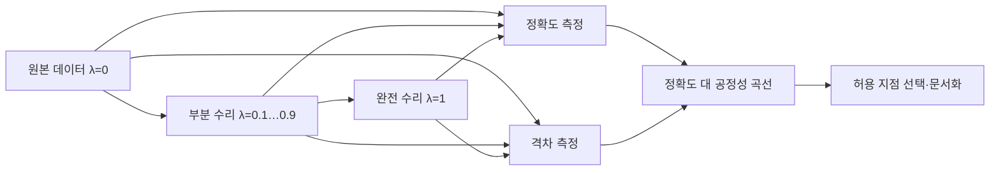

# 성능-공정성 균형

> 격차를 줄이려고 변수를 빼거나 데이터를 고치면 예측 성능이 떨어질 수 있는 **맞교환 관계**와, 그 크기를 숫자로 기록해 판단하는 방법. 항상 큰 손실이 있다고 단정할 수는 없다.

## 쉽게 말하면
볼륨 조절 다이얼처럼 "공정성"을 0에서 1까지 돌려 가며, 돌릴 때마다 정확도가 얼마나 내려가는지 표로 적어 둔다. 어느 지점까지 돌릴지는 사람이 정한다.

## 자세히
출처: Feldman 외 arXiv 1412.3756(PDF를 텍스트로 변환해 5.1·6.2·6.3절 확인, 2026-11-18), [모델 다중성](#model-multiplicity) 노드의 논문 서술. 논문의 정확도·공정성 수치는 그림으로만 제시되어 본문에서 읽은 값이 없다.
- **부분 수리(partial repair)**: 논문은 데이터 분포를 중앙 분포 쪽으로 λ만큼 이동시킨다(λ=0은 원본, λ=1은 완전 수리). 0.1씩 21개 버전(원본 + 조합식·기하식 각 10개)으로 정확도와 공정성을 함께 잰다.
- **실험 데이터**: Ricci(118명), German Credit(1,000건, 나이 25세 기준), Adult Income(48,842건, 성별). 분류기는 로지스틱 회귀·나이브 베이즈 등으로 바꿔 비교했다.
- **논문의 주장**: German과 Adult에서 어떤 공정성 값에 대해서도 부분 수리 데이터를 골라 경쟁 방법보다 높은 정확도를 낼 수 있었다고 한다. Adult에서는 나이브 베이즈 기반이 높은 공정성 구간에서 로지스틱 회귀보다 정확도가 좋았다. 분류기 선택의 영향이 크다는 한계도 적는다.
- **공정성 점수 정의**: 논문은 비교를 위해 Zemel의 공정성 점수를 `1 − ((1−α)−β) = 2·BER`로 둔다([균형 오류율](#balanced-error-rate)).
- **기록 방법(제안)**: 변수 제거나 완화 기법마다 ①성능(AUC·정확도) ②격차(선발률 비, BER) ③선택 사유를 표로 남긴다. 단일 지점이 아니라 곡선을 보고 정한다는 점이 논문의 접근과 일치한다.
- **주의**: 라벨 자체가 과거 편향을 담고 있으면 "정확도 하락"은 편향된 정답과의 불일치일 수 있다(논문도 라벨이 최선의 효용을 대변하지 못할 수 있다고 언급).
- **프록시 맥락**: 우편번호 같은 [프록시 변수](#proxy-variable)를 빼면 성능이 얼마나 떨어지는지가 정당화(사업 필요성) 논의의 핵심 자료가 된다.

## 그림으로 보기

## 예시
| 설정 | AUC | 승인율 비 | 사유 |
|---|---|---|---|
| 원본 | 기록 | 기록 | 기준선 |
| 우편번호 제거 | 기록 | 기록 | 프록시 의심 |
| λ=0.5 수리 | 기록 | 기록 | 절충 후보 |

(표는 기록 양식 예시이며 실제 값이 아니다.) 교육 활용: 비교표를 직접 채우는 실습으로 "공정성은 비용 없이 얻어진다/아니다" 중 한쪽 단정을 피하는 연습.

## 헷갈리는 것과 비교
| 개념 | 차이 |
|---|---|
| 성능-공정성 균형 | 두 지표를 함께 보며 지점 선택 |
| [제약과 성능 트레이드오프](#constraint-performance-tradeoff) | 단조 제약의 성능 비용 |
| [모델 다중성](#model-multiplicity) | 비용 없이 격차가 작은 모델이 있을 수 있음 |
| [공정성 제약 학습](#fairness-constrained-training) | 학습 단계에서 제한하는 방법 |

## 더 읽을거리
- [Feldman 외 arXiv 1412.3756](https://arxiv.org/abs/1412.3756) — 부분 수리와 6.2·6.3절 비교 실험
- [Fairlearn 완화 기법](https://fairlearn.org/main/user_guide/mitigation/index.html) — 정확도-공정성 절충을 직접 탐색하는 도구
