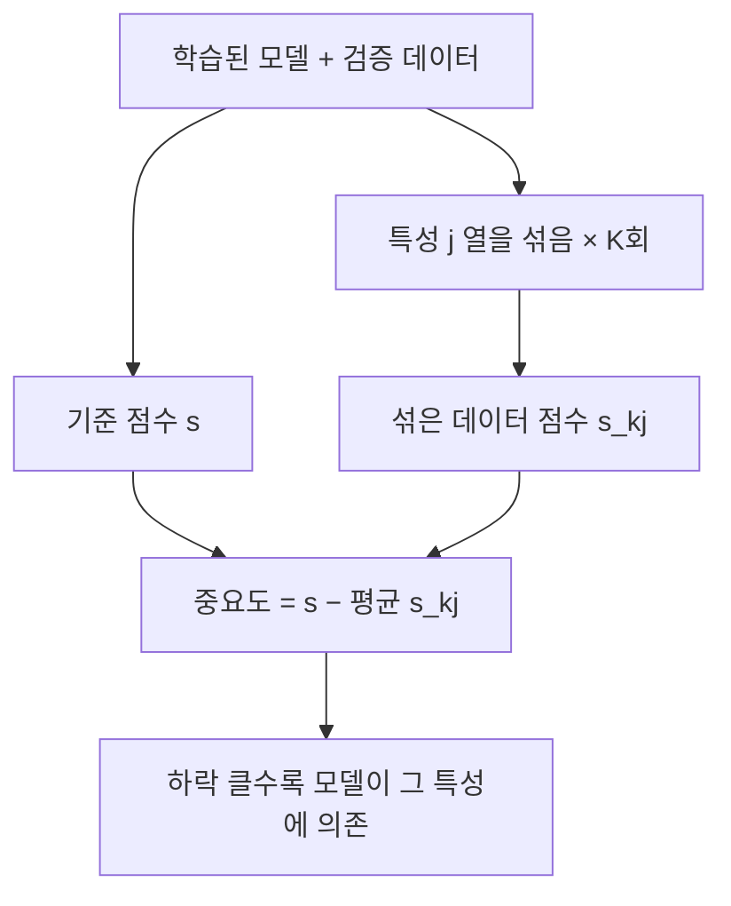

# 순열 중요도

> 한 특성의 값을 **무작위로 섞은** 뒤 모델 성능이 얼마나 떨어지는지를 그 특성의 중요도로 보는 방법. 모델 종류를 가리지 않는 전역 중요도이며, 성능 하락량 기반이라는 점에서 SHAP의 기여 크기 기반 중요도와 다르다.

## 쉽게 말하면
시험 답안지에서 한 문제의 정답 열쇠를 뒤섞어 놓고 점수가 얼마나 떨어지는지 보는 것과 같다. 많이 떨어지면 그 열쇠에 크게 의존하던 것이다.

## 자세히
출처: scikit-learn 사용자 가이드 "Permutation feature importance"(열어서 읽음) + 이 세션에서 문서 예제를 직접 실행한 결과.
- **정의(문서)**: 한 특성 열을 섞어 특성과 목표의 연결을 끊고 점수 하락을 기록한다. 하락이 크면 모델이 그 특성에 의존한다. 모델 불가지론적이며 서로 다른 섞기로 반복해 분산을 추정할 수 있다.
- **알고리즘(문서)**: ① 기준 점수 s 계산 ② 특성 j마다 K번 열 j를 섞어 점수 s_kj 계산 ③ 중요도 i_j = s − 평균(s_kj).
- **함수**: `sklearn.inspection.permutation_importance(model, X, y, n_repeats=..., scoring=..., random_state=...)`.
- **직접 실행(문서 예제, 이 세션)**: Ridge(alpha=1e-2)로 당뇨 데이터셋, `n_repeats=30`. 평균−2×표준편차 > 0인 특성: s5 0.204±0.050, bmi 0.176±0.048, bp 0.088±0.033, sex 0.056±0.023. 문서가 적은 목록(s5, bmi, bp, sex)과 같았다.
- **주의(문서)**:
  - **성능이 낮은 모델**에서 안 중요해 보이는 특성도 좋은 모델에서는 중요할 수 있다. 중요도는 "그 모델에 대한" 중요도이지 특성 자체의 예측력이 아니다.
  - **학습 세트 vs 검증 세트**: 검증 세트에서 계산하면 일반화에 기여하는 특성을 본다. 학습에서만 중요한 특성은 과적합 신호일 수 있다.
  - **상관 특성**: 하나를 섞어도 상관된 다른 특성이 정보를 가지고 있어 둘 다 중요도가 과소평가된다. 상관 특성을 군집화해 하나씩만 두는 방법이 있다.
  - **지표 선택**: `scoring`에 따라 순위가 달라질 수 있고 불균형 분류에서 특히 그렇다.
- **직접 실험(합성, 이 세션)**: y = 4·x0 + x2 + 잡음, x1은 x0의 거의 복사본. 랜덤 포레스트에서 복사본 포함 시 중요도 [x0 1.126, x1 0.115, x2 0.113], 복사본 제거 시 [x0 1.825, x2 0.114]. x0의 중요도가 복사본이 있으면 크게 줄었다. 한 가지 합성 설정의 결과다.

## 그림으로 보기


## 예시
```python
from sklearn.inspection import permutation_importance
r = permutation_importance(model, X_val, y_val, n_repeats=30, random_state=0)
for i in r.importances_mean.argsort()[::-1]:
    print(names[i], r.importances_mean[i], r.importances_std[i])
```
- 점검: 검증 세트로 계산했는가, 상관 특성을 묶었는가, 표준편차와 함께 보고했는가.

## 헷갈리는 것과 비교
| 개념 | 차이 |
|---|---|
| 순열 중요도 | 섞었을 때 성능 하락량 |
| SHAP 특성 중요도 | 평균 절댓값 기여 크기, 성능과 별개 |
| 트리의 불순도 중요도 | 높은 카디널리티 수치형 특성에 편향(문서가 서술), 순열 중요도는 이 편향을 피함 |
| [전역 vs 지역 설명](#global-vs-local-explanation) | 상위 노드 |
| [상관 변수와 SHAP](#feature-correlation-shap) | 상관 변수의 같은 문제 |

## 더 읽을거리
- [Permutation feature importance (scikit-learn)](https://scikit-learn.org/stable/modules/permutation_importance.html) — 정의·알고리즘·주의(열어서 확인)
