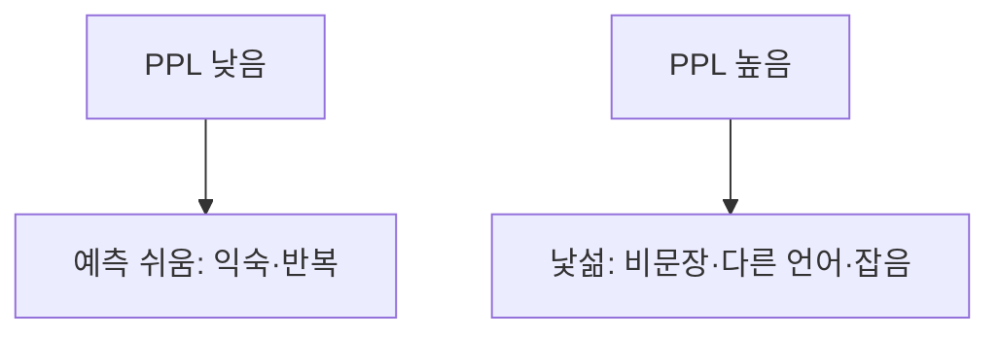

# 퍼플렉서티

> 언어 모델이 어떤 문서를 "얼마나 낯설게 느끼는가"를 나타내는 수치다. 낮을수록 모델이 그 글을 잘 예측한다. 데이터 필터링에서는 좋은 글 말뭉치로 만든 모델의 퍼플렉서티로 문서 품질을 가늠한다.

## 쉽게 말하면
문장 맞히기 퀴즈에서 매 단어마다 "보기 몇 개 중에서 고르는 기분이었나"의 평균이 퍼플렉서티다. 보기 2개 정도면 아주 익숙한 글, 보기 수천 개면 낯선 글이다.

## 자세히
(Hugging Face Transformers 문서 "Perplexity of fixed-length models"를 직접 열어 확인.)
- **정의**: 시퀀스의 **평균 음의 로그우도를 지수화**한 값. PPL(X) = exp(−(1/t)·Σ log p(xᵢ | x<ᵢ)). **데이터와 모델 예측 사이 교차 엔트로피의 지수**와 같다.
- **적용 범위**: GPT 같은 인과(자기회귀) 모델에 정의된다. BERT 같은 마스크드 모델에는 제대로 정의되지 않는다.
- **토큰화 영향**: 토큰 단위가 다르면 점수를 직접 비교할 수 없다.
- **문맥 길이 한계**: GPT-2 large는 1024토큰까지만 본다. 시퀀스를 겹치지 않는 조각으로 나눠 합산하면 문맥이 줄어 PPL이 나빠진다. 슬라이딩 윈도(stride)로 계산하면 더 정확하다. 문서의 WikiText-2 예: stride 1024에서 19.44(GPT-2 논문 보고 19.93과 비슷), stride 512에서 16.44.
- **필터링에서의 쓰임(제안)**: 위키백과 등으로 만든 [KenLM](#kenlm) 같은 모델의 PPL이 너무 높으면 저품질·비문장, 너무 낮으면 반복·정형 문서일 수 있다. PPL이 낮다고 좋은 글은 아니다(Gopher 부록은 반복 텍스트에 높은 가능도가 붙을 수 있다고 지적).

## 그림으로 보기

## 예시
- 위키 기반 모델로 크롤 문서 PPL을 계산해 상·하위 5%를 사람이 검토.
- 교육 활용: "점수 하나로 품질을 판단할 때의 함정"을 보여 주는 사례.

## 헷갈리는 것과 비교
| 개념 | 차이 |
|---|---|
| 퍼플렉서티 | 모델의 낯섦 정도(낮을수록 예측 잘함) |
| 정확도 | 맞힌 비율. 생성 모델 평가에는 직접 쓰기 어려움 |
| 교차 엔트로피 | 퍼플렉서티는 그 지수 |

## 더 읽을거리
- [Perplexity of fixed-length models (Hugging Face)](https://huggingface.co/docs/transformers/perplexity) — 정의, 슬라이딩 윈도, GPT-2 코드.
