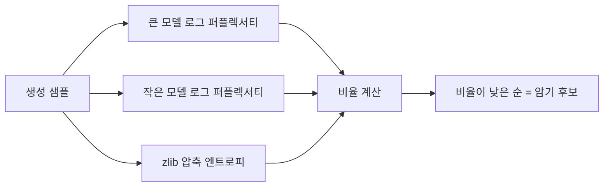
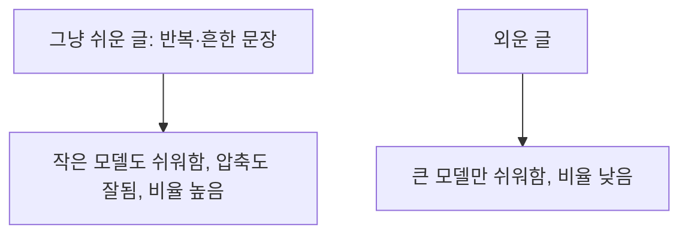

# 퍼플렉서티 비율 척도

> 모델이 어떤 글을 "너무 쉽게" 맞히는지만 보면 흔한 문장도 걸린다. 그래서 **다른 기준(작은 모델, zlib 압축)의 놀람 정도와 비교한 비율**로 "정말 외웠다"는 신호만 골라내는 것이 퍼플렉서티 비율 척도다.

## 쉽게 말하면
시험에서 만점을 받은 학생이 외운 것인지 원래 쉬운 문제였는지 구분하려 한다. 쉬운 문제는 누구나(작은 모델, 압축기) 쉽게 풀고, 외운 문제는 이 학생만 유난히 쉽게 푼다. 두 점수를 비교해 "이 학생만 유난히 쉬워했는가"를 보는 것이다.

## 자세히
- **배경**(Carlini 외 2021, arXiv 2012.07805, ar5iv 확인): 추출 공격은 GPT-2 XL에서 샘플 약 20만 개를 만든 뒤 순위를 매겨 후보를 고른다. 퍼플렉서티(낮을수록 모델이 확신)만 쓰면 흔한 문구·반복 텍스트가 상위를 차지하므로, XL과 **GPT-2 Small·Medium**의 비율, **zlib 압축 엔트로피** 대비 비율, **소문자 변환** 대비 비율, **50토큰 창의 최소 퍼플렉서티**를 함께 쓴다. 가장 좋은 구성(인터넷 조건 샘플을 zlib 비율로 순위)은 상위 100개 중 67%가 실제 학습 데이터였다.
- **직접 계산**(Hugging Face `gpt2`를 큰 모델, `distilgpt2`를 작은 모델 대역으로 사용. 문장 5개 각 1회):
  - `logppl` = gpt2의 로그 퍼플렉서티(평균 토큰당 nat), `작은모델비` = gpt2 logppl / distilgpt2 logppl, `zlib비` = (gpt2 총 nat) / (zlib 압축 비트 수).

| 텍스트 | logppl | 작은모델비 | zlib비 |
|---|---|---|---|
| MIT 라이선스 | **0.38** | **0.61** | **0.016** |
| 새로 지은 문장 | 4.85 | 0.90 | 0.147 |
| 반복 문구(같은 문장 12번) | 0.64 | 0.96 | 0.201 |
| 임의 숫자 | 5.53 | 0.98 | 0.346 |
| 뉴스풍 문장 | 3.18 | 0.97 | 0.094 |

- 해석: logppl만 보면 반복 문구(0.64)도 MIT(0.38)처럼 "쉬운 글"이다. 그러나 반복 문구는 zlib으로도 잘 압축되고(272비트) 두 모델이 비슷하게 쉬워해 비율이 높아진다(0.96, 0.201). MIT 문구만 **큰 모델이 작은 모델보다 훨씬 더** 쉬워해(0.61) zlib비도 가장 낮다(0.016). 즉 "남들보다 이 모델만 유독 쉬워하는" 신호가 암기 후보다. 한계: distilgpt2는 gpt2를 증류한 모델이라 완전히 독립된 기준이 아니고, 문장 5개·1회라 통계가 아니다. 참고로 이 실험의 zlib비는 논문이 정의한 척도의 단순화한 변형이다.
- **쓰임**: 공격자는 후보를 고르고, 방어자는 같은 척도로 자기 모델의 위험 문장을 먼저 찾아본다(제안).

## 그림으로 보기

## 예시
- 사내 모델 점검: 생성 샘플 수천 개를 위 비율로 정렬해 상위 후보를 학습 말뭉치와 대조([k-eidetic 확인](#k-eidetic-memorization)).
- 교육: 반복 문구와 라이선스 문구를 비교해 "낮은 퍼플렉서티 ≠ 암기"임을 보여 준다.

## 헷갈리는 것과 비교
| 개념 | 차이 |
|---|---|
| 퍼플렉서티 | 모델의 놀람 정도. 낮으면 쉬운 글 |
| 퍼플렉서티 비율 | 기준 모델 대비로 정규화한 신호 |
| zlib 엔트로피 | 압축기가 보는 글의 복잡도 |
| [멤버십 추론](#membership-inference-metrics) | 이런 척도들로 학습 포함 여부를 추정 |

## 더 읽을거리
- [Extracting Training Data from Large Language Models — ar5iv](https://ar5iv.labs.arxiv.org/html/2012.07805) — 여섯 척도와 결과(열어 확인).
- [distilgpt2 모델 카드](https://huggingface.co/distilgpt2) — gpt2를 증류한 작은 모델(직접 내려받아 사용).
