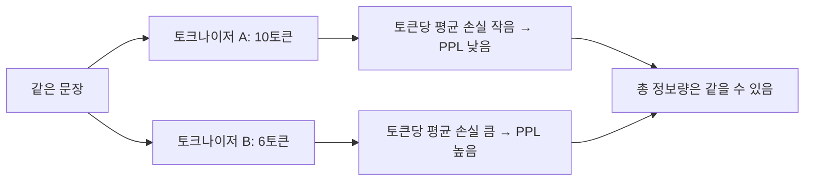

# PPL과 토크나이저

> 퍼플렉시티(PPL)는 "토큰" 단위로 계산한다. 그래서 토크나이저가 다른 모델끼리는 PPL 숫자를 그대로 비교할 수 없다.

## 쉽게 말하면
두 사람이 같은 책을 읽고 "한 번에 몇 쪽씩 틀렸나"를 비교한다고 하자. 한 사람은 낱글자 단위로, 다른 사람은 단어 단위로 채점하면 점수의 규모부터 다르다. PPL도 똑같다. 글을 잘게 쪼개는 토크나이저는 토큰 하나를 맞히기 쉬워져 PPL이 낮아 보이고, 크게 쪼개는 쪽은 높아 보인다. 모델 실력과 무관하게 말이다.

## 자세히
- 정의(Hugging Face 문서): PPL은 시퀀스의 평균 음의 로그우도를 지수화한 값, 곧 교차 엔트로피의 지수다. 식은 `PPL = exp(-(1/t) Σ log p(x_i | x_<i))`.
- 문서는 "토큰화 방식이 모델의 PPL에 직접 영향을 주므로 모델을 비교할 때 항상 고려해야 한다"고 못박는다. BERT 같은 마스크 언어 모델에는 정의되지 않는다.
- 같은 텍스트라도 토크나이저가 만드는 **토큰 수가 다르다**. 합계 손실(총 비트)은 비슷해도 토큰 수로 나누면 평균이 달라진다.
- 비교 가능하게 하는 법: ① 같은 토크나이저를 쓰는 모델끼리만 비교, ② 토큰이 아닌 문자·바이트당 손실로 환산([BPC](#bits-per-character)), ③ 같은 데이터·같은 컨텍스트 길이·같은 [슬라이딩 윈도](#sliding-window-eval) 설정.
- 평가 설정도 숫자를 바꾼다: 문서의 GPT-2 large + WikiText-2 실험에서 겹침 없는 분할(stride 1024)은 PPL 19.44, stride 512 슬라이딩은 16.44였다.

## 그림으로 보기

## 예시
- 모델 X(PPL 12)와 모델 Y(PPL 18)를 비교하려 한다. 어휘 사전이 다르면 먼저 같은 말뭉치에서 문자당 비트로 바꿔 본 뒤 판단한다.
- 양자화 전후 품질을 볼 때는 같은 모델이므로 PPL 직접 비교가 유효하다([양자화 품질 점검](#quantization-quality)).

## 헷갈리는 것과 비교
| 개념 | 차이 |
| --- | --- |
| [퍼플렉시티](#perplexity) | 토큰 단위 평균 불확실성 |
| [BPC](#bits-per-character) | 문자 단위로 환산해 토크나이저 영향을 줄임 |
| 정확도 | 맞힌 비율. PPL은 확률 분포 품질 |

## 더 읽을거리
- [Hugging Face: Perplexity of fixed-length models](https://huggingface.co/docs/transformers/perplexity) — 정의, 토큰화 영향, 슬라이딩 윈도 코드와 실험값
