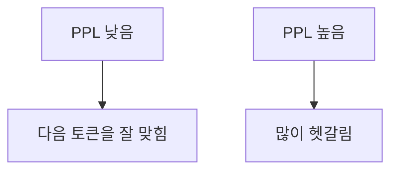

# 퍼플렉시티

> 퍼플렉시티(PPL)는 언어 모델이 다음 토큰을 얼마나 헷갈려 하는지 재는 지표다. 평균 음의 로그 가능도의 지수값이며 낮을수록 좋다.

## 쉽게 말하면
"다음에 올 단어를 몇 개 후보 중에서 고르는 느낌인가"로 읽는다. PPL이 20이면 평균적으로 20개 정도의 후보 사이에서 망설인다는 직관이다(직관일 뿐 정확한 후보 수는 아니다).

## 자세히
Hugging Face 문서 기준:
- 정의: PPL(X) = exp{ −(1/t) Σ log p(xᵢ | x₍<i₎) }. 즉 [교차 엔트로피](#cross-entropy)를 지수화한 값이다.
- 인과(자기회귀) 언어 모델용이고 BERT 같은 마스크드 모델에는 잘 정의되지 않는다([다음 토큰 예측](#next-token-prediction)).
- **토큰화가 PPL에 직접 영향**을 주므로 토크나이저가 다른 모델끼리의 PPL 비교는 조심해야 한다([토큰화](#tokenization)).
- 고정 길이 모델(GPT-2 large는 1024토큰)은 입력이 길면 잘라서 평가해야 한다. 겹치지 않게 자르면 문맥이 부족해 PPL이 나쁘게 나오고, **슬라이딩 윈도**가 더 정확하다. 문서 예: WikiText-2에서 stride 1024일 때 19.44, stride 512일 때 16.44.
- 한계: PPL이 낮다고 대화 품질·사실성이 좋다는 뜻은 아니다. 지시 따르기·추론은 별도 [벤치마크](#ai-evaluation)로 본다.

## 그림으로 보기

## 예시
- 같은 위키 텍스트에서 모델 A의 PPL 12, 모델 B의 PPL 18이면 같은 토크나이저일 때 A가 텍스트를 더 잘 예측한다.
- 양자화한 모델을 원본과 비교할 때 PPL이 얼마나 오르는지로 품질 손실을 간단히 점검한다(자주 쓰는 방식).

## 헷갈리는 것과 비교
| 개념 | 차이 |
|---|---|
| 퍼플렉시티 | 언어 모델링 능력(예측 불확실성) |
| 벤치마크 점수 | 과제 해결력(추론·코딩 등) |
| [손실](#loss-function) | 학습용 값. PPL은 그 지수 변환 |

## 더 읽을거리
- [Hugging Face: Perplexity of fixed-length models](https://huggingface.co/docs/transformers/perplexity) — 정의, 슬라이딩 윈도, GPT-2 예제.
