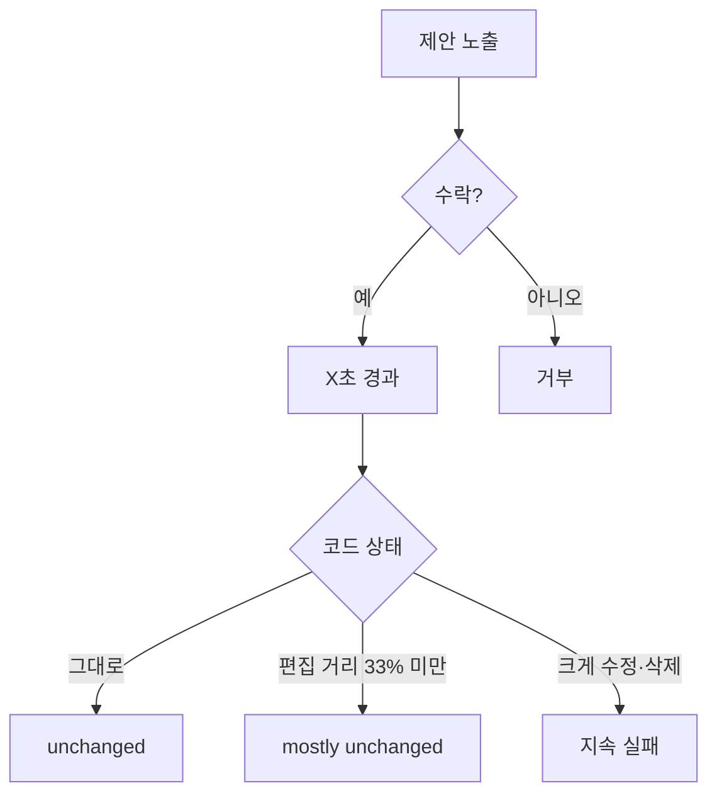

# 지속성 지표 (Persistence)

> AI가 제안해 수락된 결과가 **일정 시간이 지난 뒤에도 수정되지 않고(또는 조금만 수정되고) 남아 있는 비율**. 수락된 제안이 실제로 쓸 만했는지를 수락 순간이 아니라 시간이 지난 뒤에 보는 지표다.

## 쉽게 말하면
식당에서 주문을 받은 직후가 아니라, 10분 뒤에 그 요리가 테이블에 남아 있는지(반품되지 않았는지) 보는 것이다. 처음에는 받아들였지만 곧 고쳐 쓰거나 지웠다면 제안이 별로였다는 신호다.

## 자세히
출처: Ziegler 외, GitHub Copilot 생산성 연구(arXiv 2205.06537, ar5iv HTML 본문 확인, 2026-11-18). 코드 제안에 대한 정의이며, 문서·상담 요약 같은 다른 업무에 그대로 적용된다는 근거는 아니다.
- **정의(논문)**: 수락된 완성 제안이 X초 뒤에도 **변경 없이 남는지**(unchanged_X), **조금만 수정되고 남는지**(mostly_unchanged_X: 레벤슈타인 거리 33% 미만). 관찰 창은 30·120·300·600초.
- **비율**: 지속률 = unchanged_X ÷ 수락 건수, 퍼지 지속률 = mostly_unchanged_X ÷ 수락 건수. 수락률은 수락 ÷ 노출된 제안.
- **측정 지표 목록**: 노출률, 수락률, 지속률·퍼지 지속률, 효율(기회당 수락·지속), 기여 속도(시간당 수락 문자 수), 수락·지속 빈도, 노출 총량 등.
- **연구 규모**: 설문 17,420명에게 메일, 사용 데이터와 연결된 응답 2,047건(3.2절). 서론에는 2,631건이라는 다른 숫자가 있어 논문 내 불일치가 있다. 상관 표는 N≈1,780~1,789.
- **핵심 결과(스피어먼 상관, 종합 생산성 인식과)**: 수락률(accepted_per_shown) ρ=0.24가 최고. 퍼지 지속(30초) 0.23, 지속 30초(노출당) 0.21, 지속 600초(노출당) 0.17. 수락당 지속률은 0.06~0.07, 600초 지속률은 −0.00. 창이 길어질수록 지속 지표의 상관이 약해졌다. 논문은 "수락률이 다른 지표보다 인식 생산성을 더 잘 예측한다"고 쓴다.
- **해석(제안)**: 이 결과는 인식 생산성과의 상관이다. 지속성은 인식 생산성은 잘 설명하지 못했지만, 제안의 실제 쓰임을 보는 별개의 정보로서 가치가 있을 수 있다(논문이 주장한 것은 아니다).
- **적용 시 결정할 것**: ①창 길이 ②"조금 수정"의 임계값(정규화 편집 거리 33% 등) ③자동 포맷팅이 만든 변경을 제외할지.

## 그림으로 보기

## 예시
- 수락 100건 중 30초 뒤 그대로인 건이 62건 → 지속률 0.62(가상 값, 계산 양식 예시). 10분 뒤 41건 → 0.41로 낮아지면 수락 후 고쳐 쓰는 비율이 높다는 신호.
- 교육 활용: AI 코딩·문서 도구 도입 평가에서 수락률만 쓰는 보고서를 수락률+지속률 이중 지표로 바꾸는 실습.

## 헷갈리는 것과 비교
| 개념 | 차이 |
|---|---|
| 수락률 | 노출된 제안 중 받아들인 비율(순간) |
| 지속률 | 수락된 제안이 시간이 지나도 남는 비율 |
| [무수정 수락률](#accept-without-edit-rate) | 수락 시점의 수정 여부 |
| [수락률과 품질의 관계](#acceptance-quality-link) | 수락률이 품질이 아니라 인식을 반영한다는 논의 |

## 더 읽을거리
- [Ziegler 외 arXiv 2205.06537](https://arxiv.org/abs/2205.06537) — Copilot 사용 지표 정의와 상관 분석
- [ar5iv HTML 판](https://ar5iv.labs.arxiv.org/html/2205.06537) — 표·측정 정의 본문
