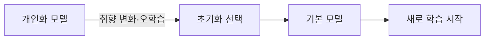

# 개인화 초기화

> 사용자의 취향이 바뀌거나 개인화가 잘못 학습됐을 때 **과거 선택을 지우거나 모델을 기본(비개인화) 상태로 되돌리는** 통제다.

## 쉽게 말하면
음악 앱이 내 취향을 잘못 파악해 엉뚱한 곡만 추천할 때, "처음 설정으로 돌리기" 버튼이 있으면 다시 시작할 수 있다.

## 자세히
(Google PAIR "Feedback + Control" 챕터를 직접 읽었다.)
- **권고(PAIR)**: 사용자의 선호가 변하므로 **과거 선택을 지우거나 갱신**할 수 있어야 하고, 제품은 "ML 모델을 기본, 비개인화 버전으로 **되돌릴**" 수 있게 해야 한다.
- **연관**: 개인화 데이터 사용 범위와 삭제 가능성은 데이터 사용 설명(범위·도달·삭제)에서 다룬다([예시 기반 설명](#example-based-explanation)의 "데이터 사용" 참고).
- **설계 질문(해석)**: 초기화하면 무엇이 사라지는지(기록, 추천, 설정)를 실행 전에 분명히 보여 주는가?

## 그림으로 보기

## 예시
- 추천 피드에서 "관심 없음" 누적이 잘못된 경우 "내 추천 기록 초기화"를 제공(제안).

## 헷갈리는 것과 비교
| 개념 | 차이 |
|---|---|
| 개인화 초기화 | 취향 기록·모델을 기본으로 |
| [AI 옵트아웃](#ai-opt-out) | AI 기능을 끔 |
| 개별 기록 삭제 | 특정 선택만 지움 |

## 더 읽을거리
- [Google PAIR — Feedback + Control](https://pair.withgoogle.com/chapter/feedback-controls/) — 직접 읽음.
