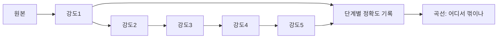
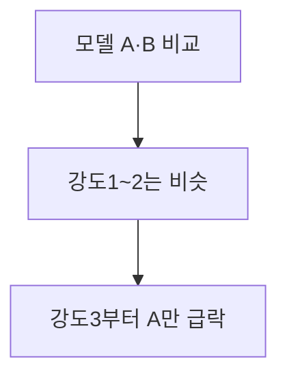

# 변형 강도 단계

> 입력을 변형(노이즈·흐림·오타 등)할 때 강도를 **약함→강함 여러 단계**로 나눠 각 단계의 성능을 재어 곡선으로 보는 방법이다. 한 번의 점수가 아니라 "얼마나 세게 흔들면 무너지는가"를 알려 준다.

## 쉽게 말하면
다리가 얼마나 튼튼한지 알려면 무게를 한 번만 올려 보는 게 아니라 점점 늘려 가며 휘는 정도를 기록한다. 모델도 변형 강도를 1, 2, 3…단계로 올리며 성능이 어디서 꺾이는지 본다.

## 자세히
- **ImageNet-C의 설계(Hendrycks & Dietterich, ar5iv 본문 직접 확인)**: 15개 손상 유형마다 **5단계 강도**, 총 75종. "손상은 다양한 강도로 나타나기 때문"이라는 이유다. mCE는 손상별로 5단계 오류를 **합산**한 뒤 AlexNet의 합산값으로 나눈다. 즉 단계별 성능을 한 숫자로 요약하되, 원 데이터는 단계별로도 볼 수 있다. 범주마다 검증용 손상(speckle noise, Gaussian blur, spatter, saturate)을 따로 둬 과적합을 막는다.
- **언어 모델 쪽 사례(HELM, arXiv 2211.09110, ar5iv 일부 확인)**: 견고성·공정성 지표는 "일련의 섭동에 대한 **최악 사례 정확도**"를 쓴다. 예시로 오타(견고성), 방언 변경(공정성). 보고된 낙차 예: NarrativeQA에서 TNLG v2(530B)가 표준 정확도 72.6%에서 섭동 시 38.9%로 하락. (원 논문의 섭동 구현은 §4.5·부록 D에 있으며 이번에 읽지 못했다.)
- **곡선으로 읽는 법(해석)**: x축 강도, y축 정확도. 완만히 내려가면 점진적 열화, 특정 단계에서 급락하면 임계점이 있다는 뜻이다. 모델 두 개를 같은 그림에 그리면 "정상 조건에서는 비슷하지만 강도 3부터 갈리는" 차이가 보인다.
- **설계 주의**: 강도 단계의 간격은 사람이 정한 기준이므로 서로 다른 변형 사이에서 같은 "3단계"가 같은 난이도라는 보장이 없다. 검증용 변형을 따로 두어 튜닝 과적합을 막는다.

## 그림으로 보기

## 예시
- OCR 모델에 흐림 강도 1~5를 적용해 정확도 곡선을 그리고 현장 카메라 품질이 어느 단계인지 비교.
- 교육 소재: 같은 질문에 오타를 0·1·3·5개 넣어 답이 달라지는 지점을 찾는 실습.

## 헷갈리는 것과 비교
| 개념 | 차이 |
|---|---|
| 변형 강도 단계 | 세기를 올리며 곡선 |
| 단일 변형 점수 | 한 지점만 봄 |
| [ImageNet-C·ImageNet-P](#imagenet-c-p) | 5단계를 쓴 표준 사례 |
| [예측 일관성 지표](#prediction-consistency-metric) | 변형 전후 답이 같은 비율 |

## 더 읽을거리
- [Benchmarking Neural Network Robustness (ar5iv)](https://ar5iv.labs.arxiv.org/html/1903.12261) — 15종×5단계 설계(직접 확인).
- [HELM (arXiv 2211.09110)](https://arxiv.org/abs/2211.09110) — 최악 사례 견고성 지표(ar5iv 앞부분 확인).
