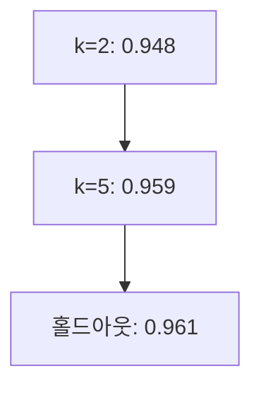

# 작은 k의 비관적 편향

> 교차검증에서 폴드 수 k가 작으면 **매번 학습에 쓰는 데이터가 적어서** 점수가 실제(전체 데이터로 학습했을 때)보다 낮게 나오는 경향이다.

## 쉽게 말하면
교과서 절반만 보고 모의고사를 치르면, 전체를 공부한 본시험보다 점수가 낮게 나온다. 그 낮은 점수로 "내 실력은 이 정도"라고 판단하면 실력을 과소평가하게 된다.

## 자세히
- **원리**: K-폴드의 학습 크기는 `(k-1)n/k`다. k=2면 절반, k=10이면 90%. 학습 곡선이 가파른 구간(데이터가 늘수록 성능이 크게 오르는 구간)에선 이 차이가 점수에 그대로 드러난다. scikit-learn 가이드도 "학습 곡선이 가파르면 5·10-폴드가 일반화 오차를 과대추정할 수 있다"고 쓴다.
- **직접 실험(scikit-learn 1.9.1, digits 학습 1,257개, 로지스틱 회귀)**: 별도 홀드아웃 점수 0.961. K-폴드 점수는 k=2 **0.948**(학습 628), k=3 0.958(838), k=5 0.959(1,006), k=10 0.956(1,131), k=20 0.960(1,194). k=2에서만 눈에 띄게 낮고(약 1.3%p), k≥3부터는 차이가 작았다.
- **해석 주의**: 이 데이터는 학습 곡선이 완만해서 편향이 작게 나온 사례다. 데이터가 적거나 모델이 데이터를 많이 필요로 하면 같은 k에서 훨씬 큰 편향이 생긴다. 한 번의 실험이라 노이즈도 섞여 있다(k=10이 k=5보다 낮은 것은 우연일 수 있다).
- **대응**: ① k를 5~10 이상으로. ② 데이터가 매우 적으면 LOO·반복 K-폴드 고려. ③ 모델 *비교*가 목적이면 모든 후보가 같은 편향을 갖게 같은 k를 쓴다(순위는 보존되는 경우가 많다 — 일반 경험칙). ④ 최종 보고용 점수는 별도 테스트 세트로 확인.
- 편향을 줄이면 분산·비용이 늘어나는 [균형 문제](#cv-variance-bias-tradeoff)다.

## 그림으로 보기

## 예시
- 샘플 100개에 2-폴드로 정확도 70% → 전체 학습 시 78%일 수 있다. 같은 모델을 10-폴드로 다시 재면 격차가 줄어든다.
- 교육: "측정 방식이 측정값을 바꾼다"는 사례.

## 헷갈리는 것과 비교
| 개념 | 차이 |
|---|---|
| 작은 k의 비관적 편향 | 학습량 부족 → 점수 과소 |
| 과적합 낙관 | 누수·튜닝 과다 → 점수 과대 |
| [학습 곡선](#learning-curve) | 이 편향이 큰지 진단하는 도구 |
| [홀드아웃 비교](#holdout-vs-cv-estimates) | 별도 세트 점수와 대조 |

## 더 읽을거리
- [scikit-learn 교차검증 가이드](https://scikit-learn.org/stable/modules/cross_validation.html) — 가파른 학습 곡선에서 5·10-폴드가 오차를 과대추정할 수 있다는 서술.
