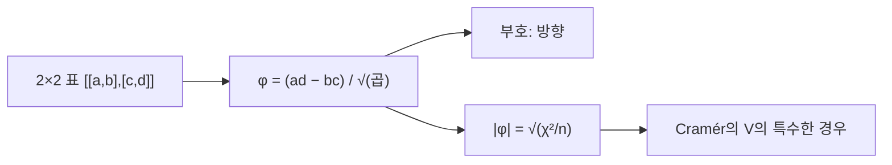

# phi 계수

> 2×2 분할표에서 두 이진 변수의 연관성을 −1~1로 나타내는 지표. 크기(절댓값)는 카이제곱 통계량을 표본 수로 나눈 값의 제곱근과 같고, 이를 더 큰 표로 확장한 것이 Cramér의 V다.

## 쉽게 말하면
"기간(작년/올해)과 결과(성공/실패)가 얼마나 같이 움직이나"를 −1(정반대)에서 +1(완전 일치) 사이 숫자 하나로 말한다. 0에 가까우면 둘은 무관하다.

## 자세히
출처: SciPy 공식 문서 `scipy.stats.contingency.association`(앞서 열어서 읽음: Cramér의 V와 Tschuprow의 T가 phi 계수의 확장이라고 서술) + 이 세션의 직접 계산(scipy 1.17.1). phi 계수의 정의식은 SciPy 문서에 없어 일반 통계 정의를 쓰고 값이 일치하는지 직접 확인했다.
- **정의(일반)**: 2×2 표 [[a, b], [c, d]]에서 φ = (a·d − b·c) / √((a+b)(c+d)(a+c)(b+d)). 부호는 연관의 방향을 나타낸다.
- **카이제곱과의 관계(일반)**: |φ| = √(χ² / n). 표본 수 n으로 나누므로 표본 크기에 따라 부풀지 않는다.
- **직접 계산(합성 표 [[8,2],[3,7]], 이 세션)**: 직접식 φ = **0.4743**(부호는 양수), √(χ²/n) = 0.4743(χ²는 보정 없는 Pearson 값), `association(..., method='cramer')`도 **0.4743**으로 같았다. 2×2 표에서는 Cramér의 V의 크기가 |φ|와 같다는 뜻이다(`min(행, 열) − 1 = 1`이므로).
- **해석(SciPy)**: 1.0은 완전한 연관, 0.0은 연관 없음(함수 문서). 이 문서는 phi 계수 자체가 아니라 V·T에 대한 서술이므로 구간(−1~1)과 부호는 일반 정의다.
- **쓰임**: 두 기간의 이진 특성(예: 승인/거절) 비교에서 효과 크기로, 표본을 늘려도 값이 변하지 않는 변화량을 본다([Cramér의 V](#cramers-v)).
- **한계**: 한 변수의 한계 분포가 매우 치우친 표에서는 최댓값이 1에 못 미친다는 알려진 성질이 있다(일반 설명, 이번 출처로 확인하지 않음).

## 그림으로 보기


## 예시
```python
import numpy as np
a, b, c, d = 8, 2, 3, 7
phi = (a*d - b*c) / np.sqrt((a+b)*(c+d)*(a+c)*(b+d))   # 0.4743
```
- 점검: 두 기간의 이진 특성을 2×2 표로 만들어 φ를 구하고 임계값(조직 기준)과 비교.

## 헷갈리는 것과 비교
| 개념 | 차이 |
|---|---|
| phi 계수 | 2×2 표의 방향 있는 연관(−1~1) |
| [Cramér의 V](#cramers-v) | 더 큰 표로 확장, 0~1 |
| Pearson 상관 | 연속 변수의 선형 상관 |
| 오즈비 | 다른 척도의 연관 효과 크기 |

## 더 읽을거리
- [scipy.stats.contingency.association (SciPy 문서)](https://docs.scipy.org/doc/scipy/reference/generated/scipy.stats.contingency.association.html) — V·T가 phi의 확장이라는 서술(열어서 확인)
