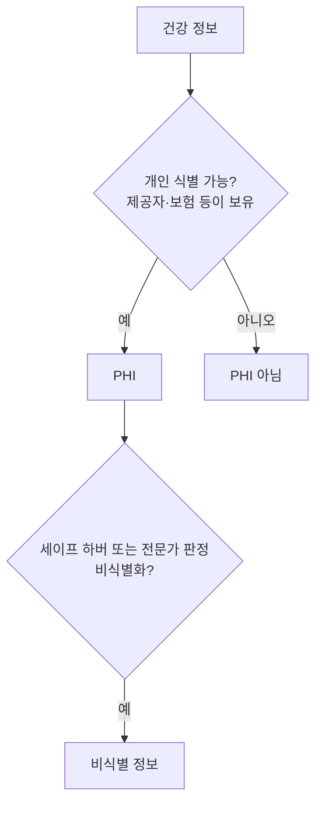
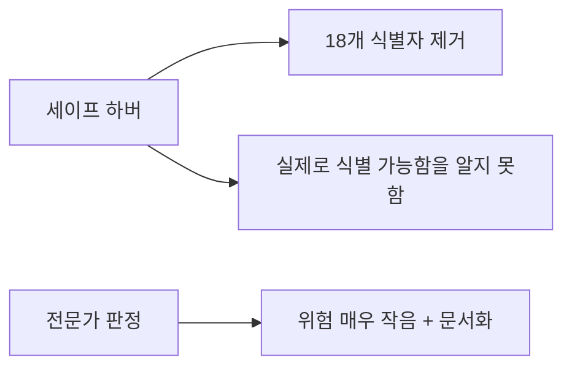

# PHI (보호 대상 건강정보)

> 미국 HIPAA가 보호하는 "개인을 식별할 수 있는 건강 정보". 의료 서비스 제공자·건강보험·청산기관 등이 만들거나 받은 정보로, 과거·현재·미래의 건강 상태, 의료 제공, 의료비 지불과 관련되고 개인을 식별하거나 식별에 쓰일 수 있다고 볼 합리적 근거가 있는 정보다.

## 쉽게 말하면
병원 기록에서 "이름과 연결되는 건강 이야기"는 PHI이고, 이름·주소·번호가 모두 지워져 아무도 누구인지 알 수 없는 통계는 PHI가 아니다. AI에 기록을 넣기 전에 이 구분이 가장 먼저 필요하다.

## 자세히
출처는 미국 연방규정 45 CFR 160.103(정의)과 164.514(비식별화)를 Cornell LII에서 열람한 것이다. 법률 자문이 아니며 미국법 맥락이다. HHS 사이트는 열리지 않아(403) 정부 해설은 확인하지 못했다.
- **IIHI(개인 식별 가능 건강 정보, 160.103)**: 인구통계 정보를 포함한 건강 정보의 부분집합으로 ① 의료 제공자·건강보험·고용주·청산기관이 만들거나 받고 ② 개인의 과거·현재·미래의 신체·정신 건강, 의료 제공, 의료비 지불과 관련되며 ③ 개인을 식별하거나 식별에 쓰일 수 있다고 믿을 합리적 근거가 있어야 한다.
- **PHI**: 전자 매체나 그 밖의 모든 형태·매체로 전송·보관되는 IIHI.
- **PHI에서 제외**: FERPA가 적용되는 교육 기록, 20 U.S.C. 1232g(a)(4)(B)(iv)의 기록, 고용주 역할로 보유한 고용 기록, 사망 후 50년이 지난 사람의 정보.
- **비식별화(164.514(b))**: 두 방법 중 하나를 쓰면 개인 식별이 불가능한 정보로 본다.
  - 전문가 판정: 통계·과학 전문성을 가진 자격자가 인정된 방법으로 단독 또는 다른 합리적 이용 가능 정보와 결합해도 식별 위험이 "매우 작다"고 결론내고 방법과 결과를 문서화.
  - 세이프 하버: 본인과 친척·고용주·가구 구성원의 다음 식별자를 모두 제거. 이름, 주(州)보다 작은 지리 단위(우편번호는 합산 인구 2만 명 초과 지역이면 앞 3자리만 유지, 아니면 000), 연도 외 날짜와 89세 초과 나이(90세 이상은 묶음 가능), 전화·팩스·이메일, 사회보장번호, 의무 기록 번호, 건강보험 수급자 번호, 계좌 번호, 인증·면허 번호, 차량 식별자·번호판, 기기 식별자·일련번호, URL, IP 주소, 지문·성문 같은 생체 식별자, 전체 얼굴 사진, 그 밖의 고유 식별 번호·특성·코드(허용된 재식별 코드 제외). 그리고 남은 정보가 식별에 쓰일 수 있다는 점을 "실제로 알지" 못해야 한다.
- **AI와의 연결(해석)**: 이름·번호만 지워서는 부족할 수 있으며(날짜, 지역, 희귀한 특성 등), 비식별화 여부는 위 두 방법의 요건으로 따진다. LLM 서비스에 PHI를 보내려면 별도로 업무 제휴 계약 등 요건을 봐야 한다([업무 제휴 계약 BAA](#business-associate-agreement)).

## 그림으로 보기

## 예시
- 환자 이름, 생일, 우편번호가 들어 있는 상담 요약은 PHI. 이름·번호를 지우고 연도만 남기고 우편번호를 마스킹해도 세이프 하버의 모든 요건과 "실제 지식" 조건을 충족해야 비식별로 본다.
- 교육 실습: 가상 진료 기록 한 장에서 세이프 하버 식별자 18종에 해당하는 부분을 형광펜으로 표시.

## 헷갈리는 것과 비교
| 개념 | 차이 |
|---|---|
| PHI | HIPAA가 보호하는 식별 가능 건강 정보 |
| 비식별 정보 | 두 방법 요건 충족, PHI 아님 |
| 일반 개인정보(PII) | 건강 정보가 아니어도 포함하는 넓은 개념 |
| [업무 제휴 계약 BAA](#business-associate-agreement) | PHI를 다루는 외부 업체와의 계약 |

## 더 읽을거리
- [45 CFR 160.103 (Cornell LII)](https://www.law.cornell.edu/cfr/text/45/160.103) — IIHI·PHI 정의(열람)
- [45 CFR 164.514 (Cornell LII)](https://www.law.cornell.edu/cfr/text/45/164.514) — 비식별화(열람)
