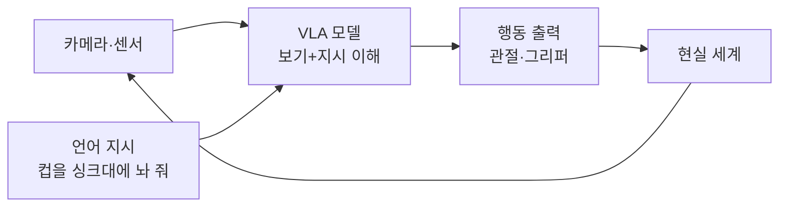
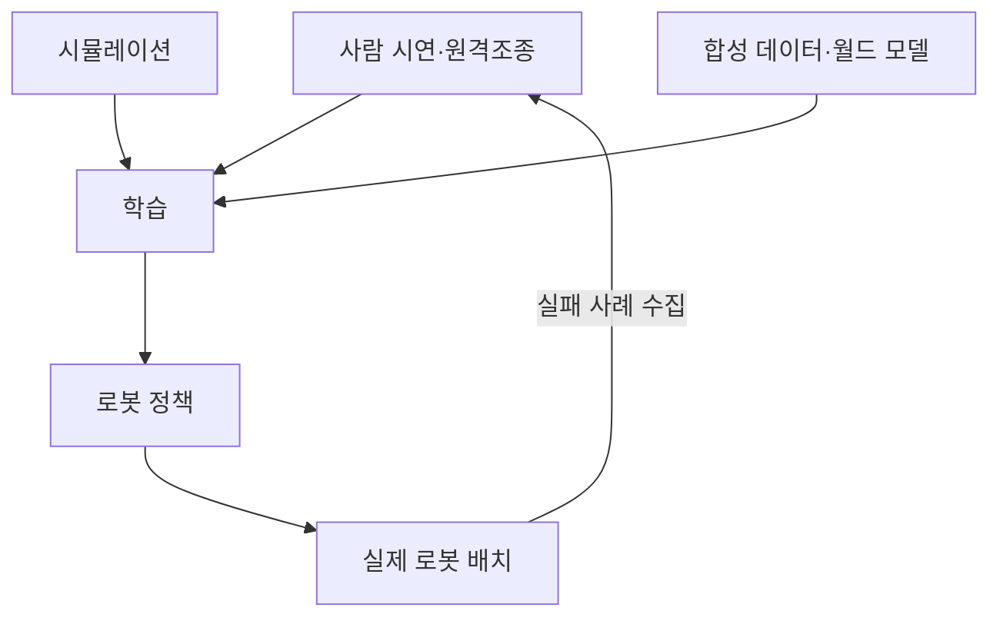

# 피지컬 AI·로보틱스

> 화면 속 텍스트·이미지를 다루는 데서 나아가, 카메라와 센서로 현실을 보고 로봇 팔·바퀴·다리로 실제 행동하는 AI.

## 쉽게 말하면
챗봇이 "말만 잘하는 비서"라면 피지컬 AI는 "손발이 달린 비서"다. 레시피를 아는 것과 실제로 계란을 깨서 팬에 올리는 것은 다른 능력이다. 현실에는 중력, 마찰, 예측 못 한 사람 같은 변수가 있어서, 글만 배운 모델로는 부족하다.

## 자세히
- **구성**: 감각(카메라·센서) → 두뇌(모델) → 행동(모터 제어)의 루프. [에이전트 루프](#agent-loop)의 현실 세계 버전이다.
- **VLA(Vision-Language-Action) 모델**: NVIDIA 학습 자료 설명 기준, 시각 입력과 언어 지시를 받아 로봇의 저수준·중간 수준 행동을 출력하는 파운데이션 모델. 예: Google RT-2, Figure AI Helix(주장: 500시간 이상 원격조종 데이터로 학습), NVIDIA Isaac GR00T.
- **GR00T N1(2025-03)**: 휴머노이드용 오픈 파운데이션 모델. 사람의 1인칭 영상, 실제·시뮬레이션 로봇 궤적, 합성 데이터로 학습. 추론 담당(System 2)과 동작 담당 두 부분 구조라는 설명이 있다. CES 2026에서 GR00T N1.6과 월드 모델 Cosmos 2.5 계열이 공개됐다(NVIDIA 발표 기준, 버전은 빨리 바뀜).
- **데이터가 병목**: 로봇 데이터는 웹 텍스트처럼 공짜로 쌓이지 않는다. 그래서 시뮬레이션과 합성 데이터, 사람 시연(원격조종)이 핵심이다.
- **Sim-to-real**: 시뮬레이터에서 학습한 정책을 실제 로봇으로 옮길 때 생기는 간극을 줄이는 기술. [강화학습](#reinforcement-learning)이 자주 쓰인다.
- **월드 모델**: 행동의 결과를 미리 상상해 보는 모델. 로봇 정책 평가와 합성 데이터 생성에 쓰인다.

## 그림으로 보기

## 예시
- 물류 창고: 상자 분류·팔레타이징 로봇.
- 휴머노이드가 "빨간 컵을 선반에 올려" 같은 자연어 지시를 수행.
- 자율주행도 넓은 의미의 피지컬 AI.
- 공부 방법: 시뮬레이터(Isaac Sim 등)와 오픈 모델을 PC에서 돌려 보는 것이 입문 경로. 실제 로봇 없이 가능.

## 헷갈리는 것과 비교
| 개념 | 차이 |
| --- | --- |
| 피지컬 AI | 현실에서 보고 행동하는 AI 전반 |
| [멀티모달](#multimodal) | 여러 입력을 이해(행동 출력은 필수 아님) |
| VLA | 멀티모달 입력 + 행동 출력 모델 |
| 전통 로봇 자동화 | 정해진 동작 반복. 피지컬 AI는 새 상황에 일반화 시도 |

## 더 읽을거리
- [NVIDIA: Isaac GR00T VLA](https://docs.nvidia.com/learning/physical-ai/sim-to-real-so-101/latest/10-groot.html) — VLA 정의와 실습
- [GR00T N1 논문 페이지](https://research.nvidia.com/publication/2025-03_nvidia-isaac-gr00t-n1-open-foundation-model-humanoid-robots) — 오픈 휴머노이드 모델
- [TechCrunch: Nvidia robotics CES 2026](https://techcrunch.com/?p=3080048) — 2026 발표 개요
