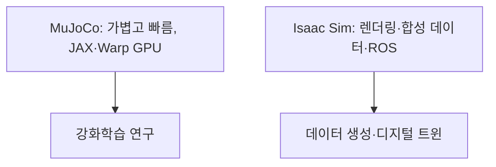

# 로봇 물리 시뮬레이터

> **로봇 물리 시뮬레이터**는 로봇과 물체가 부딪히고 움직이는 물리를 컴퓨터 안에서 계산해, 로봇을 실제로 부수지 않고 학습·검증하게 해 주는 도구다. 대표로 **MuJoCo**와 **NVIDIA Isaac Sim**이 있다.

## 쉽게 말하면
비행 시뮬레이터에서 조종사가 연습하듯, 로봇도 가상 공간에서 수백만 번 넘어지며 배운다. 가상 세계가 진짜 같을수록 현실로 옮겼을 때 덜 헤맨다.

## 자세히
- **MuJoCo**(공식 문서 확인): Multi-Joint dynamics with Contact. 로보틱스·생체역학·그래픽·머신러닝용 범용 물리 엔진. 처음 Roboti LLC가 개발했고 Google DeepMind가 인수해 무료로 공개했다(GitHub `google-deepmind/mujoco`). C/C++ 라이브러리, 모델은 XML 기반 MJCF(URDF도 로드). 일반화 좌표와 최적화 기반 접촉 동역학, 힘줄·액추에이터·변형체 지원. 파이썬 바인딩 제공. GPU 백엔드로 JAX 기반 **MJX**, NVIDIA Warp 기반 **MuJoCo Warp**가 있어 대규모 병렬 시뮬이 가능.
- **Isaac Sim**(NVIDIA 페이지 확인): Omniverse 기반 무료 오픈소스 로봇 시뮬 프레임워크(FAQ: Apache 2.0, GitHub 공개). OpenUSD 사용, CAD·URDF·실제 스캔 가져오기. 강체·차량·다관절·충돌체 시뮬. 조명·색·위치를 무작위화한 RGB·바운딩박스·분할 합성 데이터를 COCO·KITTI로 내보내기. ROS/ROS2 브리지, 로봇 학습용 Isaac Lab과 연동.
- 선택 기준(권고): 가볍고 빠른 연구·강화학습 → MuJoCo, 사실적 렌더링·합성 데이터·ROS 통합 → Isaac Sim. 어떤 것이든 [현실 격차](#sim-to-real-gap)가 남아 [도메인 랜덤화](#domain-randomization)를 함께 쓴다.

## 그림으로 보기



## 예시
```python
import mujoco
model = mujoco.MjModel.from_xml_path("robot.xml")
data = mujoco.MjData(model)
mujoco.mj_step(model, data)   # 한 스텝 물리 계산
```
- Isaac Sim에서 조명·위치를 랜덤화해 물체 검출용 학습 이미지를 대량 생성.

## 헷갈리는 것과 비교
| 개념 | 차이 |
|---|---|
| MuJoCo | 접촉 물리 중심 범용 엔진 |
| Isaac Sim | Omniverse 기반 렌더링·합성 데이터 |
| 게임 엔진 | 시각 효과 우선, 정밀 물리 부족할 수 있음(일반 지식) |
| [월드 모델](#genie-world-generation) | 학습으로 세계를 생성, 명시적 물리 없음 |

## 더 읽을거리
- [MuJoCo 문서](https://mujoco.readthedocs.io/en/stable/overview.html)
- [NVIDIA Isaac Sim](https://developer.nvidia.com/isaac/sim)
