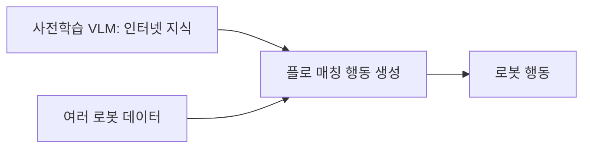
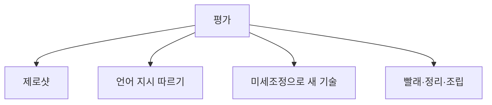

# π0 (pi-zero)

> Physical Intelligence가 발표한 **로봇 범용 제어용 VLA 모델.** 사전학습된 비전-언어 모델(VLM) 위에 **플로 매칭(flow matching)** 구조를 얹어 인터넷 규모의 의미 지식을 물려받고, 여러 로봇 플랫폼 데이터로 학습한다. (Black·Levine 외, arXiv 2410.24164, 초록 읽음)

## 쉽게 말하면
말과 그림을 이해하는 모델(VLM)에게 "손으로 일하는 법"을 얹은 것이다. 한 로봇이 아니라 팔 하나, 팔 둘, 이동형 등 여러 로봇의 시범을 섞어 가르친다.

## 자세히
- 정의(초록): "사전학습된 VLM 위에 만든 새로운 플로 매칭 아키텍처"로 **인터넷 규모의 의미 지식을 상속**하는 것을 목표로 한다.
- 학습 데이터: 단일 팔, 양팔, 이동형 조작 로봇 등 **여러 정교한 로봇 플랫폼**에서 모은 크고 다양한 데이터.
- 평가 방식 4가지(초록): ① 사전학습 후 제로샷 과제 수행 ② 사람과 상위 VLM 정책의 **언어 지시 따르기** ③ 미세조정으로 **새 기술 습득** ④ 빨래 개기, 테이블 정리, 상자 조립 같은 과제.
- 발표: 2024년 10월 제출, 2026년 1월 v4로 개정, RSS 2025 게재.
- 연결: [VLA](#vla)의 한 사례. [Diffusion Policy](#diffusion-policy)가 확산으로 행동을 생성한다면 플로 매칭은 이와 가까운 생성 방식이다(일반 설명, 초록으로 비교 확인은 하지 못함).
- 한계: 초록에는 성공률 등 정량 수치가 없다. 따라서 성능은 본문 확인이 필요하다.

## 그림으로 보기

## 예시
- "빨래를 개 줘"라는 언어 지시로 정교한 양팔 작업을 수행.
- 교육: 인터넷 지식 + 로봇 데이터의 결합이 왜 일반화에 도움이 되는지 토론.

## 헷갈리는 것과 비교
| 개념 | 차이 |
|---|---|
| π0 | VLM 기반 플로 매칭 VLA |
| [OpenVLA](#openvla) | 7B 오픈 VLA, 행동을 토큰으로 |
| [Figure Helix](#figure-helix) | S2·S1 이중 구조 휴머노이드 VLA |

## 더 읽을거리
- [π0 논문](https://arxiv.org/abs/2410.24164) — 개요와 평가 방식(초록 읽음).
