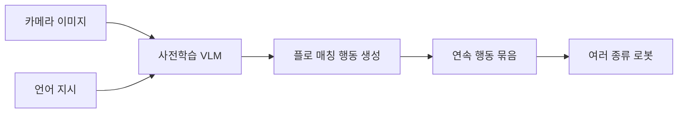
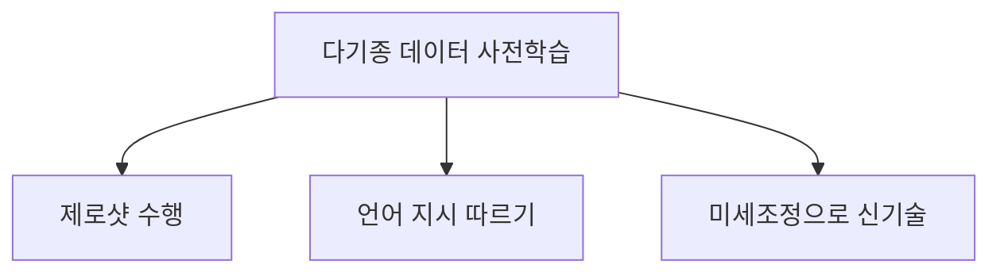

# pi0

> **π₀(pi0)** 는 **플로 매칭** 구조에 **사전학습 VLM**을 결합한 범용 로봇 정책(VLA)이다. 한 모델로 여러 종류의 로봇과 작업을 다룬다(arXiv 2410.24164, Physical Intelligence, 2024).

## 쉽게 말하면
로봇마다 따로 프로그램을 짜지 않고, 상식을 가진 모델 하나에 다양한 로봇의 경험을 먹여 두면 새 작업을 말로 시키거나 조금만 더 가르쳐도 해내는 방향이다.

## 자세히
(논문 초록 확인)
- **구성**: **플로 매칭** 구조 + **사전학습 VLM**. VLM이 인터넷 규모 데이터의 광범위한 의미 지식을 제공한다([플로 매칭](#flow-matching)).
- **학습 데이터**: 단일 팔, 양팔, 모바일 매니퓰레이터를 아우르는 크고 다양한 데이터셋([교차 로봇 학습](#cross-embodiment)).
- **평가 세 축**: ① 사전학습 후 **제로샷** 수행 ② 사람 또는 상위 VLM의 **자연어 지시** 따르기 ③ **미세조정**으로 새 기술 학습.
- 시연 과제: 빨래 개기, 테이블 정리, 상자 조립.
- 관련 글: [FAST 행동 토큰화](#action-tokenization) 초록은 pi0와 결합해 1만 시간 규모 데이터로 확장하고 확산 VLA와 비슷한 성능에 학습 시간 최대 5배 감소를 보고한다.

## 그림으로 보기

## 예시
- 빨래 개기·상자 조립처럼 손재주가 필요한 장시간 작업을 지시문으로 수행.
- 교육 활용: "범용 로봇 두뇌"라는 방향성 설명.

## 헷갈리는 것과 비교
| 개념 | 차이 |
|---|---|
| pi0 | 플로 매칭 + VLM, 연속 행동 |
| [RT-2](#rt-2) | 행동을 텍스트 토큰으로 출력 |
| [OpenVLA](#openvla) | 오픈 7B, 행동 토큰 |
| 전문 로봇 프로그램 | 작업마다 별도 개발 |

## 더 읽을거리
- [π0: A Vision-Language-Action Flow Model for General Robot Control](https://arxiv.org/abs/2410.24164)
