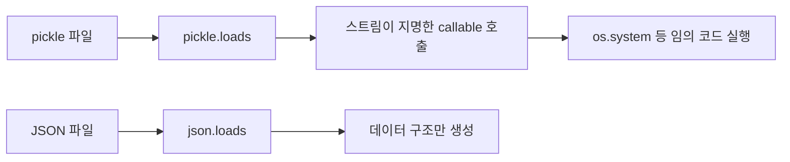

# pickle 역직렬화 위험

> 파이썬 pickle은 불러오는(unpickle) 순간 데이터 안에 적힌 호출을 실행할 수 있어, 신뢰할 수 없는 데이터를 열면 임의 코드가 실행된다.

## 쉽게 말하면
조립 설명서를 받아 그대로 따라 조립하는 상황이다. 설명서에 "조립 중에 현관문을 열어 줘"라고 적혀 있어도 따라 하게 된다. pickle 파일은 데이터가 아니라 "복원 절차서"다.

## 자세히
Python 공식 문서 기준:
- 문서 경고: "The pickle module is not secure. Only unpickle data you trust." 변조된 데이터는 unpickle 중 임의 코드를 실행할 수 있다.
- 원리: 객체의 `__reduce__()`는 "객체를 만들 때 호출할 callable과 인자"를 돌려준다. 이 callable과 인자가 데이터 스트림에 들어 있으므로, 조작된 스트림은 `os.system` 같은 importable 전역 함수를 지명할 수 있다.
- **완화 1**: `Unpickler.find_class()`를 재정의해 허용된 클래스만 통과(allow-list). 문서 예시는 `builtins`의 range 등 몇 개만 허용하고 나머지는 `UnpicklingError`. 허용 항목도 신중해야 한다.
- **완화 2**: `hmac`으로 서명해 변조를 막는다. 단, 서명 키가 유출됐거나 생산자가 신뢰 불가면 안전하지 않다.
- **대안**: JSON은 "신뢰할 수 없는 JSON을 역직렬화해도 그 자체로 임의 코드 실행 취약점이 생기지는 않는다". 대신 표현 가능한 타입이 제한적이다.
- LangGraph에서는 `pickle_fallback=True`가 DataFrame 같은 객체를 pickle로 저장하게 한다([serde](#langgraph-serde)). 체크포인트 DB를 신뢰할 수 있는 곳에만 두고, 외부 입력이 저장소에 섞이지 않게 한다.

## 그림으로 보기


## 예시
```python
class RestrictedUnpickler(pickle.Unpickler):
    def find_class(self, module, name):
        if module == "builtins" and name in {"range", "set"}:
            return getattr(builtins, name)
        raise pickle.UnpicklingError("forbidden")
```
출처가 불분명한 모델 파일(.pkl, 일부 .pt)은 열기 전에 의심한다.

## 헷갈리는 것과 비교
| 개념 | 차이 |
| --- | --- |
| pickle | 파이썬 전용, 표현력 큼, 실행 위험 |
| JSON | 범용·텍스트, 코드 실행 위험 없음 |
| [msgpack](#msgpack-vs-json) | 이진 포맷, 데이터만 표현 |

## 더 읽을거리
- [Python docs: pickle](https://docs.python.org/3/library/pickle.html) — 보안 경고, find_class, hmac
