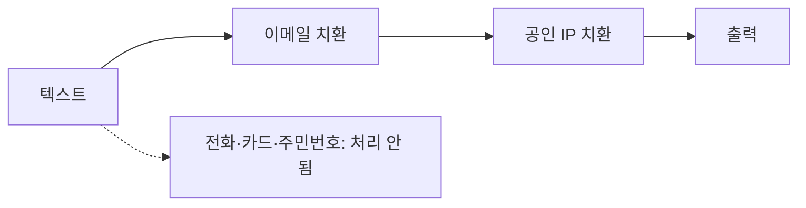
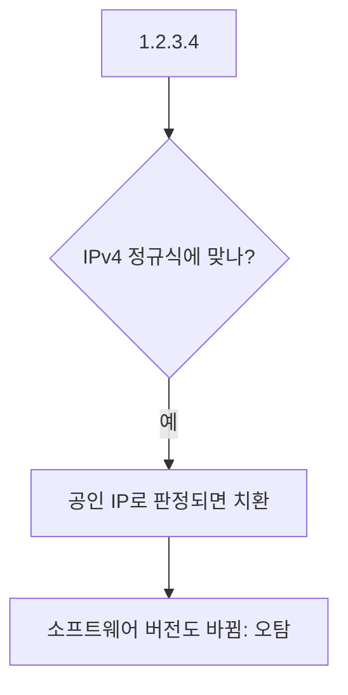

# PIIFormatter 개인정보 치환

> datatrove의 PIIFormatter는 학습 텍스트에서 **이메일 주소와 공인 IPv4 주소만** 정규식으로 찾아 더미 값으로 바꾸는 후처리 단계다. 전화번호·카드번호·주민번호 같은 다른 개인정보는 다루지 않는다.

## 쉽게 말하면
서류를 복사하기 전에 형광펜으로 이메일 칸과 IP 칸만 가리는 검열 도구다. 이름·전화번호·주민번호는 그대로 남는다. 도구가 어디까지 가리는지 알아야 "개인정보가 다 제거됐다"고 착각하지 않는다.

## 자세히
- **기능**(datatrove 소스 확인): `remove_emails`(기본 True)는 이메일을 `email@example.com`·`firstname.lastname@example.org` 중에서 **순서대로 돌려가며** 치환(무작위 아님). `remove_ips`(기본 True)는 점으로 구분된 IPv4(각 자리 0~255)를 미리 정한 6개의 가짜 주소로 치환한다. `only_remove_public_ips=True`(기본)면 `ip.is_global`인 공인 IP만 바꾸고 사설망 주소는 둔다. 일치하는 것은 모두 치환하며(`re.sub`) 허용 목록 기능은 못 봤다. 코드 주석에 따르면 기본 이메일 도메인은 예시용으로 관리되는 도메인이고 기본 IP는 "한때 ping에 응답하지 않던" 임의 주소 목록이다.
- **직접 실행**(datatrove 최신판, 문장 5개):

| 입력 | 결과 |
|---|---|
| 이메일 2개 | 둘 다 치환 |
| `192.168.1.15`(사설), `8.8.8.8`(공인), `version 1.2.3.4` | 사설은 유지, 공인은 치환, **버전 번호 1.2.3.4도 IP로 오인해 치환(오탐)** |
| 전화 `010-1234-5678`, `+1 415 555 0132`, 카드번호 | **모두 그대로 남음(미탐)** |
| 이메일 + 주민번호 `900101-1234567` | 이메일만 치환, **주민번호는 남음** |
| `1.2.3.4.5` | 앞 4자리 `1.2.3.4`만 치환되어 `188.8.131.52.5`처럼 변함(경계 처리 없음) |

- 해석: 이 도구는 **개인정보 제거의 일부**다. 한국어 환경이라면 주민번호·전화번호·계좌번호 규칙을 따로 추가해야 한다. 소프트웨어 버전·IP처럼 생긴 숫자 열이 많은 코드·기술 문서는 오탐이 생긴다. 이 결과는 소규모 합성 문장 기준이며 오탐·미탐 비율은 측정하지 않았다.
- **FineWeb에서의 위치**: [FineWeb 예시](#datatrove-fineweb-example)의 중복 제거 마지막 단계에서 TokensCounter 다음에 PIIFormatter가 쓰인다.
- **제안**: 민감 데이터는 ① 이 치환 ② 한국형 규칙(정규식) 추가 ③ 샘플 수동 검수 ④ 치환 전 원본 접근 통제를 함께 쓴다.

## 그림으로 보기

## 예시
- 크롤링한 포럼 글에서 이메일·서버 IP를 가려 학습용으로 쓰기. 그 외 개인정보는 별도 점검.
- 교육: 위 표의 5문장을 직접 돌려 "무엇이 남는지" 찾는 개인정보 감사 실습.

## 헷갈리는 것과 비교
| 개념 | 차이 |
|---|---|
| 치환(마스킹) | 값을 가짜로 바꿈. 형식 유지 |
| 삭제 | 문서·구간을 아예 제거 |
| NER 기반 탐지 | 이름·주소까지 모델로 찾음. 정규식보다 넓지만 오탐도 있음 |
| [FineWeb 품질 필터](#fineweb-quality-filters) | 품질을 거름. 개인정보와 별개 |

## 더 읽을거리
- [datatrove pii.py 소스](https://github.com/huggingface/datatrove/blob/main/src/datatrove/pipeline/formatters/pii.py) — 정규식, 옵션, 치환 방식(열어 확인).
